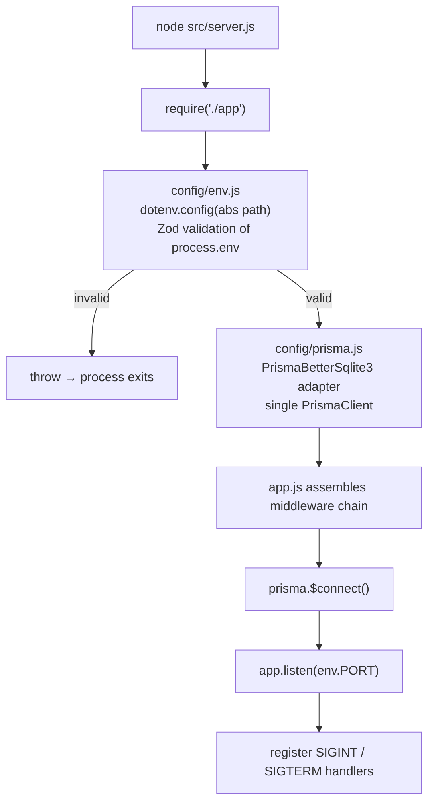
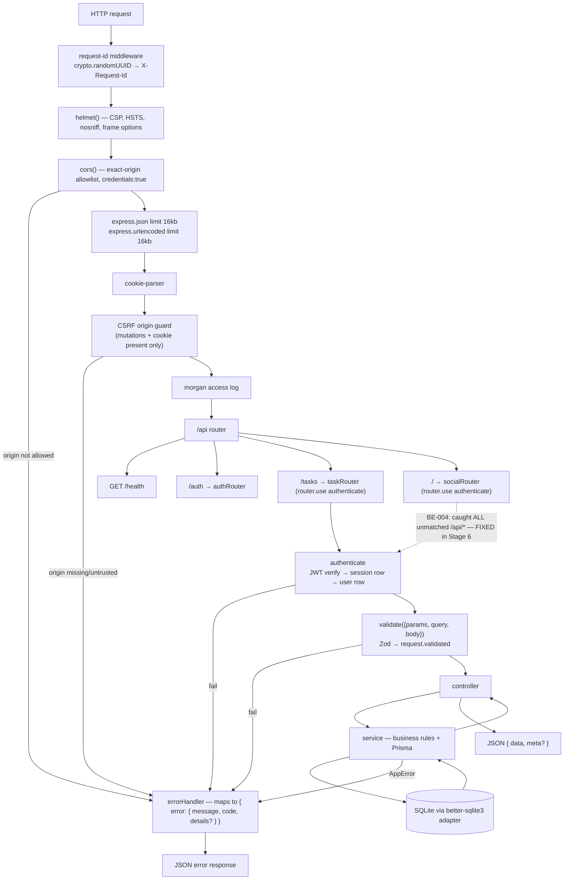
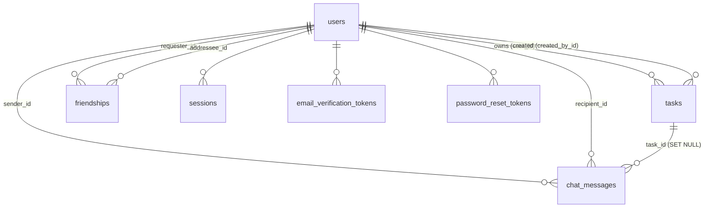

# Daymark Backend — Technical Audit Report

**Audit date:** 2026-11-13
**Audited component:** `backend/` (Node.js 20+ / Express 4 / Prisma 7 / SQLite REST API)
**Audit type:** Analysis and planning only. No application code, migration, schema, or configuration file was modified.
**Companion document:** [`BACKEND_REFACTORING_PLAN.md`](./BACKEND_REFACTORING_PLAN.md)

**Revision 2 (2026-11-13).** Re-reviewed against the source and re-verified by execution. One factual error was corrected (BE-001's compatibility claim), three findings gained executed proof (BE-003, BE-005, BE-019), and one new verification gap was recorded (BE-027). Changed passages are marked **[rev2]**. No finding was added, removed, renumbered, or re-severitised.

---

## 1. Executive Summary

Daymark's backend is a small, **genuinely well-structured** layered Express API (1,252 lines of application source across 25 files in `src/`). It is not a prototype-quality codebase: it already has correct layering (routes → controllers → services → Prisma), centralised error mapping, Zod validation on every input, server-side session revocation, bcrypt password hashing, consistent ownership scoping on every task query, and a deliberate CSRF origin check. Automated verification (`npm test`) passes, `npm audit` reports zero vulnerabilities, and there is no drift between the migration history and the Prisma schema.

The problems are therefore **specific defects, not a broken architecture**. A rewrite is not warranted and is not recommended. The work needed is targeted correction, concentrated in five areas:

**1. One critical data-integrity defect.** The `tasks.created_by_id` foreign key is declared `ON DELETE CASCADE`. When a user deletes their own account, every task they ever *sent* to a friend is deleted out of **that friend's** account. This was confirmed by execution, not inference: after user A deleted their account, the task owned by user B vanished from B's list and from the `tasks` table (**BE-001**). One user's routine, supported action silently destroys another user's data.

**2. Two high-severity availability/recovery defects.** Production registration creates the user row *before* sending the verification email and is not atomic with it; when the email provider fails, the account exists but is unverifiable, un-registerable (409) and un-loggable-into (403), with the recovery endpoint failing identically — a permanent lockout of that email address (**BE-002**, confirmed under a simulated production environment). Separately, a single shared `express-rate-limit` instance is mounted on five different auth routes, so ten failed logins lock out registration, password-reset request, password-reset confirmation and verification resend from the same IP for fifteen minutes — the exact recovery paths a user needs after failing to log in (**BE-003**, confirmed by execution).

**3. A routing defect with a user-visible side effect.** The social router is mounted at `/api` and applies `authenticate` to every path under it, so any unmatched `/api/*` URL returns `401 UNAUTHENTICATED` instead of `404 NOT_FOUND`, and the `notFound` handler is unreachable for the entire API surface. Because the frontend force-signs-out the user on any unexpected 401, a single mistyped URL silently ends the user's session (**BE-004**).

**4. API contract inconsistencies that will cost frontend time.** Validation errors carry an empty `path` for object-level failures so they cannot be mapped to form fields; chat pagination returns descending pages of ascending items, so concatenating pages yields the wrong order; one endpoint returns two different response shapes depending on which branch it took; `toggle` is non-idempotent so a retried request silently flips state back; and the list endpoint cannot sort by the `sortOrder` column the frontend actually orders by, forcing it to download every page and sort client-side.

**5. Portability risk against the project's own stated plan.** `README.md` and `SECURITY.md` both propose PostgreSQL for multi-instance production. Three behaviours currently depend on SQLite semantics and will change silently on that migration: case-insensitive search, `NULL` ordering for `dueDate`, and the single-process serialisation that currently hides a non-transactional check-then-insert in the friendship flow. The hand-written `CHECK` constraint and validation triggers are also invisible to Prisma's schema and can be dropped by a future Prisma-generated table rebuild.

**Operationally**, the project has no version control (the directory is not a git repository), no CI, no linting, no container or deployment definition, and no automated migration or contract tests. Test coverage is a single `test()` block containing the entire suite, which exercises the happy paths well but leaves every production-only code path untested — which is exactly where BE-002 lives.

**Overall assessment:** a sound foundation with one critical defect, three high-severity defects, and a set of contract inconsistencies that should be fixed *before* a frontend is built against the current contract rather than after.

---

## 2. Audit Scope and Methodology

### 2.1 What was inspected

Every non-vendored file in the repository was read in full. The backend application source is 1,252 lines across 25 `.js` files in `src/`, or 1,483 lines including tests and scripts; this is small enough that **sampling was not necessary and was not used**.

| Area | Files inspected | Coverage |
| --- | --- | --- |
| Entry point & app wiring | `src/server.js`, `src/app.js` | Full |
| Configuration | `src/config/env.js`, `src/config/prisma.js`, `.env.example`, `.env` (keys only), `prisma.config.ts` | Full |
| Routes | `src/routes/*.js` (4 files) | Full |
| Controllers | `src/controllers/*.js` (3 files) | Full |
| Services | `src/services/*.js` (4 files) | Full |
| Middleware | `src/middleware/*.js` (4 files) | Full |
| Schemas | `src/schemas/*.js` (3 files) | Full |
| Utils | `src/utils/*.js` (3 files) | Full |
| Database | `prisma/schema.prisma`, all 7 migrations, live SQLite schema dump | Full |
| Tests | `test/api.test.js`, `scripts/test.js` | Full |
| Documentation | `README.md`, `backend/README.md`, `SECURITY.md` | Full |
| Frontend (as API consumer only) | `app.js`, `index.html` | API-contract surface only |

### 2.2 Verification actually executed

All commands below were run and their real results are reported. Results are labelled with the categories required by the audit brief.

| # | Command / check | Result | Notes |
| --- | --- | --- | --- |
| V1 | `npm test` (first attempt) | **Failed** | Failed at the first assertion: `GET /api/health` returned 500. Root cause was environmental, not application code — see V2. |
| V2 | Diagnosis of V1 | **Passed** | `better-sqlite3`'s native binding was absent (`build/Release/` was empty). Not a code defect. |
| V3 | `npm rebuild better-sqlite3` | **Passed** | Compiled the already-declared dependency. `package.json` and `package-lock.json` verified byte-identical (MD5) before and after; only the gitignored native artifact changed. |
| V4 | `npm test` (after V3) | **Passed** | 1 test, 1 pass, 0 fail, ~3.5 s. |
| V5 | `npm audit` | **Passed** | 0 vulnerabilities. |
| V6 | `npm outdated` | **Passed (informational)** | Major versions available for `express` (4→5), `bcryptjs` (2→3), `dotenv`, `express-rate-limit`, `better-sqlite3`. No vulnerable versions. |
| V7 | `prisma migrate diff --from-migrations --to-schema` | **Passed** | Empty diff — no drift between migration history and `schema.prisma`. |
| V8 | Live SQLite schema dump (read-only) | **Passed** | All tables, indexes, foreign keys, the `CHECK` constraint and both triggers enumerated directly from `sqlite_master` / `PRAGMA foreign_key_list`. |
| V9 | Runtime API probes (8 suites, ~90 assertions) | **Passed (executed)** | Supertest against the real `app`, isolated `prisma/test.db`. Covered auth, token confusion, CSRF, CORS, validation, pagination, ownership, races, cascades. Findings cited as *Confirmed (runtime)* come from these. |
| V10 | Production-environment probe | **Passed (executed)** | A separate process with `NODE_ENV=production` and a deliberately unreachable email provider, to exercise production-only code paths. Source of BE-002. |
| V11 | Live server start / frontend serving / shutdown | **Passed** | Server booted, served the allowlisted frontend files, rejected traversal attempts, and exited cleanly in ~101 ms on `SIGTERM` with an idle keep-alive client attached. |
| V12 | `EXPLAIN QUERY PLAN` on the five hot queries | **Passed** | Index usage confirmed; see §8.5. |
| V13 | Query-count instrumentation (N+1 check) | **Passed** | `listFriends` = 3 queries for 5 friends, `listMessages` = 2 for 10 messages, `listTasks` = 1. No N+1. |
| V14 | `eslint` / type checking | **Not applicable** | No lint or type configuration exists in the repository. |
| V15 | Multi-instance / PostgreSQL behaviour | **Blocked by environment** | No PostgreSQL instance available; the project ships SQLite only. Portability findings (BE-009, BE-010, BE-020) are therefore reasoned from documented engine semantics and explicitly labelled *Potential*. |
| V16 | Real email-provider contract | **Blocked by environment** | No provider credentials. The adapter was exercised only against an unreachable endpoint. |
| V17 | Behaviour behind a reverse proxy | **Not executed** | No proxy available. `TRUST_PROXY_HOPS` effects are reasoned from source. |

**[rev2] Additional verification performed during the plan review.** All executed against scratch copies; `dev.db` was never written to.

| # | Check | Result | What it established |
| --- | --- | --- | --- |
| V18 | Naive `tasks` rebuild under real `prisma migrate deploy`, on a copy of the database | **Executed — failed the intended invariants** | FK correctly became `SET NULL` and all 14 rows survived, but **`chat_messages.task_id` links were destroyed** (2 → 0) and **both triggers were dropped** (2 → 0). Source of the BE-001 and BE-019 rev2 notes. |
| V19 | Corrected rebuild with link capture/restore and explicit trigger SQL | **Executed — passed** | Links preserved (2 → 2), both triggers present, all 8 indexes, 14 rows, `SET NULL`, `foreign_key_check` empty, `friendships` CHECK intact, no Prisma drift. |
| V20 | Is a Prisma SQLite migration transactional? | **Executed** | **Not by default — but it can be made so.** `PRAGMA foreign_keys=OFF` takes effect, which is only possible outside a transaction. **[rev3, Stage 3]** Re-measured with a deliberate mid-migration runtime failure: without an explicit transaction the partial state survives; with an explicit `BEGIN … COMMIT` it rolls back completely. See plan §5.1 rule 5. |
| V21 | Friendship pair-uniqueness options on SQLite 3.53.2 | **Executed** | Unique **expression** index on `MIN()/MAX()` works, rejects reciprocals, allows unrelated pairs, and causes **no Prisma drift**. A **generated column** is unusable with Prisma — declared, Prisma writes to it and SQLite rejects (`cannot INSERT into generated column`). |
| V22 | Rate-limiter keying strategies | **Executed** | A composite `ip+email` key is bypassed by varying **or case-varying** the address (both returned 200 after the budget was exhausted). Layered per-IP + per-account behaves correctly. One limiter instance on two routes shares a counter and the library emits **no** warning. |
| V23 | Token cleanup and replay | **Executed** | Deleting an `email_verification_tokens` row while its JWT is valid **restores replay**. Session and password-reset rows fail closed. |
| V24 | Zod → JSON Schema conversion of the real schemas | **Executed** | All 17 request schemas convert with `io:'input'`; 5 throw with `io:'output'`. Query-parameter types do not match the wire format and cross-field refinements are absent. |
| V25 | Test-database binding when a suite is run directly | **Executed (configuration only, no connection opened)** | `node --test test/api.test.js` resolves to `NODE_ENV=development`, `DATABASE_URL=file:./prisma/dev.db`. |
| V26 | Bundled-frontend response-field dependencies | **Executed** | Enumerated from source: `createdById` **is** read (`app.js:314`), `sender.id`/`sender.name` are read (942/947), `taskId` is read (943), `priorityOrder` and `completedAt` are **not** read. |

### 2.3 Exclusions

- `backend/node_modules/` — third-party code, excluded from review except for the dependency-health checks (V5, V6) and the native-binding diagnosis (V2–V3).
- `backend/prisma/dev.db`, `backend/prisma/test.db` — binary SQLite data files. `test.db`'s *schema* was read; neither file's contents were modified by the audit beyond the rows created by the project's own test suite and the probe scripts (both of which write only to the isolated `test.db`). **`dev.db` was never written to.**
- `app.js`, `index.html`, `styles.css`, `favicon.svg` (frontend) — reviewed only as evidence of the API contract consumers depend on. A frontend code review was not in scope.
- `.env` — read for *key names and value lengths only*. No secret value is reproduced in this report.

### 2.4 Coverage limitations

1. **No version control.** The directory is not a git repository (`git status` → `fatal: not a git repository`). Repository history, blame, and branch state could not inform the audit, and no `.gitignore` effectiveness could be verified against actually-tracked files.
2. **Production paths are partially simulated.** BE-002 was reproduced with a *deliberately unreachable* provider. The behaviour against a real provider returning e.g. HTTP 500 or timing out is inferred to be identical (same `throw`), but was not executed.
3. **Single-process only.** All runtime evidence comes from one Node process against SQLite. Concurrency findings that depend on multiple processes or a different engine are labelled *Potential*, not *Confirmed*.
4. **No load or soak testing.** Performance statements are based on query plans and query counts, not on measured throughput.
5. **No frontend repository.** The frontend in this workspace is a vanilla-JS client in the same directory. End-to-end compatibility with any *separate* frontend cannot be confirmed — see §13.

---

## 3. Existing System Overview

Daymark is a personal to-do application with a lightweight social layer. Based on the source (not on documentation claims), the backend implements:

**Accounts and sessions**
- Email/password registration with bcrypt hashing (cost 12).
- Login issuing a JWT (HS256) carried in an `HttpOnly` cookie. The token is never placed in a JSON response body.
- **Server-side session records.** Every JWT's `jti` corresponds to a row in `sessions`; authentication requires that row to exist, be unrevoked and unexpired. This makes logout a true revocation rather than a cookie deletion.
- Email verification (production-gated) and password reset, both via single-use, purpose-scoped, audience-separated JWTs backed by database rows.
- Account deletion requiring password re-confirmation.

**Tasks**
- Full CRUD, scoped to the authenticated owner on every single query.
- Filtering by completion, priority, free-text search, and due-date range; sorting by creation date, due date or priority; offset pagination.
- A dedicated completion-toggle endpoint maintaining a `completedAt` timestamp.
- **Recipient-owned task assignment**: a user may create a task that is *owned by* an accepted friend. `userId` is the recipient; `createdById` records the sender. The sender has no subsequent access to it (reads return 404). Assignment also posts a chat notification.

**Social**
- Friend requests by email address, with automatic acceptance of a reciprocal pending request.
- Accept / decline, and friend removal.
- Direct messaging between accepted friends, paginated.

**Operational**
- A health endpoint that round-trips a query to the database.
- Optional same-origin serving of the frontend from a fixed five-file allowlist.

---

## 4. Repository Structure

```text
project/
├── index.html, app.js, styles.css, favicon.svg   # Vanilla-JS frontend (not in audit scope)
├── package.json                                  # Thin convenience wrapper → npm --prefix backend
├── README.md, SECURITY.md
└── backend/
    ├── package.json          # API dependencies, scripts, engines: node >=20.19
    ├── prisma.config.ts      # Prisma 7 config: schema path, migrations path, datasource URL
    ├── .env / .env.example   # Runtime configuration
    ├── prisma/
    │   ├── schema.prisma     # 7 models
    │   ├── migrations/       # 7 checked-in SQL migrations (up only)
    │   └── dev.db, test.db   # SQLite files (gitignored)
    ├── scripts/test.js       # Isolated-test-database runner
    ├── test/api.test.js      # Single integration test
    └── src/
        ├── server.js         # Process lifecycle: connect, listen, signal handling
        ├── app.js            # Express assembly: middleware chain, routers, static allowlist
        ├── config/           # env.js (Zod-validated config), prisma.js (single client)
        ├── routes/           # api · auth · task · social  (routing + rate limits only)
        ├── controllers/      # auth · task · social  (HTTP in/out only)
        ├── services/         # auth · task · social · email  (business logic + persistence)
        ├── schemas/          # auth · task · social  (Zod request schemas)
        ├── middleware/       # authenticate · validate · error-handler · not-found
        └── utils/            # app-error · async-handler · safe-user
```

### Directory responsibilities, as actually implemented

| Directory | Actual responsibility | Assessment |
| --- | --- | --- |
| `config/` | Loads and validates environment via Zod; constructs the single Prisma client. | Clean. `env.js` resolves `.env` by absolute path so it works from any CWD — a deliberate, correct touch. |
| `routes/` | Maps paths to controllers; attaches `authenticate`, `validate`, and rate limiters. | Clean and declarative; an endpoint's full contract is readable from one line. |
| `controllers/` | Extracts `request.validated` / `request.user`, calls a service, sets status and JSON envelope. Auth controller additionally owns cookie options. | Thin and correct. No business logic leaked here, with one exception (see BE-002: the register controller orchestrates email sending). |
| `services/` | Business rules **and** Prisma access. There is no separate repository layer. | A deliberate and, at this size, defensible choice — see §5.3. |
| `schemas/` | Zod schemas, all `.strict()`. | Strong. Source of the project's mass-assignment immunity. |
| `middleware/` | Cross-cutting concerns. | Clean. `authenticate` correctly performs both token and session-row validation. |
| `utils/` | Three small, single-purpose helpers. | Genuinely cohesive — not a junk drawer. |

**No circular dependencies exist.** The dependency graph is strictly acyclic: `routes → controllers → services → config/prisma`, with `middleware` and `utils` as leaves. This was verified by reading every `require` in `src/`.

---

## 5. Architecture and Dependency Flow

### 5.1 Startup sequence



Configuration is validated **at import time**, before any server starts. A misconfigured environment fails fast with an aggregated list of problems rather than failing later at request time. This is a notable strength.

### 5.2 Request lifecycle (actual, verified)



### 5.3 Worked example — `PATCH /api/tasks/:id`

| Step | File:line | What happens |
| --- | --- | --- |
| 1 | `app.js:18-22` | Request ID generated, `X-Request-Id` set. |
| 2 | `app.js:23` | Helmet security headers applied. |
| 3 | `app.js:24-33` | CORS: `Origin` checked against `env.CORS_ORIGINS`; missing Origin is allowed. |
| 4 | `app.js:34-36` | Body parsed (16 KB cap); cookies parsed. |
| 5 | `app.js:37-46` | Mutation + session cookie present ⇒ `Origin` must be in the allowlist, else `403 CSRF_ORIGIN_DENIED`. |
| 6 | `api.routes.js:15` | Dispatch to `taskRouter`. |
| 7 | `task.routes.js:9` | `authenticate` — verifies HS256 JWT (issuer `daymark-api`, audience `daymark-web`), then **requires a live `sessions` row**, then loads the user. |
| 8 | `task.routes.js:15` | `validate({ params: idParams, body: updateTaskSchema })` → `request.validated`. |
| 9 | `task.controller.js:18-21` | Calls `taskService.updateTask(request.user.id, id, body)`. |
| 10 | `task.service.js:110-123` | Derives `priorityOrder` and `completedAt`; issues `updateMany({ where: { id, userId } })`; `count === 0` ⇒ `404 TASK_NOT_FOUND`. |
| 11 | `task.service.js:122` | Re-reads via `getTask(userId, id)`. |
| 12 | `task.controller.js:20` | `200 { data: { task } }`. |

**The ownership predicate `{ id, userId }` is present on every task read and write.** Cross-user access is therefore a 404, not a 403 — verified at runtime for GET, PATCH, PATCH/toggle and DELETE. This is correct and should be preserved.

### 5.4 Layering assessment

| Concern | Verdict |
| --- | --- |
| Unnecessary coupling | None significant. Services depend on `config/prisma` directly, which is appropriate at this size. |
| Missing layers | No repository layer. **Not a defect here** (see §7.4), but it does make service unit-testing require a database. |
| Redundant abstractions | None. There are no speculative interfaces, factories, or DI containers — appropriate for the language and size. |
| Circular dependencies | None. |
| Boundary violations | Two minor ones: the auth controller owns cookie policy (reasonable), and `auth.controller.js:44` performs inline JWT verification that belongs in the service (**BE-029**). |

---

## 6. Complete Endpoint Inventory

**23 API endpoints** across four routers, plus 5 static file routes. Every endpoint discovered in the source is listed. All responses use `{ "data": ... }` on success (with `{ "meta": ... }` where paginated) and `{ "error": { "message", "code", "details"? } }` on failure.

### 6.1 Summary table

| # | Method | Path | Auth | Handler | Service | Success | Rate limit |
| --- | --- | --- | --- | --- | --- | --- | --- |
| 1 | GET | `/api/health` | none | inline (`api.routes.js:10`) | — (raw `SELECT 1`) | 200 | none |
| 2 | POST | `/api/auth/register` | none | `auth.controller.register` | `authService.register` | 201 / **202** | login(10/15m) **+** email(5/1h) |
| 3 | POST | `/api/auth/login` | none | `auth.controller.login` | `authService.login` | 200 | login(10/15m) |
| 4 | GET | `/api/auth/session` | optional | `auth.controller.session` | — | 200 | none |
| 5 | GET | `/api/auth/verify-email` | none | `auth.controller.verifyEmail` | `authService.verifyEmail` | 200 | none |
| 6 | POST | `/api/auth/resend-verification` | none | `auth.controller.resendVerification` | `authService.getUnverifiedUser` | 202 | login(10/15m) + email(5/1h) |
| 7 | POST | `/api/auth/password-reset/request` | none | `auth.controller.requestPasswordReset` | `authService.createPasswordReset` | 202 | login(10/15m) + email(5/1h) |
| 8 | POST | `/api/auth/password-reset/confirm` | none | `auth.controller.resetPassword` | `authService.resetPassword` | 204 | login(10/15m) |
| 9 | GET | `/api/auth/me` | **required** | `auth.controller.me` | — | 200 | none |
| 10 | POST | `/api/auth/logout` | none¹ | `auth.controller.logout` | `authService.revokeSession` | 204 | none |
| 11 | DELETE | `/api/auth/me` | **required** | `auth.controller.deleteAccount` | `authService.deleteAccount` | 204 | none |
| 12 | POST | `/api/tasks` | **required** | `task.controller.createTask` | `taskService.createTask` | 201 | none |
| 13 | GET | `/api/tasks` | **required** | `task.controller.listTasks` | `taskService.listTasks` | 200 | none |
| 14 | GET | `/api/tasks/:id` | **required** | `task.controller.getTask` | `taskService.getTask` | 200 | none |
| 15 | PATCH | `/api/tasks/:id/toggle` | **required** | `task.controller.toggleTask` | `taskService.toggleTask` | 200 | none |
| 16 | PATCH | `/api/tasks/:id` | **required** | `task.controller.updateTask` | `taskService.updateTask` | 200 | none |
| 17 | DELETE | `/api/tasks/:id` | **required** | `task.controller.deleteTask` | `taskService.deleteTask` | 204 | none |
| 18 | GET | `/api/friends` | **required** | `social.controller.listFriends` | `socialService.listFriends` | 200 | none |
| 19 | POST | `/api/friends/requests` | **required** | `social.controller.sendFriendRequest` | `socialService.sendFriendRequest` | 201 | social(30/1m) |
| 20 | PATCH | `/api/friends/requests/:id` | **required** | `social.controller.decideFriendRequest` | `socialService.decideFriendRequest` | 200 | social(30/1m) |
| 21 | DELETE | `/api/friends/:friendId` | **required** | `social.controller.removeFriend` | `socialService.removeFriend` | 204 | social(30/1m) |
| 22 | GET | `/api/friends/:friendId/messages` | **required** | `social.controller.listMessages` | `socialService.listMessages` | 200 | none |
| 23 | POST | `/api/friends/:friendId/messages` | **required** | `social.controller.sendMessage` | `socialService.sendMessage` | 201 | social(30/1m) |
| S | GET | `/`, `/index.html`, `/app.js`, `/styles.css`, `/favicon.svg` | none | `app.js:57-63` | — | 200 | none |

¹ `/api/auth/logout` has no `authenticate` middleware; it reads and verifies the cookie itself and always returns 204.

### 6.2 Detailed specifications

---

#### 1. `GET /api/health`

- **Auth:** none. **Params:** none.
- **Response 200:** `{ "data": { "status": "ok", "database": "ok", "timestamp": "<ISO-8601>" } }`
- **Response 500:** `{ "error": { "message": "An unexpected error occurred.", "code": "INTERNAL_ERROR" } }`
- **Verified:** 200 confirmed at runtime. **The 500 path was also confirmed** — during V1, with the native SQLite binding missing, this endpoint returned 500.
- **Problem:** returns `500 INTERNAL_ERROR` on database failure rather than `503 SERVICE_UNAVAILABLE`, and conflates liveness with readiness (**BE-031**). Load balancers and orchestrators distinguish these.

---

#### 2. `POST /api/auth/register`

- **Body** (`.strict()`): `name` (1–100, trimmed), `email` (valid, ≤254, lower-cased), `password` (≥8 chars, ≤72 UTF-8 **bytes** — a correct bcrypt-specific guard).
- **Non-production response 201:** `{ "data": { "user": {...} }, "meta": { "verificationRequired": false } }` + `Set-Cookie`.
- **Production response 202:** `{ "data": { "user": {...} }, "meta": { "verificationRequired": true } }`, **no cookie**. The user must verify before logging in.
- **User shape** (allowlisted by `toPublicUser`): `{ id, name, email, createdAt, updatedAt }`. Verified: no `passwordHash`, no `emailVerifiedAt`.
- **Errors:** 409 `EMAIL_ALREADY_REGISTERED`; 422 `VALIDATION_ERROR`; 429 `RATE_LIMITED`.
- **Problems:** **BE-002** (production email failure orphans the account — confirmed), **BE-016** (409 is an enumeration oracle), **BE-017** (5/hour cap applies in development too), **BE-003** (shared limiter).

---

#### 3. `POST /api/auth/login`

- **Body:** `email`, `password` (1–256).
- **200:** `{ "data": { "user": {...} } }` + `Set-Cookie`.
- **Errors:** 401 `INVALID_CREDENTIALS`; **403 `EMAIL_NOT_VERIFIED`** (production only); 422; 429.
- **Verified strength:** unknown email and wrong password both yield an identical 401, and a bcrypt comparison against a dummy hash runs for unknown emails so timing does not reveal account existence (`auth.service.js:10,151`). The 403 is only reachable *after* a correct password, so it is **not** an enumeration vector.

---

#### 4. `GET /api/auth/session`

- **Auth:** optional. **200 always**, with `{ "data": { "user": null } }` when signed out, invalid, expired or revoked. Verified at runtime with a garbage cookie → `200 { user: null }`.
- Correct design for frontend bootstrap — avoids a spurious 401 on first paint.
- **Minor:** an invalid cookie is not cleared, so the browser keeps re-sending it.

---

#### 5. `GET /api/auth/verify-email`

- **Query:** `token` (1–4096).
- **200:** `{ "data": { "user": {...} }, "meta": { "verified": true } }`.
- **400 `INVALID_VERIFICATION_TOKEN`** on bad signature, wrong audience, expiry, or replay.
- **Verified:** replay returns 400 (single-use enforced by inserting the token's `jti` as a primary key inside a transaction); a *session* token presented here is rejected. Audience separation (`daymark-email-verification`) works.
- **Problems:** token travels in a URL query string (**BE-035**); re-verifying an already-verified user returns 200 and re-stamps `emailVerifiedAt`; consumed token rows are never purged (**BE-005**).

---

#### 6. `POST /api/auth/resend-verification` — **7.** `POST /api/auth/password-reset/request`

- **Body:** `{ email }`. **Always 202** with a generic message regardless of whether the account exists. Verified: the response for an unknown email is byte-identical to that for a known one. Correct anti-enumeration design.
- **Problem:** both call the email service inline, so a provider failure yields a 500 that *does* distinguish the existing-account case (**BE-002** family), and both share the login limiter (**BE-003**).

---

#### 8. `POST /api/auth/password-reset/confirm`

- **Body:** `{ token, password }`. **204** on success.
- **400 `INVALID_RESET_TOKEN`** on bad/expired/used token.
- **Verified strengths:** consumption is transactional and guarded by `updateMany(... usedAt: null ...)` with a count check, so three concurrent redemptions of one token returned `[204, 400, 400]`. All of the user's other reset tokens are invalidated and **all active sessions are revoked** on success (`auth.service.js:139-140`) — confirmed: a cookie issued before the reset returned 401 afterwards. This is exactly right.

---

#### 9. `GET /api/auth/me` — **10.** `POST /api/auth/logout` — **11.** `DELETE /api/auth/me`

- `GET /me`: 200 `{ data: { user } }`, 401 if unauthenticated. Byte-identical implementation to `/session` apart from the middleware (**BE-034**).
- `POST /logout`: always 204. Verifies the cookie, revokes the matching `sessions` row, clears the cookie. Verified: the cookie is dead afterwards (401 on reuse) — true server-side revocation, not just cookie deletion.
- `DELETE /me`: body `{ password }`; 401 `INVALID_CREDENTIALS` on mismatch (verified); 204 on success, cascading to tasks, friendships, messages, sessions and tokens. **This is the site of BE-001.**

---

#### 12. `POST /api/tasks`

- **Body** (`.strict()`): `title` (1–200, trimmed), `description` (≤5000, nullable, optional), `dueDate` (ISO date or date-time, nullable, optional), `priority` (`low|medium|high`, default `medium`), `assignedToId` (UUID, optional), `sortOrder` (int 0–1,000,000, optional).
- **201:** `{ "data": { "task": { id, userId, createdById, title, description, dueDate, priority, priorityOrder, sortOrder, completed, completedAt, createdAt, updatedAt } } }`
- **Assignment semantics (verified):** with `assignedToId` set to an **accepted friend**, the created task has `userId = recipient`, `createdById = sender`; it appears only in the recipient's list; the sender receives 404 on every subsequent access; and a `chat_messages` row is created as a notification, inside the same transaction. Assigning to a *pending* friend, a stranger, or an unknown UUID all return `404 FRIEND_NOT_FOUND` (verified) — a deliberate, correct non-disclosure choice.
- **Errors:** 401, 403 (CSRF), 404 `FRIEND_NOT_FOUND`, 413, 422.
- **Problems:** `priorityOrder` (an internal sort column) is exposed in the contract (**BE-018**); no idempotency key (**BE-006** family).

---

#### 13. `GET /api/tasks`

- **Query** (`.strict()`): `completed` (`true|false`), `priority`, `search` (1–200), `dueBefore`, `dueAfter`, `sortBy` (`createdAt|dueDate|priority`, default `createdAt`), `order` (`asc|desc`, default `desc`), `page` (1–10000, default 1), `limit` (1–100, default 20). Cross-field rule: `dueAfter ≤ dueBefore`.
- **200:** `{ "data": { "tasks": [...] }, "meta": { "pagination": { page, limit, total, pages } } }`
- **Verified behaviours:**
  - Empty result → `{ "tasks": [] }` with `pages: 0`. **Empty array, never null** — good.
  - `page=9999` beyond range → empty array, `pages: 1`, no error.
  - `dueBefore=YYYY-MM-DD` is inclusive of that whole day (`exclusiveDateEnd` adds one UTC day) — correct and non-obvious.
  - Duplicate query parameters (`?priority=low&priority=high`) → 422, not silently coerced.
  - `search` is **case-insensitive** (SQLite `LIKE` default).
  - `dueDate` ASC puts `null` first; DESC puts `null` last.
- **Problems:** **BE-009** (unescaped `%`/`_` wildcards — a search for `%` matched every task), **BE-010** (NULL ordering is engine-specific), **BE-013** (cannot sort by `sortOrder`).

---

#### 14–17. `GET` / `PATCH` / `PATCH …/toggle` / `DELETE` `/api/tasks/:id`

- **Params:** `id` must be a UUID — a non-UUID returns **422**, a well-formed unknown UUID returns **404** (verified).
- `PATCH` body (`.strict()`): any of `title`, `description`, `dueDate`, `priority`, `completed`, `sortOrder`; at least one required (empty body → 422).
- **Verified:** `description: null` and `dueDate: null` clear the fields; a date-time with an offset normalises to UTC (`2026-12-01T22:30:00+05:00` → `2026-12-01T17:30:00.000Z`); `completedAt` is always server-generated and cannot be supplied by the client; unknown keys are rejected.
- `PATCH …/toggle` takes no body and inverts `completed`, maintaining `completedAt`.
- All four return **404 `TASK_NOT_FOUND`** for another user's task — verified for every verb.
- **Problems:** **BE-006** (toggle is non-idempotent — an unanswered request that the client retries flips state twice), **BE-021** (the `completed` read-then-write in `updateTask` is not transactional, unlike `toggleTask`), **BE-028** (`delete data.assignedToId` at `task.service.js:112` is dead code — the strict schema already rejects that key, verified: 422).

---

#### 18. `GET /api/friends`

- **200:** `{ "data": { "friends": [User], "requests": [{ id, direction: "sent"|"received", user: User, createdAt }] } }`
- Single query with both relations included (3 queries total for 5 friends — **no N+1**).
- **Problem:** returns every friend and request with no pagination; fine at current scale, unbounded in principle.

---

#### 19. `POST /api/friends/requests`

- **Body:** `{ email }`. **201** on both the "new request" and "auto-accepted reciprocal" branches.
- **Verified contract defect (BE-008):** the two branches return **different shapes** —
  - new request → `{ id, status: "pending", createdAt, user }`
  - reciprocal auto-accept → `{ id, status: "accepted", user }` (**no `createdAt`**)
- **Errors:** 404 `USER_NOT_FOUND` (verified — an authenticated enumeration oracle, **BE-016**), 422 `SELF_FRIEND_REQUEST`, 409 `ALREADY_FRIENDS`, 409 `REQUEST_ALREADY_PENDING`.
- **Problem:** returning 201 for an auto-accepted friendship misrepresents the operation; no transaction wraps the check-then-insert (**BE-020**).

---

#### 20. `PATCH /api/friends/requests/:id`

- **Body:** `{ action: "accept" | "decline" }`. **200** `{ data: { request: { id, status, user } } }`.
- **Verified:** only the **addressee** of a *pending* request can act; accepting one's own outgoing request → 404 `REQUEST_NOT_FOUND`. Correct authorization.
- **Problem (BE-008):** `decline` **deletes** the row but responds `status: "declined"` — a value that the `CHECK ("status" IN ('pending','accepted'))` constraint makes impossible to store. The API reports a state that does not exist. A declined requester can also immediately re-request (verified) — no block list.

---

#### 21. `DELETE /api/friends/:friendId`

- **204** on success; **404 `FRIEND_NOT_FOUND`** if not an accepted friend.
- **Verified side effects:** messages are **retained** in the database and become fully visible again if the pair re-friends (5 of 5 historical messages reappeared). Previously assigned tasks remain with their owner. This may be intended, but it is undocumented and is a privacy decision a product owner should make explicitly (**BE-024**).

---

#### 22. `GET /api/friends/:friendId/messages`

- **Query:** `page` (default 1), `limit` (1–100, default 50).
- **200:** `{ "data": { "messages": [{ id, sender: User, recipientId, taskId, body, createdAt }] }, "meta": { "pagination": {...} } }`
- **Verified ordering defect (BE-007):** with five messages and `limit=2`, page 1 returns `["msg4","msg5"]` and page 2 returns `["msg2","msg3"]`. Each page is internally **ascending**, but pages walk **backwards**. Concatenating page 1 + page 2 gives `msg4, msg5, msg2, msg3` — chronologically wrong. Offset paging is also unstable: a message arriving between requests shifts every page boundary.
- **Problem (BE-032):** the full `sender` object (including `email`, `createdAt`, `updatedAt`) is embedded in **every** message.
- **Verified authorization:** non-friends get 404; messaging yourself gets 404.

---

#### 23. `POST /api/friends/:friendId/messages`

- **Body:** `{ body }` — trimmed, 1–500 chars. Whitespace-only → 422; 501 chars → 422 (both verified).
- **201** with the created message. 404 if not an accepted friend.
- **Verified:** message bodies are stored and returned **raw** (`` round-trips unchanged). This is **correct** for a JSON API — escaping is the renderer's job — and the project's own test asserts it deliberately.

---

### 6.3 Cross-cutting contract behaviour (all verified at runtime)

| Behaviour | Result |
| --- | --- |
| Malformed JSON | `400 INVALID_JSON` |
| Body > 16 KB | `413 PAYLOAD_TOO_LARGE` |
| Unknown body/query key | `422 VALIDATION_ERROR` (all schemas `.strict()`) |
| `Content-Type: text/plain` | Body ignored → `422` |
| **`Content-Type: application/x-www-form-urlencoded`** | **Accepted — `201 Created`** (**BE-028**: `express.urlencoded` is enabled although no endpoint needs it) |
| No body at all | `422` |
| `__proto__` / `constructor` in body or query | `422`; `Object.prototype` **not polluted** (verified) |
| Mass assignment (`userId`, `id`, `completedAt`, `createdAt`) | `422 Unrecognized keys` — **immune** |
| Unknown route **under `/api`**, unauthenticated | **[rev4]** `404 NOT_FOUND` — ~~`401 UNAUTHENTICATED`~~ **BE-004 fixed in Stage 6** |
| Unknown route **under `/api`**, authenticated | `404 NOT_FOUND` |
| Unknown route outside `/api` | `404 NOT_FOUND` (correct) |
| CORS preflight, allowed origin | `204` + `Access-Control-Allow-Origin` + `-Credentials: true` |
| CORS preflight, disallowed origin | `403 CORS_ORIGIN_DENIED` |
| `Access-Control-Expose-Headers` | **absent** — `X-Request-Id` and `RateLimit` are unreadable by the browser (**BE-014**) |
| Mutation with cookie but **no** `Origin` header | `403 CSRF_ORIGIN_DENIED` — blocks curl/mobile/server-to-server clients (**BE-015**) |
| `Authorization: Bearer <token>` | **`401`** — bearer tokens are *not* supported, contradicting `backend/README.md` (**BE-015**) |
| Date serialisation | ISO-8601 UTC with milliseconds, consistently |
| Unicode / emoji in text fields | Preserved correctly |

---

## 7. Business Logic and Services

### 7.1 `auth.service.js` (175 lines) — the most security-sensitive module

Implemented rules: bcrypt cost 12; dummy-hash comparison for unknown emails; production-gated email verification; purpose- and audience-scoped JWTs for three distinct token types; database-backed single-use semantics for verification and reset tokens; full session revocation on password reset; password re-confirmation for account deletion.

**Token design is a genuine strength.** Three token types share one secret but are separated by `audience` (`daymark-web`, `daymark-email-verification`, `daymark-password-reset`) **and** a `purpose` claim, and each is additionally bound to a database row. Cross-type confusion was tested in all three directions at runtime and rejected every time; `alg: none` forgery and a validly-signed JWT with an unknown `jti` were both rejected (401).

**Weaknesses:** the register flow is not atomic with email delivery (**BE-002**); consumed/expired token and session rows are never purged (**BE-005**).

### 7.2 `task.service.js` (143 lines)

Ownership scoping is applied uniformly and correctly. `createTask` verifies accepted friendship before assignment and wraps task creation plus the notification message in one transaction. The date helpers (`parseDate`, `exclusiveDateEnd`) correctly make `dueBefore=YYYY-MM-DD` inclusive.

**Weaknesses:** `updateTask`'s `completed` branch reads then writes outside a transaction while `toggleTask` uses one (**BE-021**); `priorityOrder` duplicates `priority` and is exposed publicly (**BE-018**); `delete data.assignedToId` is dead (**BE-028**); search is not wildcard-escaped (**BE-009**).

### 7.3 `social.service.js` (148 lines)

Friendship symmetry is handled consistently with an `OR` on both directions. `getFriendship` is a well-factored guard reused by four operations. Authorization on `decideFriendRequest` correctly restricts to the addressee of a pending request.

**Weaknesses:** the response-shape divergence and the unstorable `"declined"` status (**BE-008**); non-transactional check-then-insert with no unordered-pair DB constraint (**BE-020**); reverse-then-map pagination (**BE-007**).

### 7.4 On the absence of a repository layer

Services talk to Prisma directly. **This is the right call for this project** and should not be "fixed" for architectural tidiness: Prisma is already a data-access abstraction, the codebase is ~1,250 lines, there is one database, and no second persistence target is planned. Introducing repository interfaces would add indirection without removing any coupling.

The one real consequence is that **services cannot be unit-tested without a database**. The remedy is a fast, disposable test database (already half-built in `scripts/test.js`), not an abstraction layer. This is addressed in the plan as REF-030/REF-031.

---

## 8. Database Schema and Relationships

### 8.1 Effective schema (reconstructed from the live SQLite file, not from the Prisma schema)



| Table | Columns | Keys & constraints |
| --- | --- | --- |
| `users` | `id` TEXT PK (UUID), `name`, `email`, `email_verified_at`, `password_hash`, `created_at`, `updated_at` | **UNIQUE** `email` |
| `tasks` | `id` TEXT PK, `user_id`, `created_by_id`, `title`, `description`, `due_date`, `priority` (default `medium`), `priority_order` (default 2), `sort_order` (default 0), `completed`, `completed_at`, `created_at`, `updated_at` | FK `user_id`→`users` **CASCADE**; FK `created_by_id`→`users` **CASCADE** ← **BE-001**; 2 triggers validating `priority` |
| `friendships` | `id` PK, `requester_id`, `addressee_id`, `status`, `created_at`, `updated_at` | **UNIQUE** (`requester_id`,`addressee_id`); **CHECK** `status IN ('pending','accepted')`; both FKs CASCADE |
| `chat_messages` | `id` PK, `sender_id`, `recipient_id`, `task_id`, `body`, `created_at` | FKs to `users` CASCADE; FK `task_id`→`tasks` **SET NULL** |
| `sessions` | `id` PK (= JWT `jti`), `user_id`, `expires_at`, `created_at`, `revoked_at` | FK CASCADE |
| `email_verification_tokens` | `id` PK (= JWT `jti`), `user_id`, `expires_at`, `created_at` | FK CASCADE |
| `password_reset_tokens` | `id` PK (= JWT `jti`), `user_id`, `expires_at`, `used_at`, `created_at` | FK CASCADE |

**On identifier design:** the audit brief asks specifically about inappropriate `BIGSERIAL`-style auto-generated identifiers on columns that should merely reference an existing primary key. **No such problem exists here.** Every table uses an application-supplied `TEXT` UUID primary key, and the token tables deliberately reuse the JWT's `jti` as their primary key — which is precisely what makes single-use enforcement atomic (an insert conflict *is* the replay check). This is a good design decision and should be preserved.

### 8.2 `ON DELETE` behaviour — the critical finding

| FK | Behaviour | Correct? |
| --- | --- | --- |
| `tasks.user_id` → `users.id` | CASCADE | ✅ Deleting a user removes the tasks they own. |
| **`tasks.created_by_id` → `users.id`** | **CASCADE** | ❌ **BE-001.** Deleting the *sender* destroys a task **owned by someone else**. |
| `chat_messages.task_id` → `tasks.id` | SET NULL | ✅ Notifications survive task deletion. |
| `chat_messages.sender_id` / `recipient_id` | CASCADE | ⚠️ Deleting one participant erases the conversation for the other too (same class of problem as BE-001, lower impact — see BE-001 discussion). |
| `friendships.*`, `sessions.*`, token tables | CASCADE | ✅ Correct — these have no independent meaning. |

### 8.3 Migration quality

Seven up-only migrations, all applied cleanly, producing a schema with **zero drift** from `schema.prisma` (verified with `prisma migrate diff`).

**Good:** `20261113010000_collaboration` is a correctly-written SQLite table rebuild — it uses `PRAGMA defer_foreign_keys=ON`, creates `new_tasks`, backfills `created_by_id` from `user_id` for pre-existing rows, backfills `priority_order` with a `CASE` expression, drops, renames and recreates every index. This is careful, data-preserving work.

**Concerns:**
1. **No down migrations** (**BE-023**). Prisma does not generate them; none were written. There is no rehearsed rollback path.
2. **Constraints invisible to Prisma** (**BE-019**). The `CHECK` on `friendships.status` and both `tasks` priority triggers exist only in hand-written SQL. `prisma migrate diff` cannot see them. Because SQLite implements many `ALTER`s as a table rebuild, a future Prisma-generated migration touching `tasks` or `friendships` would **silently drop them**. The `20261113010000` migration already demonstrates this hazard pattern.
3. **`priority_order` is unvalidated.** The triggers check `priority` but nothing enforces that `priority_order` matches it (**BE-018**).
4. **No migration tests** — nothing verifies that the sequence applies to a fresh database *and* to an upgraded one.

### 8.4 Transaction usage

| Operation | Transactional? | Assessment |
| --- | --- | --- |
| `verifyEmail` | ✅ interactive | Correct — insert-jti + update-user must be atomic. |
| `resetPassword` | ✅ interactive | Correct and careful — guarded `updateMany` with count check prevents double-spend. Verified `[204,400,400]` under concurrency. |
| `createTask` (assignment) | ✅ interactive | Correct — task + notification atomic. |
| `toggleTask` | ✅ interactive | Correct. |
| `listTasks`, `listMessages` | ✅ array form | Correct — keeps rows and count consistent. |
| **`updateTask` (completed branch)** | ❌ | **BE-021** — read-then-write across two statements. |
| **`sendFriendRequest`** | ❌ | **BE-020** — check-then-insert across statements. |
| `deleteAccount` | relies on FK cascade | Atomic at the engine level; the *semantics* are wrong (BE-001). |

### 8.5 Query performance (`EXPLAIN QUERY PLAN`, executed)

| Query | Plan | Verdict |
| --- | --- | --- |
| user + completed filter | `SEARCH tasks USING INDEX tasks_user_id_completed_idx` + temp B-tree for ORDER BY | Good |
| free-text search | `SEARCH tasks USING INDEX tasks_user_id_idx` then scan | Expected — `LIKE '%x%'` is not indexable. Acceptable at this scale. |
| priority sort | `USING INDEX tasks_user_id_priority_order_idx` + temp B-tree for last ORDER BY term | Good |
| chat history | `MULTI-INDEX OR` over both composite indexes | Good — the two mirrored indexes exist precisely for this. |
| session lookup | `SEARCH sessions USING INDEX sqlite_autoindex_sessions_1 (id=?)` | Optimal |
| friendship lookup | `MULTI-INDEX OR` on the unique index | Good |

**Indexing is well-considered and no index is missing for the current query set.** Query counts confirm **no N+1 problems** anywhere (`listFriends` 3 queries for 5 friends; `listMessages` 2 for 10 messages; `listTasks` 1).

The genuine scalability limit is **offset pagination** (`skip`), which degrades on large tables and is unstable under concurrent inserts — most visible in chat (BE-007).

---

## 9. Authentication and Authorization

### 9.1 What is implemented (and verified)

| Control | Implementation | Verified |
| --- | --- | --- |
| Password hashing | bcrypt, cost 12; 72-byte input guard | ✅ |
| Password storage | `toPublicUser` allowlist; hash never leaves the service | ✅ absent from every response |
| Login timing | Dummy-hash comparison for unknown emails | ✅ code + identical 401s |
| Token | JWT HS256, explicit `algorithms: ['HS256']` on every verify | ✅ `alg:none` rejected |
| Token transport | `HttpOnly` cookie; never in a response body | ✅ |
| Cookie flags (production) | `HttpOnly; Secure; SameSite=Lax; Path=/api; Max-Age` | ✅ observed under `NODE_ENV=production` |
| Session revocation | DB-backed `sessions` row required on every authenticated request | ✅ orphan JWT → 401; post-logout cookie → 401 |
| Logout | Revokes the server-side session, then clears the cookie | ✅ |
| Password reset | Revokes **all** sessions | ✅ pre-reset cookie → 401 |
| Token single-use | Enforced by PK insert / guarded `updateMany` | ✅ replay → 400; concurrent → `[204,400,400]` |
| Token type separation | `audience` + `purpose` claim + DB row | ✅ all three cross-uses rejected |
| CSRF | Origin allowlist on cookie-bearing mutations | ✅ `https://attacker.example` → 403 |
| Resource ownership | `{ id, userId }` predicate on every task query | ✅ 404 for all verbs cross-user |
| Relationship authorization | Accepted friendship required for chat and assignment | ✅ pending/stranger → 404 |
| Mass assignment | `.strict()` Zod schemas | ✅ 422 on `userId`, `id`, `completedAt` |
| Prototype pollution | `.strict()` schemas | ✅ `Object.prototype` unpolluted |
| SQL injection | Prisma parameterises everything; the single raw query is a static `` `SELECT 1` `` template | ✅ no string-concatenated SQL anywhere |
| Error disclosure | Generic 500 body; no stack, no requestId in production | ✅ |
| Security headers | Helmet: CSP `default-src 'self'`, HSTS, `nosniff`, COOP/CORP, frame options | ✅ observed |
| Static file serving | Fixed five-entry filename allowlist — no user input reaches the path | ✅ traversal → 404 |

This is a stronger authentication implementation than is typical for a project of this size.

### 9.2 Authorization matrix (verified by execution)

| Actor | Own task | Other's task | Assigned task (as sender) | Friend's chat | Stranger's chat |
| --- | --- | --- | --- | --- | --- |
| Unauthenticated | 401 | 401 | 401 | 401 | 401 |
| Authenticated owner | ✅ 200 | — | — | ✅ 200 | — |
| Authenticated non-owner | — | **404** | **404** | — | **404** |
| Sender of an assigned task | — | — | **404** (no retained access) | — | — |

**There is no role or admin concept** in the system — no `role` column, no privileged endpoints. Consequently there is no privilege-escalation surface, and none should be invented without a product requirement.

### 9.3 Security weaknesses found

| ID | Issue | Severity |
| --- | --- | --- |
| BE-003 | Shared rate limiter blocks account recovery after failed logins | HIGH |
| BE-016 | User enumeration via registration 409 and friend-request 404 | MEDIUM |
| BE-005 | Session/token tables never purged | MEDIUM |
| BE-015 | Cookie-only auth blocks non-browser clients; README claims otherwise | MEDIUM |
| BE-035 | Verification/reset tokens in URL query strings | LOW |
| BE-032 | Full sender object (incl. email) duplicated on every chat message | LOW |

**Explicitly not findings** (checked and found sound): SQL injection, mass assignment, prototype pollution, JWT algorithm confusion, token-type confusion, missing ownership checks, password-hash exposure, stack-trace leakage, path traversal, login-timing enumeration.

### 9.4 Operational security notes (configuration, not code defects)

- `TRUST_PROXY_HOPS` defaults to `0`. This is the **safe** default (`X-Forwarded-For` is ignored, so it cannot be spoofed to evade rate limits). However, if deployed behind a proxy **without** setting it, every client shares the proxy's IP and the rate limiters become global — which, combined with BE-003, would lock out all users at once. `SECURITY.md` documents this; it must not be missed.
- Production configuration validation is genuinely good: `env.js` rejects a short or placeholder-looking `JWT_SECRET`, a non-HTTPS `APP_BASE_URL` or email provider URL, and a missing email configuration — all at startup.

---

## 10. Configuration and Infrastructure

### 10.1 Configuration

`src/config/env.js` validates all 13 variables with Zod at import time, coerces types, applies defaults, and adds production-specific `superRefine` rules. `.env` is resolved by **absolute** path so it loads regardless of CWD. `CORS_ORIGINS` is derived by merging the configured list with the `APP_BASE_URL` origin and de-duplicating. This is a well-built configuration module.

**Issues:**
- **BE-022:** `DATABASE_URL="file:./prisma/dev.db"` is relative to the **process CWD**, while `.env` is resolved absolutely. Verified: starting the server from the project root fails with `Cannot open database because the directory does not exist`. Worse, if a `prisma/` directory *does* exist in the CWD, SQLite silently creates and uses an **empty** database instead of failing. `npm start` works only because `--prefix backend` sets the CWD.
- **BE-030:** the `COOKIE_SAME_SITE === 'none'` rule rejects the value in **non**-production while its message says "requires HTTPS in production". The logic is defensible (`Secure` is off outside production, and browsers reject `SameSite=None` without `Secure`), but the message describes the opposite situation.

### 10.2 Infrastructure — what exists and what does not

| Artifact | Status |
| --- | --- |
| `Dockerfile` / `docker-compose.yml` | **Absent** |
| CI configuration (`.github/`, `.gitlab-ci.yml`) | **Absent** |
| `Makefile` | **Absent** |
| Lint / format config (ESLint, Prettier, `.editorconfig`) | **Absent** |
| `.nvmrc` | **Absent** (`engines.node >= 20.19` is declared in `package.json`) |
| OpenAPI / Swagger specification | **Absent** |
| **Version control** | **Absent — the directory is not a git repository** |
| Health endpoint | Present (`/api/health`) |
| Readiness/liveness separation | **Absent** (BE-031) |
| Database-availability wait on startup | **Absent** — `prisma.$connect()` fails fast with no retry |
| Graceful shutdown | Present and **verified working** (exits in ~101 ms on SIGTERM even with an idle keep-alive client) |
| Structured logging | **Absent** — `console.*` only |

### 10.3 Can another developer start this backend from the documentation?

**Yes — with two caveats.** The README instructions were followed and they work: install, configure `.env`, `db:generate`, `db:migrate`, `npm start`. The server booted, served the frontend, and answered `/api/health`.

Caveats discovered:
1. **`better-sqlite3` requires a native compile.** In this checkout the binding was missing and `npm test` failed at the first assertion with an opaque 500. A developer on a Node version without a prebuilt binary will hit this with no guidance in the README. Documenting the build toolchain requirement (or pinning Node via `.nvmrc`) would prevent it.
2. **The CWD requirement is undocumented** (BE-022).

### 10.4 Deployment risks

- No container or process-manager definition; no documented deployment target.
- SQLite with a single-process driver adapter **cannot serve multiple instances**. `SECURITY.md` acknowledges this and proposes PostgreSQL — but three behaviours will change silently on that move (BE-009, BE-010, BE-020).
- No backup, retention, or restore procedure exists — only a note in `SECURITY.md` saying one is required.
- No CI means nothing enforces that tests pass before a change ships.

---

## 11. Error Handling and Reliability

### 11.1 Middleware order (`app.js`) — correct

`requestId → helmet → cors → json/urlencoded → cookieParser → CSRF guard → morgan → /api router → static → notFound → errorHandler`.

Security headers precede body parsing; the CSRF guard runs after cookies are parsed and before any route; the error handler is last. There is no ordering defect.

### 11.2 Error mapping (`error-handler.js`)

Maps `AppError`, `ZodError`, Prisma `P2002`, body-parser `SyntaxError`, `entity.too.large`, and CORS errors to stable codes. Checks `response.headersSent` and delegates to Express — correctly preventing double writes. Produces a uniform `{ error: { message, code, details? } }` envelope. Never leaks a stack trace or raw ORM error.

**Problems:**
- **BE-011:** 500s log **only** `{ requestId, errorName }`. No message, no stack, no route, no method. Confirmed during the production probe, where a real failure logged exactly `{ requestId: '...', errorName: 'TypeError' }` — not enough to diagnose anything. The comment explains the intent (avoid logging ORM arguments containing user data), which is a legitimate concern, but the chosen remedy discards the diagnostic payload entirely. Compounding this, `morgan(':method :status :response-time ms')` logs **no URL and no request ID**, so a 500 cannot even be tied to an endpoint.
- **BE-028:** the `MulterError` branch is dead — `multer` is not a dependency and there are no file uploads.

### 11.3 Panic, timeout, and lifecycle handling

| Concern | Status |
| --- | --- |
| Async handler rejections | ✅ `asyncHandler` wraps every route (Express 4 requirement, correctly understood). |
| Unhandled synchronous throws | ✅ Caught by Express. |
| `uncaughtException` / `unhandledRejection` | ❌ **BE-036** — no handlers. An unhandled rejection outside a route crashes the process (Node default). |
| HTTP server timeouts | ⚠️ Node defaults only (`requestTimeout` 300 s, `headersTimeout` 60 s, `keepAliveTimeout` 5 s). Not explicitly configured, but the defaults are reasonable. |
| Per-request/DB timeouts | ❌ None. A slow query has no deadline. |
| Graceful shutdown | ✅ **Verified working** — idempotent guard, `server.close()`, `prisma.$disconnect()`, clean exit in ~101 ms. |
| Shutdown force-timeout | ❌ No fallback if an in-flight request hangs. |
| Signal handlers registered before `listen` | ❌ **BE-036** — registered after; a signal during `$connect()` is unhandled. |
| Request context propagation | ⚠️ `request.id` exists but is not passed into services or access logs. |

### 11.4 Are failures frontend-friendly?

Mostly yes — the envelope is uniform and codes are stable. Three exceptions degrade the experience:
- **BE-004**: a mistyped `/api/*` URL returns 401, and the frontend's blanket "401 ⇒ sign out" rule turns that into a forced logout.
- **BE-012**: validation `details[].path` is `""` for object-level errors, so the frontend cannot attach messages to fields (its handler falls back to `"input: Unrecognized key..."`).
- **BE-014**: `Retry-After` / `RateLimit` headers exist on 429s but are not CORS-exposed, so a cross-origin frontend cannot tell the user how long to wait.

---

## 12. Test Coverage and Quality

### 12.1 What exists

- `scripts/test.js` — a thoughtful runner that forces `NODE_ENV=test`, redirects `DATABASE_URL` to an isolated `prisma/test.db`, supplies a test secret, and applies migrations with `migrate deploy`. **It deliberately never resets the developer's `dev.db`.** Good engineering.
- `test/api.test.js` — **one** `test()` block, 200 lines, ~90 assertions, using `supertest`.

### 12.2 What it covers (genuinely well)

Health; signed-out session bootstrap; registration (success, duplicate, invalid); login failure genericity; `/me`; unauthenticated 401; task creation; filtering (completed + priority + search); date-range filtering; invalid-filter rejection; priority sorting; **cross-user 404 isolation for all four task verbs**; friend request → accept; recipient-owned assignment including sender-side 404s; assignment to a non-friend; chat send/read; non-friend chat 404; **CSRF rejection from an untrusted origin**; toggle and completion-clearing; delete; logout and post-logout cookie invalidation; password-reset full cycle including session revocation, replay rejection and old-password rejection; account deletion; email-verification success and replay.

For a single test, that is a strong, security-aware selection.

### 12.3 Gaps

| Gap | Significance |
| --- | --- |
| **Everything is in one `test()`** | A failure at assertion 3 hides the remaining ~87. Observed directly in V1. |
| **No unit tests at all** | `parseDate`/`exclusiveDateEnd`, `buildListWhere`, `toPublicUser`, `PRIORITY_ORDER` mapping are untested in isolation. |
| **No production-path tests** | `NODE_ENV=production` branches — verification-required registration, `EMAIL_NOT_VERIFIED` login, email-provider failure — are untested. **BE-002 lives in exactly this gap.** |
| **No cascade/data-integrity tests** | Nothing asserts what survives account deletion. **BE-001 lives here.** |
| **No migration tests** | Fresh-install vs upgraded-database equivalence is unverified. |
| **No rate-limit tests** | BE-003 would have been caught by one. |
| **No contract/schema tests** | Nothing pins response shapes; BE-008's divergence went unnoticed. |
| **No negative pagination/ordering tests** | BE-007's ordering is unasserted. |
| **No concurrency tests** | BE-020/BE-021 unexercised. |
| No coverage reporting, no lint, no CI | Nothing enforces any of the above. |
| **[rev2] Nothing enforces that `scripts/test.js` is the entry point** | `scripts/test.js` correctly redirects to `prisma/test.db` and never resets `dev.db`. But the suite has no guard of its own: running `node --test test/api.test.js` directly — or using an IDE's "run this file" action — loads `.env` instead and binds **`dev.db`**. Verified by resolving the configuration both ways: direct execution yields `NODE_ENV=development`, `DATABASE_URL=file:./prisma/dev.db`. A fail-closed guard is needed (plan REF-030). Separately, `npm run db:migrate` is `prisma migrate dev`, which may **reset** the database when it detects drift; it should be documented as development-only. |

**Verified results:** `npm test` → **1 passed, 0 failed** (after the environmental native-binding repair). `npm audit` → **0 vulnerabilities**. `prisma migrate diff` → **no drift**.

---

## 13. Frontend Integration Readiness

A vanilla-JS frontend exists in this workspace and already consumes 21 of the 23 endpoints, so the contract is proven workable in practice. For a **separate** frontend application, the assessment is as follows.

> **Limitation:** no separate frontend repository was provided. End-to-end compatibility with any such client **cannot be confirmed**. Everything below is derived from the backend contract and from how the bundled client uses it.

### 13.1 Ready to integrate against today

| Capability | Notes |
| --- | --- |
| Registration / login / logout | Complete, with true server-side session revocation. |
| Session bootstrap | `GET /api/auth/session` returns `200 { user: null }` when signed out — exactly the right primitive. |
| Current user | `GET /api/auth/me`. |
| Password reset & email verification | Complete, single-use, expiring. |
| Account deletion | Complete, password-confirmed. |
| Task CRUD | Complete, with consistent ownership scoping. |
| Filtering / sorting / pagination | Present, with pagination metadata. |
| Friends & chat | Complete. |
| Response envelope | Uniform `{ data, meta? }` / `{ error }`. |
| Dates | ISO-8601 UTC everywhere. |
| Empty states | Empty arrays, never `null`. |
| CORS | Exact-origin with credentials; preflight verified. |
| Security headers | Helmet defaults; CSP compatible with a no-inline-script frontend (verified — `index.html` has zero inline scripts). |

### 13.2 Blockers and friction (must be addressed)

| # | Issue | ID | Impact on a frontend |
| --- | --- | --- | --- |
| 1 | Unknown `/api/*` returns 401 | BE-004 | A typo'd URL signs the user out. Any 401-based auto-logout rule becomes unsafe. |
| 2 | Validation `path` is `""` | BE-012 | Cannot map errors to form fields; only a concatenated string can be shown. |
| 3 | Chat pages are descending blocks of ascending items | BE-007 | Naive "load more" produces a scrambled transcript. |
| 4 | `POST /friends/requests` returns two shapes | BE-008 | Client must defensively handle a missing `createdAt`. |
| 5 | `toggle` is non-idempotent | BE-006 | Retry-on-timeout silently flips state back. |
| 6 | No `sortBy=sortOrder`; no bulk reorder | BE-013 | The bundled client downloads **all** pages and sorts locally, then issues **N parallel PATCHes** to persist a drag-reorder. |
| 7 | `Retry-After`/`RateLimit` not CORS-exposed | BE-014 | Cannot show "try again in N minutes" on a 429. |
| 8 | `X-Request-Id` not CORS-exposed | BE-014 | Cannot quote a correlation ID in a bug report. |
| 9 | Cookie-only auth + mandatory `Origin` on mutations | BE-015 | **Non-browser clients cannot mutate at all.** A native mobile app or server-side renderer is blocked. The README's "or bearer token" claim is false (verified 401). |
| 12 | **[rev2]** `task.createdById` will become nullable (BE-001 fix) | BE-001 | Clients must handle `null`. The bundled frontend reads it at `app.js:314` and degrades to "Sent by a friend". |
| 10 | No OpenAPI specification | BE-033 | No generated client, no contract tests, no type safety. |
| 11 | Enumeration oracles | BE-016 | `409` on registration and `404 USER_NOT_FOUND` on friend-request expose whether an email is registered. |

### 13.3 Cannot be determined without product specification

- Whether chat requires real-time delivery (the bundled client polls every 5 s — adequate for small scale, but a product decision).
- Whether unfriending should revoke access to history or delete it (**BE-024**).
- Whether declined requests should block re-requests.
- Whether a declined request should be retained for audit.
- Whether tasks need labels, reminders, recurrence, or attachments (the schema has nullable fields anticipating this, but nothing is implemented — these are **missing features, not defects**).
- Whether multi-device session listing/revocation is needed (the `sessions` table would support it).
- Target deployment topology — which determines whether the PostgreSQL migration, and therefore BE-009/BE-010/BE-020, is urgent or theoretical.

---

## 14. Detailed Findings

Severity: **CRITICAL** (severe security/data-integrity/availability risk) · **HIGH** (significant correctness, security or architectural problem) · **MEDIUM** (maintainability, reliability, contract inconsistency) · **LOW** (minor but justified improvement).

Status: **Confirmed (runtime)** — reproduced by execution · **Confirmed (code)** — unambiguous from source · **Potential** — reasoned, not reproduced in this environment.

---

### BE-001 — Deleting an account destroys tasks owned by other users

- **Severity:** CRITICAL · **Category:** Database / Data Integrity · **Status:** Confirmed (runtime)
- **Location:** `backend/prisma/schema.prisma:70`; `backend/prisma/migrations/20261113010000_collaboration/migration.sql:18`; triggered via `backend/src/services/auth.service.js:172`
- **Current implementation:** `createdBy User @relation("TaskCreator", fields: [createdById], references: [id], onDelete: Cascade)` — and in SQL, `CONSTRAINT "tasks_created_by_id_fkey" FOREIGN KEY ("created_by_id") REFERENCES "users" ("id") ON DELETE CASCADE`. `deleteAccount` calls `prisma.user.delete({ where: { id: userId } })`, and the engine cascades on **both** FKs.
- **Why it is problematic:** `created_by_id` is provenance metadata ("who sent this"), not ownership. Ownership is `user_id`. Cascading on provenance means **one user's account deletion deletes a different user's data** — data that user owns, can edit, and may depend on. The deletion is silent and irreversible.
- **Impact:** User B's tasks disappear with no notification, no audit trail and no recovery path (there is no backup procedure). The more the assignment feature is used, the worse the blast radius. This also violates the reasonable expectation set by `SECURITY.md`, which states that deletion "cascades tasks, friendships, messages, sessions" — implying *the deleting user's* tasks.
- **Evidence (executed):**
  ```
  [assign.owner/creator]                        true / true
  [B.owns-task-before-A-deletes]                true
  [A.delete-account.status]                     204
  [>>> B.still-owns-task-after-A-deleted]       false
  [>>> DB.task-row-after-creator-deleted]       DELETED
  ```
  Live schema dump: `tasks.created_by_id -> users.id   ON DELETE CASCADE / ON UPDATE CASCADE`
- **Recommended solution:** make `created_by_id` nullable and change the FK to `ON DELETE SET NULL`, preserving the task for its owner while recording that the creator is gone. In Prisma: `createdById String? @map("created_by_id")` with `onDelete: SetNull`. Expose the creator as `null` (or a tombstone like `{ deleted: true }`) in API responses. Apply via a new SQLite table-rebuild migration modelled on `20261113010000`, which already demonstrates the correct `PRAGMA defer_foreign_keys` pattern.
- **Reasoning:** `SET NULL` matches the column's actual semantics. The same reasoning already motivated `chat_messages.task_id → SET NULL`, so this change makes the schema internally consistent rather than introducing a new idea.
- **Verification:** an automated test asserting that after user A (creator) deletes their account, a task with `userId = B` still exists, is readable by B, and reports a null/tombstone creator. Plus a migration test confirming no rows are lost on upgrade.
- **Dependencies:** none. Should be fixed first.
- **Compatibility impact:** `task.createdById` becomes nullable in responses — **a breaking change for any consumer that assumes it is a string**. **[rev2 — correction]** Revision 1 stated that the bundled frontend does not read `createdById`. **That was wrong.** It reads it at `app.js:314`: `task.createdById !== task.userId ? \`Sent by ${findFriend(task.createdById)?.name || 'a friend'}\``. With `null`, the comparison is still true and `findFriend(null)` returns `undefined`, so the existing fallback **"Sent by a friend"** is rendered — correct and graceful, but a behaviour path that must be covered by a test rather than assumed. No data is destroyed by the migration itself.
- **[rev2] Migration hazard discovered while reviewing the fix.** A naive rebuild of `tasks` — the obvious implementation, and the one the first draft of the refactoring plan prescribed — **causes a second, different data loss**. Executed against a copy of the real database under `prisma migrate deploy`, it set the foreign key correctly and preserved all 14 task rows, but also set **every `chat_messages.task_id` to `NULL`** (2 → 0) and **dropped both priority triggers** (2 → 0). The cause is that SQLite's `DROP TABLE` performs an implicit delete of every row, which fires `chat_messages.task_id`'s `ON DELETE SET NULL`; `PRAGMA defer_foreign_keys=ON` defers constraint *violations* but does not suppress these *actions*. `task_id` is user-visible — the bundled frontend styles assignment notifications by it (`app.js:943`). A verified migration that preserves links, triggers and indexes is given in the plan's §5.2/S1; it must be used instead.

---

### BE-002 — Production registration is not atomic with verification-email delivery, permanently orphaning accounts

- **Severity:** HIGH · **Category:** Bug / Reliability · **Status:** Confirmed (runtime, simulated production)
- **Location:** `backend/src/controllers/auth.controller.js:15-24`; `backend/src/services/auth.service.js:26-42`; `backend/src/services/email.service.js:11-27`
- **Current implementation:** `authService.register()` creates the user row and returns a verification token. The **controller** then calls `emailService.sendVerificationEmail()`. If the provider call throws, the error propagates to the error handler — but **the user row has already been committed**.
- **Why it is problematic:** the account exists and is unverified. The user cannot register again (`409`), cannot log in (`403 EMAIL_NOT_VERIFIED`), and `resend-verification` fails identically because it calls the same failing provider. The email address is permanently unusable with no self-service recovery. Two concerns compound it: business orchestration lives in the controller rather than the service, and a transient third-party outage is converted into permanent user-facing damage.
- **Impact:** during any email-provider incident, every registration in that window produces a dead account. Support must delete rows manually. Users see only `500 An unexpected error occurred.`
- **Evidence (executed under `NODE_ENV=production` with an unreachable provider):**
  ```
  [>>> prod register status]                                     500 {"error":{...,"code":"INTERNAL_ERROR"}}
  [>>> prod register set-cookie]                                  undefined
  [>>> DB: was the user row still created despite email failure?] YES  emailVerifiedAt=null
  [>>> prod re-register]                                          409 EMAIL_ALREADY_REGISTERED
  [>>> prod login while unverified]                               403 EMAIL_NOT_VERIFIED
  [>>> prod resend-verification]                                  500 INTERNAL_ERROR
  ```
- **Recommended solution:** (a) move email orchestration out of the controller into `authService.register`; (b) do not fail registration on a delivery error — return `202` with `meta.verificationRequired: true` and `meta.verificationEmailSent: false`, log the failure, and let the user retry via `resend-verification`; (c) make `resend-verification` resilient — it already returns a generic 202, so a provider error should be logged and swallowed rather than surfaced as 500; (d) optionally queue delivery with retry.
- **Reasoning:** account creation and email delivery are separate failure domains. The account is the durable artifact; delivery is retryable. Coupling them so that the retryable one can permanently block the durable one inverts the correct dependency.
- **Verification:** a test with a stubbed provider that throws, asserting registration returns 202, the user exists, and a subsequent `resend-verification` with a working provider succeeds and allows login.
- **Dependencies:** relates to BE-011 (the failure logs only `errorName: 'TypeError'`, which would make this near-impossible to diagnose in production).
- **Compatibility impact:** registration under a provider outage changes from 500 to 202 — strictly an improvement. A new `meta.verificationEmailSent` field is additive.

---

### BE-003 — One shared rate limiter across five auth routes locks users out of account recovery

- **Severity:** HIGH · **Category:** Security / Reliability · **Status:** Confirmed (runtime)
- **Location:** `backend/src/routes/auth.routes.js:11-18` (definition), lines 30, 31, 34, 35, 36 (five usages)
- **Current implementation:** a single `loginLimiter` **instance** (10 requests / 15 min, `skipSuccessfulRequests: true`) is mounted on `/register`, `/login`, `/resend-verification`, `/password-reset/request` **and** `/password-reset/confirm`. `express-rate-limit` keeps one store per instance, so all five share a single per-IP counter. By contrast, `createEmailActionLimiter()` is a **factory** called three times, correctly producing independent limiters — showing the author understood the distinction but did not apply it here.
- **Why it is problematic:** the natural user journey is "fail login a few times → use password reset". This implementation makes the second step impossible for 15 minutes precisely because the first step failed. It is a self-inflicted denial of the recovery path.
- **Impact:** a user who forgets their password and tries 10 times cannot reset it, cannot register a new account, and cannot resend verification — all from the same IP. Behind a reverse proxy with the default `TRUST_PROXY_HOPS=0`, **all users share one IP**, so 10 failures by anyone lock out registration and password reset **for every user globally**.
- **Evidence (executed):**
  ```
  [11 failed logins]                                     [401 ×10, 429]
  [>>> register AFTER login limit burned]                429 RATE_LIMITED
  [>>> password-reset/request AFTER login limit burned]  429 RATE_LIMITED
  [>>> resend-verification AFTER login limit burned]     429 RATE_LIMITED
  [>>> password-reset/confirm AFTER login limit burned]  429 RATE_LIMITED
  [tasks after (should be 401 not 429)]                  401 UNAUTHENTICATED   ← correctly unaffected
  ```
- **Recommended solution:** convert `loginLimiter` to a factory (as `createEmailActionLimiter` already is) and give each route its own instance with an appropriate budget; never gate `password-reset/request` or `/confirm` behind the login counter. **[rev2 — correction]** Revision 1 additionally recommended keying the login limiter on "IP **plus** submitted email". **That recommendation is withdrawn: it is a weakening.** A composite key gives every `(IP, address)` pair its own budget, so an attacker varying the address obtains unlimited fresh budgets from one IP. Executed: after exhausting `victim@x.com`, a request for `victim2@x.com` returned **200**, and the case-variant `VICTIM@x.com` also returned **200** — the limiter runs before Zod normalises the address. The correct design is **two layered limiters**, per-IP and per-account, both of which must pass; verified to cut off a targeted account at its per-account ceiling while the per-IP ceiling still bites after the attacker switches accounts. See plan §3.2.
- **[rev2] The library cannot warn about this.** `express-rate-limit` 7.5.1 ships validation checks including `ERR_ERL_STORE_REUSE`, but mounting a single limiter *instance* on several routes is legal and emits **no warning** — verified by reproducing the current shape, which produced a shared counter and zero warnings. Only a regression test catches this class of defect.
- **Reasoning:** rate limits should be scoped to the abuse they prevent. Credential stuffing (login) and recovery-email spam (reset) are different threats with different budgets; sharing a counter means mitigating one denies the other.
- **Verification:** a test that burns the login limit and asserts `/password-reset/request` still returns 202 and `/register` still returns 201/202.
- **Dependencies:** interacts with the `TRUST_PROXY_HOPS` configuration risk (§9.4).
- **Compatibility impact:** none — strictly fewer spurious 429s.

---

### BE-004 — Unknown `/api/*` routes return 401 instead of 404, and the frontend turns that into a forced logout

- **Severity:** HIGH · **Category:** API Contract / Bug · **Status:** ✅ **[rev4] FIXED in Stage 6** (REF-013, REF-014) — was Confirmed (runtime)
- **Location:** `backend/src/routes/api.routes.js:16`; `backend/src/routes/social.routes.js:18`; **[rev4]** `backend/src/routes/task.routes.js:9`; `backend/src/middleware/not-found.js`; consumer impact at `app.js:75-77`
- **Current implementation:** `router.use('/', socialRouter)` mounts the social router at the `/api` root, and `socialRouter` begins with `router.use(authenticate)`. Because a path-less `router.use` matches **every** path, any `/api/*` URL not matched by `/health`, `/auth/*` or `/tasks/*` falls into `authenticate` and returns 401 before the `notFound` middleware can run. `notFound` is therefore **unreachable for the entire `/api` surface** for unauthenticated callers.
- **Why it is problematic:** the same URL returns a different status depending on whether a session exists (401 vs 404), which is both semantically wrong and inconsistent. It also breaks the documented error contract and makes `notFound` dead code under `/api`.
- **Impact:** compounded by the bundled frontend, which treats *any* unexpected 401 as session expiry: `if (response.status === 401 && currentUser) { showSignedOut('Your session expired. Please sign in again.'); }`. A single typo'd API path therefore **silently signs the user out and discards their in-memory state**. It also makes API discovery confusing and hampers debugging.
- **Evidence (executed):**
  ```
  [route /api/does-not-exist]                      401 UNAUTHENTICATED
  [route /api/auth/does-not-exist]                 401 UNAUTHENTICATED
  [route /api/friends/nope/extra]                  401 UNAUTHENTICATED
  [route /api/]                                    401 UNAUTHENTICATED
  [route /api/does-not-exist (authenticated)]      404 NOT_FOUND
  [route /totally-unknown]                         404 NOT_FOUND     ← correct outside /api
  ```
- **Recommended solution:** mount the social router on explicit prefixes (`router.use('/friends', friendsRouter)`) instead of `/`, and add an `/api`-scoped `notFound` before the global one so unmatched API paths always return `404 NOT_FOUND` regardless of authentication. Splitting the social router into `friends` and `messages` routers also improves readability.
- **[rev4] There was a SECOND, independent cause, and this finding originally missed it.** The diagnosis above is correct but incomplete. Both `social.routes.js:18` **and `task.routes.js:9`** began with a path-less `router.use(authenticate)`, which matches every path under the mount — *including paths that have no route*. Correcting only the mount would have left unknown paths under `/api/tasks/*` and `/api/friends/*` still answering 401. Proven before the change: with a valid session those same paths returned 404, because `authenticate` passed the request through to the global handler, while anonymous callers were stopped one middleware earlier. The fix therefore required **both** explicit prefix mounts **and** per-route `authenticate`.
- **[rev4] Resolution (Stage 6):** every sub-router is mounted on an explicit prefix, `authenticate` is attached per route in all three routers, and `notFound` is registered as the last API-scoped middleware. Unknown `/api/*` paths now return `404 NOT_FOUND` identically to anonymous and authenticated callers, verified in-process and over a real socket for GET/POST/PATCH/DELETE and for an unrouted method on a real path. All 23 endpoints remain reachable with unchanged authentication requirements. The proposed router split was deliberately **not** performed — see `IMPLEMENTATION_STAGE_06.md` §3. Permanently guarded by `backend/test/api-routing.test.js` (promoted from the known-defect suite; 10 assertions grew to 38).
- **Reasoning:** authentication middleware should guard the routes it owns, not every unmatched path. Prefix-mounting restores "does this route exist?" as a question answered before "are you allowed?".
- **Verification:** assert `GET /api/nope` returns 404 both with and without a session; assert all 23 existing endpoints still resolve.
- **Dependencies:** none, though a frontend fix (only auto-logout on 401 from endpoints known to exist) is advisable alongside it.
- **Compatibility impact:** clients that currently treat 401-on-unknown-path as session expiry will see 404. This is the intended correction; the bundled frontend's behaviour improves.

---

### BE-005 — Sessions and consumed tokens accumulate forever

- **Severity:** MEDIUM · **Category:** Reliability / Performance · **Status:** Confirmed (runtime)
- **Location:** `backend/src/services/auth.service.js:15, 71, 99`; no cleanup code anywhere in `src/`
- **Current implementation:** every login inserts a `sessions` row; every verification inserts an `email_verification_tokens` row; every reset request inserts a `password_reset_tokens` row. Nothing ever deletes expired, revoked or used rows. `authenticate` filters with `expiresAt: { gt: new Date() }`, so stale rows are inert but permanent.
- **Why it is problematic:** three tables grow monotonically with user activity and never shrink. With a 7-day default TTL, an active user generates dozens of permanently-retained session rows per month. Retaining consumed security tokens indefinitely is also poor data hygiene.
- **Impact:** unbounded database growth; slowly degrading index performance on the hot `sessions` lookup; retention of security artifacts beyond their useful life. In the isolated test database alone, routine testing left 43 session rows, 19 password-reset tokens and 10 verification tokens — none purgeable.
- **Evidence (executed):** `[DB.sessions rows (incl. revoked/expired)] 43` · `[DB.password_reset_tokens rows] 19` · `[DB.email_verification_tokens rows] 10`
- **Recommended solution:** add a periodic cleanup deleting `sessions` where `expires_at < now()` OR (`revoked_at` is not null AND older than a short grace period), and `password_reset_tokens` where `expires_at < now()` OR `used_at` is not null. Run it on a timer inside the process (adequate at this scale) or as a scheduled command.
- **[rev2] The three tables are not equally safe to purge — verified.** `email_verification_tokens` must **not** follow the same rule. Replay protection for verification is "insert the `jti` as a primary key" (`auth.service.js:71`), so **absence of the row means the replay succeeds**. Executed: a token that had already been consumed, whose row was then deleted while its JWT was still valid, **verified successfully a second time**. Sessions and password-reset tokens do not share this property — there, absence means *reject* (`middleware/authenticate.js:41`, `auth.service.js:132`), which was also verified. The verification row's `expires_at` equals the JWT's own `exp`, so deleting only rows whose `expires_at` is comfortably past (a 48-hour margin for clock skew) is safe, because `jwt.verify` rejects the token before the row is consulted. Per-table rules are specified in plan §5.2/S4.
- **Reasoning:** expired rows carry no authorization value. A scheduled delete is the proportionate fix — no new infrastructure required.
- **Verification:** insert expired rows, run the job, assert they are gone and that live sessions survive.
- **Dependencies:** none.
- **Compatibility impact:** none — only already-invalid rows are removed.

---

### BE-006 — `PATCH /api/tasks/:id/toggle` is non-idempotent, so retries corrupt state

- **Severity:** MEDIUM · **Category:** API Contract / Reliability · **Status:** Confirmed (code + runtime)
- **Location:** `backend/src/services/task.service.js:125-136`; `backend/src/routes/task.routes.js:14`; consumed at `app.js:669`
- **Current implementation:** `toggleTask` reads `completed` and writes its inverse. The request carries no desired state and no precondition.
- **Why it is problematic:** HTTP clients retry on timeout. If the response is lost after the server committed, the client's retry flips the task **back**. The user sees their action undone. There is no `If-Match`, no idempotency key, and no way for the client to express "set completed = true".
- **Impact:** silent data corruption on flaky networks — the most common condition for mobile clients. The bundled frontend calls this endpoint directly for every completion toggle.
- **Evidence:** `const completed = !task.completed;` (`task.service.js:129`). Four concurrent toggles all returned 200 (`[200,200,200,200]`), each flipping state — the endpoint has no notion of a target state.
- **Recommended solution:** keep `PATCH /tasks/:id` with an explicit `{ "completed": true|false }` as the canonical, idempotent operation (it already exists and already maintains `completedAt`). Either retire `/toggle` or redefine it to accept an optional desired state and/or an `If-Match` ETag. Have the client send the explicit value it computed.
- **Reasoning:** a stateless HTTP API should express the intended *end state*, not a relative mutation, so that retries are safe. The idempotent endpoint already exists, so this is mostly a client-contract change.
- **Verification:** send the same explicit-state request twice; assert identical results and an unchanged `completedAt` on the second.
- **Dependencies:** BE-021 (the explicit-state path should become transactional).
- **Compatibility impact:** if `/toggle` is removed, clients must migrate. Recommended transition: keep it, document it as non-idempotent, and move the bundled client to the explicit form.

---

### BE-007 — Chat pagination returns descending pages of ascending items

- **Severity:** MEDIUM · **Category:** API Contract · **Status:** Confirmed (runtime)
- **Location:** `backend/src/services/social.service.js:109-129` (`orderBy: { createdAt: 'desc' }` + `records.reverse()`)
- **Current implementation:** fetches the newest `limit` messages by `createdAt DESC` with `skip`, then reverses the array so each page reads oldest→newest. Page 2 returns an older block, also internally ascending.
- **Why it is problematic:** the ordering contract is self-contradictory across pages. Concatenating pages in request order yields a chronologically scrambled transcript. Offset paging is additionally unstable: a message arriving between page requests shifts every subsequent boundary, causing duplicates or omissions.
- **Impact:** any "load older messages" feature produces a wrong transcript unless the client knows to prepend and re-sort. The ordering guarantee is undocumented, so a new frontend will get it wrong.
- **Evidence (executed, five messages, `limit=2`):**
  ```
  [chat page1(limit2)] ["msg4","msg5"]  meta={"page":1,"limit":2,"total":5,"pages":3}
  [chat page2(limit2)] ["msg2","msg3"]
  ```
  Concatenated: `msg4, msg5, msg2, msg3` — not chronological.
- **Recommended solution:** adopt cursor pagination for chat — `GET /friends/:id/messages?before=<cursor>&limit=50` returning items consistently newest-first (or oldest-first) with `meta.nextCursor`. Use a stable composite cursor (`createdAt` + `id`) to break ties. If offset paging must be retained short-term, document the ordering precisely and keep direction consistent across pages.
- **Reasoning:** chat is an append-heavy, reverse-chronological feed — the canonical case where offset pagination is unstable and cursors are correct.
- **Verification:** insert messages between page fetches; assert no duplicates, no omissions, and monotonic ordering across concatenated pages.
- **Dependencies:** none.
- **Compatibility impact:** **breaking** for message listing. Mitigate by supporting `before`/`after` alongside `page`/`limit` for one release, then removing offset params.

---

### BE-008 — `POST /api/friends/requests` returns two different shapes; `decline` reports an unstorable status

- **Severity:** MEDIUM · **Category:** API Contract · **Status:** Confirmed (runtime)
- **Location:** `backend/src/services/social.service.js:62-76` (shapes); `:84-87` (decline)
- **Current implementation:** the auto-accept branch returns `{ id, status, user }` from `prisma.friendship.update`, while the new-request branch returns `{ id, status, createdAt, user }` from a `select`-ed `create`. Both respond 201. `decline` deletes the row but returns `status: 'declined'`.
- **Why it is problematic:** one endpoint, one status code, two schemas — a client cannot rely on `createdAt` existing. Separately, `'declined'` violates the database's own `CHECK ("status" IN ('pending','accepted'))`, so the API reports a state the system cannot represent. And 201 Created is wrong for a branch that *accepted an existing* request rather than creating one.
- **Impact:** defensive client code, impossible-to-generate type definitions, and a response field whose domain is larger than the schema's. Caught only because both branches were probed.
- **Evidence (executed):**
  ```
  [>>> sendFriendRequest shape drift] new=["id","status","createdAt","user"]
                                      autoaccept=["id","status","user"]
  [reciprocal-auto-accept] 201 status=accepted hasCreatedAt=false
  [decline] 200 status=declined
  ```
  Live schema: `"status" TEXT NOT NULL DEFAULT 'pending' CHECK ("status" IN ('pending', 'accepted'))`
- **Recommended solution:** return one shape from both branches (`{ id, status, createdAt, updatedAt, user }`) by selecting the same fields; respond 200 for the auto-accept branch with `meta.autoAccepted: true`, 201 only for a genuinely new request. For decline, either return `204 No Content` (matching the delete) or introduce a persisted `'declined'` status with a widened `CHECK` if declines should be retained — a product decision.
- **Reasoning:** a response schema must be a function of the endpoint, not of an internal branch. Status values in responses should be drawn from the same domain the database permits.
- **Verification:** assert identical key sets from both branches; assert the decline response matches whichever contract is chosen.
- **Dependencies:** the decline choice depends on the product decision in BE-024's family.
- **Compatibility impact:** additive for the auto-accept branch (gains `createdAt`); the 201→200 change and any decline change are breaking and should be noted in release notes.

---

### BE-009 — Search does not escape `LIKE` wildcards, and its case-insensitivity is engine-dependent

- **Severity:** MEDIUM · **Category:** API Contract / Database · **Status:** Confirmed (runtime); portability aspect **Potential**
- **Location:** `backend/src/services/task.service.js:22-27`; schema at `backend/src/schemas/task.schemas.js:43`
- **Current implementation:** `{ title: { contains: filters.search } }` compiles to `LIKE '%' || ? || '%'`. The user's string is parameterised (so **this is not SQL injection**) but `%` and `_` retain their wildcard meaning inside the pattern.
- **Why it is problematic:** two separate issues. (1) A search for `50%` matches far more than intended, and a bare `%` or `_` matches everything — user input silently changes match semantics. (2) Case-insensitivity comes from SQLite's default ASCII-only `LIKE`; PostgreSQL's `LIKE` is case-**sensitive**, and Prisma's `mode: 'insensitive'` is not supported on SQLite. The documented PostgreSQL migration would therefore silently break search without any code change.
- **Impact:** confusing results today; a silent behavioural regression on the engine migration the project already plans. Also only ASCII-insensitive, so non-ASCII search is already case-sensitive.
- **Evidence (executed):**
  ```
  [C.search lower/UPPER/Exact counts]       1 / 1 / 1     ← case-insensitive on SQLite
  [D.search-percent-wildcard-matches]       2             ← '%' matched every task
  [D.search-underscore-matches]             2             ← '_' matched every task
  ```
- **Recommended solution:** escape `%`, `_` and the escape character before building the filter, and emit an explicit `ESCAPE` clause; document the case-sensitivity guarantee and pin it with a test that will fail on an engine whose behaviour differs. On a PostgreSQL move, switch to `mode: 'insensitive'` or `citext`/`ILIKE`.
- **Reasoning:** a search parameter is data, not pattern syntax. Making the guarantee explicit and tested converts a silent future regression into a loud one.
- **Verification:** assert a search for `%` returns only tasks literally containing `%`; assert a mixed-case search matches.
- **Dependencies:** BE-010 (same migration-portability theme).
- **Compatibility impact:** search results change for queries containing `%` or `_` — a correction, but visible.

---

### BE-010 — `NULL` ordering for `dueDate` is engine-specific and undocumented

- **Severity:** MEDIUM · **Category:** API Contract / Database · **Status:** Confirmed (runtime, SQLite); portability **Potential**
- **Location:** `backend/src/services/task.service.js:85-87`
- **Current implementation:** `orderBy: { [filters.sortBy]: filters.order }` with no `nulls` specification. `dueDate` is nullable.
- **Why it is problematic:** SQLite sorts `NULL` first in ASC and last in DESC. **PostgreSQL does the opposite in DESC** (`NULLS FIRST` is its default for DESC). Tasks without a due date would jump from the bottom of the list to the top on the planned migration, with no code change and no test to catch it.
- **Impact:** a silent, user-visible reordering on engine migration. Today the behaviour is simply undocumented, so a frontend cannot know where undated tasks appear.
- **Evidence (executed):**
  ```
  [dueDate asc order]  [["no due",null],["has due","2026-12-25T00:00:00.000Z"]]
  [dueDate desc order] [["has due","2026-12-25T00:00:00.000Z"],["no due",null]]
  ```
- **Recommended solution:** specify ordering explicitly — Prisma supports `orderBy: { dueDate: { sort: 'asc', nulls: 'last' } }` on engines that implement it; otherwise order by a computed "has due date" expression first. Document the guarantee ("tasks without a due date always sort last") and add a test.
- **Reasoning:** an ordering guarantee is part of the API contract. Leaving it to engine defaults means the contract changes when infrastructure changes.
- **Verification:** a test asserting undated tasks appear last in both directions, run against whichever engine is in use.
- **Dependencies:** BE-009.
- **Compatibility impact:** ordering of undated tasks changes in one direction — visible but small, and better done deliberately now than accidentally later.

---

### BE-011 — Server errors log only an error class name, making production incidents undiagnosable

- **Severity:** MEDIUM · **Category:** Reliability / Maintainability · **Status:** Confirmed (runtime)
- **Location:** `backend/src/middleware/error-handler.js:46-49`; access log at `backend/src/app.js:47`
- **Current implementation:** `console.error({ requestId: request.id, errorName: error?.name || 'Error' })` — no message, no stack, no route, no method, no user context. The access log format is `':method :status :response-time ms'` — **no URL and no request ID**.
- **Why it is problematic:** a 500 produces a log line naming only the error class. Because the access log omits the URL, the failure cannot even be attributed to an endpoint. The `requestId` is logged but appears in no other log line, so it correlates nothing. The code comment explains the intent — avoiding ORM errors that may embed user data — which is a legitimate concern, but the chosen remedy discards the entire diagnostic payload rather than redacting selectively.
- **Impact:** production incidents cannot be diagnosed from logs. BE-002 was reproduced here only because the probe controlled the failure; in production it would have surfaced as `{ requestId: '...', errorName: 'TypeError' }` and nothing more.
- **Evidence (executed during the production probe):**
  ```
  { requestId: 'cf98b185-...', errorName: 'TypeError' }
  POST 500 338.623 ms            ← access log: no URL, no request id
  ```
- **Recommended solution:** adopt a structured logger (`pino` is the idiomatic, dependency-light choice). Log `requestId`, `method`, `route` (the pattern, not the raw URL, so tokens in query strings are never written), `statusCode`, `errorName`, `error.message`, and the stack — with a redaction allowlist for ORM metadata rather than wholesale suppression. Include `requestId` in the access log so lines correlate.
- **Reasoning:** the privacy goal and the debuggability goal are both achievable; they were traded off unnecessarily. Logging the route *pattern* rather than the raw URL also preserves the (correct) decision not to log verification tokens.
- **Verification:** trigger a handled 500 and assert the log contains request id, route pattern, error message and stack, and that no token or password value appears.
- **Dependencies:** improves diagnosis of BE-002 and every future incident.
- **Compatibility impact:** none — log format only.

---

### BE-012 — Validation errors carry an empty `path` for object-level failures

- **Severity:** MEDIUM · **Category:** API Contract · **Status:** Confirmed (runtime)
- **Location:** `backend/src/middleware/validate.js:9-12`; `backend/src/middleware/error-handler.js:23`
- **Current implementation:** `path: issue.path.join('.')`. For Zod issues raised at the object level — `.strict()` unknown-key rejections and `.refine()` failures — `issue.path` is `[]`, so `path` becomes `""`.
- **Why it is problematic:** the `details` array exists so clients can attach messages to fields. An empty path carries no routing information, and the message text ("Unrecognized keys: …", "Provide at least one field to update.") is the only signal. There is also no machine-readable issue code — only prose.
- **Impact:** the bundled frontend falls back to `` `${item.path || 'input'}: ${item.message}` `` and renders `"input: Unrecognized key: \"nope\""`. Field-level form validation is impossible for this class of error. Per-field errors do work (`path: "sortBy"` was observed), so the contract is inconsistent.
- **Evidence (executed):**
  ```
  [I.unknown-field]    422 details=[{"path":"","message":"Unrecognized key: \"nope\""}]
  [PATCH empty body]   422 details=[{"path":"","message":"Provide at least one field to update."}]
  [duplicate query param priority] 422 details=[{"path":"priority","message":"Invalid option: ..."}]   ← field-level works
  ```
- **Recommended solution:** include the request part and a stable machine code in every detail: `{ "location": "body", "path": "title", "code": "too_small", "message": "..." }`, using `null` (not `""`) for object-level issues and mapping Zod's `issue.code`. Document which codes are emitted.
- **Reasoning:** error details are a contract, not debug output. A stable code lets clients localise and branch without parsing English.
- **Verification:** assert each failure class returns the expected `location`/`path`/`code` triple.
- **Dependencies:** none.
- **Compatibility impact:** additive if existing fields are retained; changing `""` to `null` is minor and the bundled client already handles falsy paths.

---

### BE-013 — Tasks cannot be sorted by `sortOrder`, and there is no bulk reorder endpoint

- **Severity:** MEDIUM · **Category:** API Contract / Performance · **Status:** Confirmed (runtime)
- **Location:** `backend/src/schemas/task.schemas.js:46`; `backend/src/services/task.service.js:85-87`; consumer at `app.js:284-295` and `app.js:748-751`
- **Current implementation:** `sortBy` is `z.enum(['createdAt','dueDate','priority'])` — `sortOrder` is absent, even though the column exists, is writable via `POST`/`PATCH`, is returned in responses, and has a dedicated index (`tasks_user_id_sort_order_idx`).
- **Why it is problematic:** the server stores and indexes a manual ordering it cannot sort by. The frontend is forced to fetch **every page** of tasks and sort client-side, and to persist a drag-reorder it issues **one PATCH per task in parallel** — there is no bulk endpoint.
- **Impact:** the bundled client loops `page=1..n` at `limit=100` on every load, so pagination provides no benefit for its primary view; a reorder of 40 tasks fires 40 concurrent writes, each a separate transaction, with partial-failure recovery handled by reloading everything. This scales poorly and makes reordering non-atomic.
- **Evidence (executed):** `[G.sortBy=sortOrder] 422 {"path":"sortBy","message":"Invalid option: expected one of \"createdAt\"|\"dueDate\"|\"priority\""}`. Live index present: `tasks_user_id_sort_order_idx`. Frontend: `await Promise.all(ordered.map((task) => api(...{ sortOrder })))`.
- **Recommended solution:** add `sortOrder` to the `sortBy` enum (with a `createdAt` tie-breaker, mirroring the existing `priority` handling), and add `PATCH /api/tasks/order` accepting `{ "items": [{ "id", "sortOrder" }] }` applied in one transaction with ownership verified for every id.
- **Reasoning:** the data model already supports manual ordering; only the API surface is missing. A bulk endpoint makes reordering atomic and turns N requests into one.
- **Verification:** assert `sortBy=sortOrder` returns the manual order; assert the bulk endpoint is atomic (a foreign id in the list rejects the whole batch) and ownership-scoped.
- **Dependencies:** none.
- **Compatibility impact:** purely additive.

---

### BE-014 — `X-Request-Id` and rate-limit headers are not exposed to cross-origin clients

- **Severity:** MEDIUM · **Category:** API Contract · **Status:** Confirmed (runtime)
- **Location:** `backend/src/app.js:24-33` (no `exposedHeaders`); headers set at `app.js:20` and `auth.routes.js:14,22`
- **Current implementation:** the CORS middleware sets `credentials` and `origin` but not `exposedHeaders`. Browsers therefore expose only the CORS-safelisted response headers.
- **Why it is problematic:** the server does useful work that the browser then discards. `X-Request-Id` is generated for every response specifically for correlation; `RateLimit`, `RateLimit-Policy` and `Retry-After` are emitted on 429s. A cross-origin frontend can read none of them.
- **Impact:** users cannot quote a request ID when reporting a bug; the UI cannot say "try again in N minutes" on a rate-limited response and must show a generic message instead. This matters most under BE-003, where a 429 blocks account recovery.
- **Evidence (executed):** `[X.exposed-headers] undefined` while the same responses carried `ratelimit: "limit=10, remaining=0, reset=898"`, `retry-after: "898"`, and a 36-character `x-request-id`.
- **Recommended solution:** add `exposedHeaders: ['X-Request-Id', 'RateLimit', 'RateLimit-Policy', 'RateLimit-Reset', 'Retry-After']` to the CORS options.
- **Reasoning:** a one-line change that makes already-produced diagnostics usable.
- **Verification:** assert `Access-Control-Expose-Headers` lists them and that a cross-origin client can read `Retry-After` on a 429.
- **Dependencies:** improves the UX of BE-003.
- **Compatibility impact:** none — additive.

---

### BE-015 — Cookie-only authentication plus a mandatory `Origin` header blocks all non-browser clients, and the README documents otherwise

- **Severity:** MEDIUM · **Category:** API Contract / Documentation · **Status:** Confirmed (runtime) — **[rev4] documentation half FIXED in Stage 6** (REF-016); the design characteristic remains open
- **[rev4] What Stage 6 did and did not change.** REF-016 covered only the false README claim, which is now corrected: the README states that the session cookie is the only accepted credential and explains why bearer support is a deliberate omission. The claim was disproved at runtime first — the identical JWT returns 200 in the cookie and 401 `UNAUTHENTICATED` as an `Authorization: Bearer` header — and the boundary is now asserted by `backend/test/api-routing.test.js`. **The underlying limitation is unchanged:** cookie-only authentication plus a mandatory `Origin` header still blocks non-browser clients. That is a design decision to take deliberately, not a documentation defect, and it remains open.
- **Location:** `backend/src/middleware/authenticate.js:10`; `backend/src/app.js:37-46`; incorrect claim at `backend/README.md` ("All task routes require a valid session cookie or bearer token")
- **Current implementation:** `authenticate` reads the token **only** from `request.cookies[env.COOKIE_NAME]`; there is no `Authorization` header path. The CSRF guard additionally rejects any mutation that presents a session cookie without an allowlisted `Origin`.
- **Why it is problematic:** the combination is correct and deliberate **for browsers** — and genuinely good CSRF defence — but it means no non-browser client can authenticate at all, and even a client that somehow obtained a cookie cannot mutate, because curl, mobile apps and server-to-server callers send no `Origin`. The README claims bearer tokens work; they return 401.
- **Impact:** native mobile apps, CLI tools, server-side rendering, integration scripts and webhook consumers are all blocked. A developer following the README will waste time before discovering it. Note that `backend/README.md` also correctly states elsewhere that "The API accepts cookie sessions only" — the document contradicts itself.
- **Evidence (executed):**
  ```
  [L.bearer-token-accepted]   401 {"error":{"message":"Authentication required.","code":"UNAUTHENTICATED"}}
  [CSRF.cookie-no-origin]     403 {"error":{"message":"Request origin is not allowed.","code":"CSRF_ORIGIN_DENIED"}}
  ```
- **Recommended solution:** **first**, correct the README — this is the only mandatory part, since cookie-only is a defensible design. **Then, only if a non-browser client is an actual requirement**, add an explicit opt-in bearer path: accept `Authorization: Bearer` validated against the same `sessions` table, and skip the Origin check only for requests authenticated that way (never for cookie-authenticated ones, or CSRF protection is lost).
- **Reasoning:** the current design is a legitimate trade-off, not a bug — the defect is that the documentation misstates it. Adding bearer support without a real requirement would widen the attack surface for no benefit.
- **Verification:** documentation review; if bearer support is added, assert that a bearer-authenticated mutation succeeds without `Origin` while a cookie-authenticated one without `Origin` still returns 403.
- **Dependencies:** §13 frontend-integration assessment.
- **Compatibility impact:** documentation only, unless bearer support is added (purely additive).

---

### BE-016 — Registration and friend-request endpoints reveal whether an email is registered

- **Severity:** MEDIUM · **Category:** Security · **Status:** Confirmed (runtime)
- **Location:** `backend/src/services/auth.service.js:39`; `backend/src/services/social.service.js:50`
- **Current implementation:** registering with an existing email returns `409 EMAIL_ALREADY_REGISTERED`; sending a friend request to an unknown email returns `404 USER_NOT_FOUND`.
- **Why it is problematic:** both are oracles for "does an account exist for this address". The project clearly cares about this — login is carefully generic, with a dummy bcrypt comparison to equalise timing, and both email endpoints return identical 202s for known and unknown addresses. Two endpoints are inconsistent with that stance.
- **Impact:** an attacker can enumerate registered addresses. Registration is unauthenticated (rate-limited to 5/hour per IP, which bounds but does not prevent it); the friend-request oracle requires an account but is cheaper (30/min). For a personal task app the practical harm is modest, which is why this is MEDIUM rather than HIGH — but it undermines the privacy posture the codebase otherwise maintains.
- **Evidence (executed):**
  ```
  [E.duplicate-register]       409 {"code":"EMAIL_ALREADY_REGISTERED"}
  [F.friendreq-unknown-email]  404 {"code":"USER_NOT_FOUND"}
  ```
  Contrast: `[resetUnknown.body equals resetRequested.body]` — the reset endpoint is correctly generic.
- **Recommended solution:** registration — return `202` with the same generic body whether or not the address is taken, and send either a verification email (new account) or an "account already exists" email, letting the mailbox owner learn the outcome. This is the standard pattern and composes naturally with the existing production verification flow. Friend requests — return `202` generically and deliver the request only if the user exists, or require an exact user id obtained through an explicit, rate-limited lookup.
- **Reasoning:** anti-enumeration must be applied consistently; a single leaking endpoint negates the hardening done elsewhere.
- **Verification:** assert byte-identical responses for known and unknown addresses on both endpoints.
- **Dependencies:** the registration change depends on the production email flow being reliable — i.e. **BE-002 should be fixed first**.
- **Compatibility impact:** **breaking** — registration stops returning 409, so clients that display "email already taken" must change. The bundled frontend surfaces the error message generically and would continue to work, but the UX changes and should be redesigned deliberately.

---

### BE-017 — Registration is capped at five accounts per hour per IP in every environment, including development

- **Severity:** MEDIUM · **Category:** Reliability / Infrastructure · **Status:** Confirmed (runtime)
- **Location:** `backend/src/routes/auth.routes.js:19-26, 30`
- **Current implementation:** `registrationEmailLimiter` (5 per hour, **not** `skipSuccessfulRequests`) is applied to `/register` unconditionally.
- **Why it is problematic:** the limit is aimed at verification-email abuse, but it is enforced even where no email is sent (development and test auto-verify and never call a provider). It also counts **successful** registrations, so the limit is on account creation itself.
- **Impact:** a developer or QA engineer cannot create more than five accounts per hour — this audit hit the limit while creating fixtures, which is how it was found. In production behind a proxy with the default `TRUST_PROXY_HOPS=0`, all users share one IP, limiting the entire service to **five registrations per hour globally**. Any organisation behind shared NAT is similarly affected.
- **Evidence (executed):** a probe creating 24 accounts failed partway; registrations beyond the fifth returned `429 RATE_LIMITED`, forcing fixtures to be created directly in the database.
- **Recommended solution:** scope the email-action limiter to paths that actually send email, or make it environment-aware (relaxed when `NODE_ENV !== 'production'`); keep a separate, more generous account-creation limit; and treat correct `TRUST_PROXY_HOPS` configuration as a deployment prerequisite, verified at startup when a proxy is expected.
- **Reasoning:** rate limits should guard the scarce resource (provider quota, inbox spam), not the operation that merely sometimes triggers it.
- **Verification:** assert more than five registrations succeed in test/development; assert the production email path remains limited.
- **Dependencies:** BE-003 (same file, same class of problem).
- **Compatibility impact:** none in production if the production budget is unchanged.

---

### BE-018 — `priority` and `priorityOrder` are denormalised with no enforced coupling, and the internal column is public

- **Severity:** MEDIUM · **Category:** Database / API Contract · **Status:** Confirmed (runtime)
- **Location:** `backend/prisma/schema.prisma:75-76`; `backend/src/services/task.service.js:4, 61, 114`; triggers in `20261113060000_priority_constraint/migration.sql`
- **Current implementation:** `priority` (string) and `priority_order` (int) are stored separately and kept in sync in application code via `PRIORITY_ORDER`. Both triggers validate `priority` only. `priorityOrder` is returned in every task response.
- **Why it is problematic:** two columns encode one fact with no database-level guarantee that they agree. Any write path that misses the mapping — a future endpoint, a data fix, an import, a direct SQL update — silently desynchronises sorting from the displayed value, and nothing detects it. Separately, an internal sort key is part of the public contract, so it cannot be changed without a breaking change.
- **Impact:** latent correctness risk in sorting; a contract field with no meaning to clients. Current application code is correct (verified: `PATCH priority:'low'` yielded `low/1`), so this is a durability-of-correctness issue rather than a present bug.
- **Evidence (executed):** `[patch priority -> priorityOrder] low/1`. Triggers (from the live DB) check only `NEW."priority" NOT IN ('low','medium','high')` — nothing constrains `priority_order`.
- **Recommended solution:** extend the triggers (or a `CHECK`) to enforce the pairing, e.g. reject rows where `priority_order <> CASE priority WHEN 'low' THEN 1 WHEN 'medium' THEN 2 ELSE 3 END`. Omit `priorityOrder` from API responses. On a PostgreSQL migration, prefer a native `ENUM` with natural ordering and drop the second column entirely.
- **Reasoning:** a derived column should be guaranteed by the database, not by discipline. Removing it from responses restores the freedom to change the representation later.
- **Verification:** attempt a direct SQL update setting a mismatched pair and assert it is rejected; assert `priorityOrder` is absent from responses while priority sorting still works.
- **Dependencies:** BE-019 (the triggers are invisible to Prisma).
- **Compatibility impact:** removing `priorityOrder` from responses is breaking for any client reading it — the bundled frontend does not.

---

### BE-019 — Hand-written CHECK constraints and triggers are invisible to Prisma and can be silently dropped

- **Severity:** MEDIUM · **Category:** Database / Infrastructure · **Status:** Confirmed (code + runtime)
- **Location:** `20261113060000_priority_constraint/migration.sql` (both triggers); `20261113010000_collaboration/migration.sql:42` (the `CHECK`); neither represented in `backend/prisma/schema.prisma`
- **Current implementation:** the `friendships.status` `CHECK` and both `tasks` priority triggers exist only in hand-written SQL. `prisma migrate diff` reports no drift because it cannot see them.
- **Why it is problematic:** SQLite implements many schema changes as a table rebuild (create-new → copy → drop → rename). A future Prisma-generated migration touching `tasks` or `friendships` would emit exactly that pattern from the Prisma schema alone — **silently dropping the trigger and the CHECK**. The repository already contains a migration that performs precisely this rebuild (`20261113010000`), so the hazard is demonstrated, not hypothetical. Nothing in the test suite would notice.
- **Impact:** invisible loss of the only database-level validation for task priority and friendship status, leaving the application as the sole guard. A silent integrity regression introduced by routine tooling.
- **Evidence (executed):** `prisma migrate diff --from-migrations --to-schema` → `-- This is an empty migration.` while the live database contains `tasks_priority_insert_check`, `tasks_priority_update_check` and the `CHECK ("status" IN ('pending','accepted'))`.
- **[rev2] No longer hypothetical — demonstrated.** A rebuild of `tasks` was executed against a copy of the real database under `prisma migrate deploy`. **Both priority triggers were gone afterwards** (2 → 0), while `migrate diff` still reported no drift and the test suite would still have passed. This is precisely the silent loss described above, realised by the very first migration the refactoring plan schedules. REF-025 (a re-appliable `constraints.sql`) and REF-028 (a test asserting the objects exist after deploy) are therefore **hard prerequisites of the BE-001 fix**, not follow-up hardening — the plan has been resequenced accordingly.
- **Recommended solution:** record these objects explicitly — maintain a short `prisma/sql/constraints.sql` re-applied by every migration that rebuilds the affected tables, add a checklist note to the migration workflow, and add a schema-integrity test that asserts each trigger and constraint exists after migrations run. On PostgreSQL, prefer native `ENUM`/`CHECK` declared through Prisma so the ORM owns them.
- **Reasoning:** constraints the ORM cannot see are constraints the ORM can destroy. A test that asserts their presence converts a silent failure into a build failure.
- **Verification:** a test querying `sqlite_master` for both triggers and the CHECK after `migrate deploy`.
- **Dependencies:** BE-018, BE-023.
- **Compatibility impact:** none — protective only.

---

### BE-020 — Friendship creation is a non-transactional check-then-insert with no unordered-pair constraint

- **Severity:** MEDIUM · **Category:** Database / Reliability · **Status:** **Potential** — not reproduced on SQLite
- **Location:** `backend/src/services/social.service.js:53-75`; unique index at `backend/prisma/schema.prisma:105`
- **Current implementation:** `findFirst` checks for an existing friendship in either direction, then a separate `create` inserts one. There is no transaction. The database's unique index is on the **ordered** pair `(requester_id, addressee_id)`, so `(A,B)` and `(B,A)` are distinct rows and both can exist.
- **Why it is problematic:** between the check and the insert, a concurrent reciprocal request can pass its own check. Both inserts then succeed because neither violates the ordered-pair index. The result is two friendship rows for one pair — a state the application assumes impossible. The protection today is incidental: `better-sqlite3` is synchronous and serialises statements within one process.
- **Impact:** **none observed on the current stack** — 12 concurrent reciprocal trials produced zero duplicates. The risk materialises exactly where the project plans to go: PostgreSQL and/or multiple instances, both named in `README.md` and `SECURITY.md`. A duplicate pair would make a friend appear twice in `GET /api/friends` and make `getFriendship`'s `findFirst` non-deterministic, so accept/remove could operate on either row.
- **Evidence (executed):** `[>>> duplicate reciprocal friendship rows] 0/12 trials created TWO rows for one user pair`. Reported honestly as **Potential**: the code path is unguarded, but the defect does not manifest on the current engine.
- **Recommended solution:** wrap check-and-create in `prisma.$transaction`, and add a database-level guarantee for the unordered pair — a unique index on normalised `(LEAST(a,b), GREATEST(a,b))` columns, or a stored `user_pair_key` maintained by the application with a unique index. Handle the resulting `P2002` as the "already exists" branch rather than relying on the pre-check.
- **Reasoning:** uniqueness invariants belong in the database. A pre-check is an optimisation; the constraint is the guarantee. Adding it now is cheap and removes a migration-time surprise.
- **Verification:** a concurrency test issuing reciprocal requests in parallel, asserting exactly one row — meaningful once run against PostgreSQL.
- **Dependencies:** becomes HIGH if a PostgreSQL or multi-instance migration proceeds.
- **Compatibility impact:** none if existing data has no duplicates; the migration should detect and merge any before adding the constraint.

---

### BE-021 — `updateTask`'s completion branch reads then writes outside a transaction

- **Severity:** MEDIUM · **Category:** Reliability · **Status:** Confirmed (code)
- **Location:** `backend/src/services/task.service.js:115-122`
- **Current implementation:** when `completed` is present, the service reads the current value, computes `completedAt`, then issues `updateMany` — two statements, no transaction. `toggleTask` (lines 126-135) performs the equivalent work **inside** `prisma.$transaction`.
- **Why it is problematic:** the inconsistency is the clearest signal: the author recognised the need for atomicity in one place and missed it in the other. Between the read and the write, a concurrent update can change `completed`, leaving `completedAt` inconsistent with `completed` — a timestamp claiming a completion that did not happen at that moment, or `null` on a completed task. A further non-atomic read follows at line 122 to build the response.
- **Impact:** low probability on single-process SQLite, higher on PostgreSQL or multiple instances. `completedAt` is user-visible and would be wrong.
- **Evidence:** `task.service.js:116` (`findFirst`) and `:120` (`updateMany`) are separate awaits with no transaction; compare `:126` (`prisma.$transaction`).
- **Recommended solution:** wrap the read-modify-write in `prisma.$transaction`, mirroring `toggleTask`, and return the row read inside it. Better still, factor the shared completion logic so both endpoints use one implementation — which also addresses BE-006.
- **Reasoning:** consistency with the existing correct implementation; no new concepts introduced.
- **Verification:** a concurrency test asserting `completedAt` is non-null exactly when `completed` is true after interleaved updates.
- **Dependencies:** BE-006 (same refactor).
- **Compatibility impact:** none.

---

### BE-022 — `DATABASE_URL` resolves against the process working directory while `.env` resolves absolutely

- **Severity:** MEDIUM · **Category:** Infrastructure · **Status:** Confirmed (runtime)
- **Location:** `backend/.env` / `.env.example` (`DATABASE_URL="file:./prisma/dev.db"`); `backend/src/config/env.js:6`; consumed at `backend/src/config/prisma.js:6`
- **Current implementation:** `env.js` deliberately resolves `.env` with `path.resolve(__dirname, '../../.env')` so configuration loads from any directory — but the `DATABASE_URL` it loads is a **relative** `file:` URL that `better-sqlite3` resolves against `process.cwd()`.
- **Why it is problematic:** the module takes care to be CWD-independent and then hands the driver a CWD-dependent path. Starting the server from anywhere other than `backend/` fails — and if a `prisma/` directory happens to exist in the CWD, SQLite **silently creates and uses an empty database** instead of failing, so the service appears healthy with no data.
- **Impact:** `npm start` works only because `--prefix backend` sets the CWD. A systemd unit, a Docker `WORKDIR`, a process manager, or plain `node backend/src/server.js` will fail or, worse, bind to an empty database. The failure mode is opaque: `Cannot open database because the directory does not exist`.
- **Evidence (executed from the project root):**
  ```
  cwd                   : /Users/.../project
  DATABASE_URL from .env: file:./prisma/dev.db
  RESULT: startup FAILED -> Cannot open database because the directory does not exist
  ```
- **Recommended solution:** resolve the SQLite path to an absolute one in `config/prisma.js` (relative to `__dirname`) before passing it to the adapter, exactly as `env.js` already does for `.env`; or document an absolute `DATABASE_URL`. Additionally, fail fast when the target file does not exist rather than letting SQLite create an empty one.
- **Reasoning:** the codebase already established the right pattern one file earlier; this applies it consistently.
- **Verification:** start the server from three different working directories and assert all three bind to the same database file.
- **Dependencies:** a prerequisite for any containerisation work.
- **Compatibility impact:** none if the resolution base matches today's effective behaviour.

---

### BE-023 — No down migrations and no migration tests

- **Severity:** MEDIUM · **Category:** Database / Infrastructure · **Status:** Confirmed (code)
- **Location:** `backend/prisma/migrations/*` — seven directories, each containing only `migration.sql`
- **Current implementation:** up-only migrations (Prisma's default). No rollback scripts; no test applies the sequence to a fresh database or verifies that an upgraded database matches a fresh one.
- **Why it is problematic:** there is no rehearsed recovery path if a migration misbehaves in production, and no automated check that the history remains applicable. The forthcoming BE-001 fix requires a SQLite table rebuild — precisely the kind of change that warrants a tested rollback.
- **Impact:** a bad migration must be recovered by hand-written SQL under pressure, with no backup procedure in place either (`SECURITY.md` requires one but none exists).
- **Evidence:** directory listing shows only `migration.sql` files; `test/api.test.js` contains no migration assertions. The audit's own `prisma migrate diff` check is not part of the test suite.
- **Recommended solution:** for each new migration, write and review a `down.sql` even if Prisma does not execute it automatically, and rehearse it against a copy. Add a migration test asserting (a) a fresh database applies all migrations cleanly, (b) the resulting schema matches `schema.prisma` (`migrate diff` is empty), and (c) the triggers and CHECK from BE-019 exist. Document a backup/restore procedure before any production deployment.
- **Reasoning:** proportionate to the project — no new infrastructure, just scripts and tests that would have caught real problems.
- **Verification:** the migration test runs in CI against a throwaway database.
- **Dependencies:** BE-019; prerequisite for safely shipping BE-001.
- **Compatibility impact:** none.

---

### BE-024 — Unfriending retains full message history and restores access on re-friending

- **Severity:** MEDIUM · **Category:** Security / Product decision · **Status:** Confirmed (runtime)
- **Location:** `backend/src/services/social.service.js:96-99` (deletes only the friendship row); `:101-130` (gates reads on a current friendship)
- **Current implementation:** `removeFriend` deletes the friendship. Messages are untouched. `listMessages` requires a current accepted friendship, so history becomes inaccessible — until the pair re-friends, at which point **all** of it is visible again. Tasks previously assigned remain with their owner (correct).
- **Why it is problematic:** the retention and re-disclosure policy is implicit. A user who removes a contact may reasonably expect the conversation to be gone; instead it is dormant and fully restorable by a single accepted request. Nothing in the API or documentation states this.
- **Impact:** a privacy expectation mismatch. The behaviour may be entirely acceptable — it is how many messaging products work — but it is currently an accident of implementation rather than a decision, and it is undocumented. **This requires a product decision, not merely a code change.**
- **Evidence (executed):**
  ```
  [messages-after-unfriend]              404 FRIEND_NOT_FOUND
  [DB.messages-retained-after-unfriend]  5
  [messages-visible-after-refriend]      5
  ```
- **Recommended solution:** decide and then document explicitly. Options: (a) keep current behaviour and document it; (b) soft-delete the conversation per participant on unfriend so re-friending starts fresh; (c) hard-delete on unfriend. Also define retention for messages whose counterpart deleted their account (currently cascade-deleted for both parties — see BE-001's discussion of `chat_messages.sender_id`).
- **Reasoning:** data-retention behaviour is a policy decision with privacy implications; the code should implement a stated policy rather than imply one.
- **Verification:** once decided, assert the chosen behaviour.
- **Dependencies:** relates to BE-001 (cascade semantics) and to the privacy notice `SECURITY.md` says is required.
- **Compatibility impact:** depends on the option chosen; (b) and (c) are user-visible and irreversible for existing data.

---

### BE-025 — No structured logging, log levels, or request correlation

- **Severity:** MEDIUM · **Category:** Reliability / Maintainability · **Status:** Confirmed (code)
- **Location:** `backend/src/app.js:47`; `backend/src/server.js:8,15,17,28`; `backend/src/middleware/error-handler.js:48`; `backend/src/services/email.service.js:7,33`
- **Current implementation:** seven `console.*` calls plus a minimal morgan format. No levels, no JSON output, no correlation beyond the single `requestId` logged in the error handler.
- **Why it is problematic:** logs cannot be filtered by severity, parsed by a log aggregator, or correlated across the lifetime of one request. There is no way to silence development-only output in production or to raise verbosity during an incident.
- **Impact:** production observability is effectively limited to "a request happened and returned a status". Combined with BE-011 (no URL in the access log), diagnosis requires reproducing issues locally.
- **Evidence:** `grep -rn "console\." src/` returns seven call sites and no logger abstraction; no logging dependency is declared.
- **Recommended solution:** introduce a single small structured logger (`pino`), expose it via `config/logger.js`, attach a child logger carrying `requestId` to each request, and replace the `console.*` calls. Configure level by environment.
- **Reasoning:** one lightweight dependency closes the largest observability gap. This is deliberately separate from BE-011, which is about *what* is logged on errors; this finding is about the *mechanism*.
- **Verification:** assert logs are valid JSON in production mode, carry a level, and include `requestId` on both the access line and the error line for a single request.
- **Dependencies:** BE-011 builds on this.
- **Compatibility impact:** none.

---

### BE-026 — No version control, CI, linting, or deployment definition

- **Severity:** MEDIUM · **Category:** Infrastructure · **Status:** Confirmed (runtime)
- **Location:** repository root and `backend/`
- **Current implementation:** `git status` reports `fatal: not a git repository`. There is no `.github/`, `.gitlab-ci.yml`, `Dockerfile`, `docker-compose.yml`, `Makefile`, ESLint/Prettier config, `.nvmrc`, or OpenAPI specification.
- **Why it is problematic:** no history, no review, no revert, no blame. Nothing enforces that `npm test` passes before a change ships, that style is consistent, or that `npm audit` stays clean — all of which this audit had to run manually. `.gitignore` files exist and are well written, which implies version control was intended but never initialised.
- **Impact:** every change is unreviewed and unrecoverable. Any refactoring programme — including the one proposed in the companion plan — is unsafe without a baseline to diff against and revert to. There is also no reproducible deployment artifact, and the native `better-sqlite3` build that broke this checkout's test run would be caught instantly by CI.
- **Evidence:** `git status` → `fatal: not a git repository (or any of the parent directories): .git`. File-existence sweep confirms all of the above artifacts absent.
- **Recommended solution:** initialise a git repository and commit the current state as the baseline **before any refactoring**; add a CI workflow running `npm ci`, `npm test`, `npm audit` and the migration check on every push; add ESLint with a minimal rule set; pin Node with `.nvmrc` matching `engines`. A `Dockerfile` is worth adding when a deployment target is chosen — **not** Kubernetes or any orchestration layer, which this project does not need.
- **Reasoning:** this is the prerequisite for every other change. Fixing BE-001 means editing a cascade rule that destroys data when wrong; doing that without version control or CI is the single largest process risk in the project.
- **Verification:** CI runs green on a trial pull request; `git log` shows the baseline commit.
- **Dependencies:** **blocks the safe execution of every other finding.**
- **Compatibility impact:** none.

---

### BE-027 — The entire test suite is one test case, leaving production paths and data-integrity behaviour untested

- **Severity:** MEDIUM · **Category:** Testing · **Status:** Confirmed (runtime)
- **Location:** `backend/test/api.test.js:13-200` — a single `test()` containing ~90 assertions
- **Current implementation:** one sequential integration test sharing state across all assertions. No unit tests, no per-feature files, no coverage reporting.
- **Why it is problematic:** an early failure masks everything after it — observed directly during this audit, where a failure at assertion 3 hid the remaining ~87 and made an environmental problem look like a total API failure. State is shared, so tests cannot run in isolation or in parallel, and a failure's cause is hard to localise. Most importantly, the structure has left entire categories untested: **BE-001 and BE-002 both live in gaps this suite does not reach.**
- **Impact:** the suite provides a useful smoke signal but cannot support confident refactoring. Specifically untested: all `NODE_ENV=production` branches, cascade/data-integrity behaviour, rate limiting, response-shape contracts, pagination ordering, concurrency, and migrations.
- **Evidence (executed):** V1 failed at `test/api.test.js:19` and reported `tests 1 / pass 0 / fail 1` — one assertion, total opacity. V4 passed with `tests 1 / pass 1`. Content review confirms a single `test()` block.
- **Recommended solution:** split into focused suites (`auth`, `tasks`, `social`, `contracts`, `migrations`) with independent fixtures; add unit tests for the pure helpers (`parseDate`, `exclusiveDateEnd`, `buildListWhere`, `toPublicUser`); add the specific regression tests named in BE-001, BE-002, BE-003, BE-004, BE-007 and BE-008; enable coverage reporting. Keep `scripts/test.js`'s isolated-database approach, which is already correct.
- **Reasoning:** the existing test is good work with the wrong granularity. Splitting it costs little and turns the suite into a refactoring safety net.
- **Verification:** suites run independently and in any order; coverage is reported; each listed regression test fails against the current code and passes after its fix.
- **Dependencies:** BE-026 (CI to run them); prerequisite for safely executing the refactoring plan.
- **Compatibility impact:** none.

---

### BE-028 — Dead code and an unnecessary body parser

- **Severity:** LOW · **Category:** Maintainability · **Status:** Confirmed (runtime)
- **Location:** `backend/src/middleware/error-handler.js:36-39`; `backend/src/services/task.service.js:112`; `backend/src/app.js:35`
- **Current implementation:** three unreachable or unnecessary items: (a) a `MulterError` branch in the error handler although `multer` is not a dependency and no endpoint accepts uploads; (b) `delete data.assignedToId` in `updateTask`, although `updateTaskSchema` is `.strict()` and already rejects that key with 422; (c) `express.urlencoded`, although no endpoint consumes form data.
- **Why it is problematic:** (a) and (b) imply defences that do not exist and will mislead the next reader — (b) in particular suggests `assignedToId` is accepted on update when it is not. (c) means the API accepts a content type it never needs, which widens the request surface: an HTML form POST is parsed and processed.
- **Impact:** maintenance confusion; a small unnecessary attack surface. Not currently exploitable — the CSRF Origin guard and `SameSite=Lax` both block cross-site form submissions — but it is surface with no purpose.
- **Evidence (executed):** `ls node_modules/multer` → not found. `[V.patch-assignedToId] 422 Unrecognized key: "assignedToId"` — the guard is unreachable. `[POST urlencoded form body] 201 "from form"` — form bodies are accepted and create tasks.
- **Recommended solution:** delete the `MulterError` branch and the `delete data.assignedToId` line; remove `express.urlencoded` (or keep it only if a form-posting client is a genuine requirement). Optionally require `Content-Type: application/json` on mutations.
- **Reasoning:** removing code that cannot execute reduces the surface a reader must reason about; removing a parser nothing uses reduces the surface an attacker can reach.
- **Verification:** assert form-encoded mutations are rejected after removal; assert all 23 endpoints still behave identically.
- **Dependencies:** none.
- **Compatibility impact:** any client posting form-encoded bodies would break — none known; the bundled frontend sends JSON exclusively.

---

### BE-029 — Logout re-implements JWT verification inline in the controller

- **Severity:** LOW · **Category:** Maintainability / Architecture · **Status:** Confirmed (code)
- **Location:** `backend/src/controllers/auth.controller.js:44`
- **Current implementation:** `require('jsonwebtoken').verify(token, env.JWT_SECRET, { issuer, audience, algorithms })` — an inline `require` inside a function, duplicating the verification options already defined in `middleware/authenticate.js:21-25`.
- **Why it is problematic:** three smells in one line: a lazy `require` inside a function body (inconsistent with every other module, which requires at the top); token-verification logic in the HTTP layer rather than the auth service; and duplicated verification parameters that must now be changed in two places. If the issuer, audience or algorithm policy changes, logout can silently diverge from authentication.
- **Impact:** maintenance hazard rather than a present defect — the logic is currently correct and logout is deliberately permissive (an unverifiable token still clears the cookie and returns 204).
- **Evidence:** `auth.controller.js:44` versus `middleware/authenticate.js:21-25` — the same four options restated.
- **Recommended solution:** move verification into `authService` (e.g. `revokeSessionFromToken(token)`), have the controller call it, and share one JWT-options constant between the service and the middleware. Hoist the `require` to the top of the module.
- **Reasoning:** controllers should handle HTTP; token policy belongs with the rest of the auth logic. One definition of the verification options prevents divergence.
- **Verification:** assert logout still returns 204 for valid, expired and absent cookies, and that a valid session is revoked.
- **Dependencies:** none.
- **Compatibility impact:** none.

---

### BE-030 — Misleading validation message for `COOKIE_SAME_SITE=none`

- **Severity:** LOW · **Category:** Maintainability · **Status:** Confirmed (code)
- **Location:** `backend/src/config/env.js:41-43`
- **Current implementation:** `if (config.COOKIE_SAME_SITE === 'none' && config.NODE_ENV !== 'production')` raises *"SameSite=None requires HTTPS in production."*
- **Why it is problematic:** the condition fires in **non**-production while the message describes production. The underlying logic is sound — `secure` is only set when `NODE_ENV === 'production'`, and browsers reject `SameSite=None` without `Secure`, so the value is genuinely unusable in development — but an operator reading the error will look in the wrong place.
- **Impact:** wasted debugging time during cross-origin deployment configuration. No functional defect.
- **Evidence:** `env.js:41-43`; `auth.controller.js:8` confirms `secure: env.NODE_ENV === 'production'`.
- **Recommended solution:** reword to state the actual rule: *"COOKIE_SAME_SITE=none requires the Secure attribute, which is only set when NODE_ENV=production. Use 'lax' for local development."*
- **Reasoning:** validation messages are the operator's primary interface to configuration; they must describe the rule that fired.
- **Verification:** set the value in development and confirm the message names the real constraint.
- **Dependencies:** none.
- **Compatibility impact:** none.

---

### BE-031 — Health endpoint returns 500 on database failure and does not separate liveness from readiness

- **Severity:** LOW · **Category:** Infrastructure / Reliability · **Status:** Confirmed (runtime)
- **Location:** `backend/src/routes/api.routes.js:10-13`
- **Current implementation:** a single `/api/health` route runs `` prisma.$queryRaw`SELECT 1` ``. A database failure propagates to the error handler and becomes `500 INTERNAL_ERROR`.
- **Why it is problematic:** `500` means "the application malfunctioned"; `503 Service Unavailable` means "a dependency is down, retry". Orchestrators and load balancers treat these differently, and `503` is the signal that should remove an instance from rotation. There is also one endpoint for two questions — liveness (is the process up?) and readiness (can it serve traffic?) — so a database blip makes the process look dead and can trigger an unnecessary restart that cannot help.
- **Impact:** misleading monitoring signals and potential restart loops during a database outage. The endpoint is also unauthenticated and uncached, so it can be used to probe database health from outside.
- **Evidence (executed):** during V1, with the native SQLite binding missing, `GET /api/health` returned **500** — the test asserted `200` and received `500`. After repair it returns `200 {"status":"ok","database":"ok"}`.
- **Recommended solution:** split into `/api/health/live` (process-only, always 200 while the event loop runs) and `/api/health/ready` (checks the database, returns `503` with `{ "error": { "code": "DEPENDENCY_UNAVAILABLE" } }` on failure). Keep `/api/health` as an alias for readiness during transition. Consider a short cache to avoid a query per probe.
- **Reasoning:** matches the distinction every orchestrator and load balancer already makes, at the cost of a few lines.
- **Verification:** simulate a database failure and assert `/live` returns 200 while `/ready` returns 503.
- **Dependencies:** none.
- **Compatibility impact:** additive if `/api/health` is retained.

---

### BE-032 — Chat responses embed a full user object on every message

- **Severity:** LOW · **Category:** Performance / API Contract · **Status:** Confirmed (runtime)
- **Location:** `backend/src/services/social.service.js:120-127, 138-145`
- **Current implementation:** each message carries `sender: { id, name, email, createdAt, updatedAt }` — the complete public user object — repeated for every message in the page.
- **Why it is problematic:** in a two-party conversation there are exactly two possible senders, so the payload repeats the same two objects up to 100 times per page. It also propagates the sender's `email` and account timestamps into a message feed, where only identity is needed.
- **Impact:** roughly a 3–5× payload inflation on chat pages; the bundled client polls every 5 seconds at `limit=100`, so this is the API's highest-volume response. Account metadata appears in a context that does not need it (the recipient is an accepted friend who can already see it, so this is payload hygiene rather than a disclosure vulnerability).
- **Evidence (executed):** a single message serialises as `{"id":"...","sender":{"id":"...","name":"C","email":"p2-...@example.com","createdAt":"...","updatedAt":"..."},"recipientId":"...","taskId":null,"body":"msg4","createdAt":"..."}` — the sender object is larger than the message.
- **Recommended solution:** return `senderId` only and let the client resolve identities from `GET /api/friends`, or include a minimal `{ id, name }`. If full objects are wanted, return a `meta.participants` map once per response and reference it by id.
- **Reasoning:** a collection response should not repeat an entity that belongs to the collection's context.
- **Verification:** assert the shape and that payload size for 100 messages drops materially; update the client to resolve names locally.
- **Dependencies:** best bundled with BE-007, which changes this endpoint anyway.
- **Compatibility impact:** **breaking** for any client reading `message.sender.name` — including the bundled frontend. Transition by adding `senderId` first, migrating the client, then removing the embedded object.

---

### BE-033 — No API specification or versioning strategy

- **Severity:** LOW · **Category:** API Contract / Maintainability · **Status:** Confirmed (code)
- **Location:** repository-wide; routes mounted at `/api` with no version segment
- **Current implementation:** the contract is documented only in `backend/README.md` prose — which this audit found to be inaccurate in at least one place (BE-015's bearer-token claim). There is no OpenAPI document, no generated types, and no versioning or deprecation policy.
- **Why it is problematic:** the Zod schemas already encode most of the request contract precisely, but nothing publishes it. A separate frontend team must read handler source to learn response shapes. With no version segment, any breaking change — and this audit recommends several — has no compatibility mechanism beyond coordinated deployment.
- **Impact:** slower frontend integration, no generated client or type safety, no contract tests, and no safe path to ship the breaking changes identified in BE-007, BE-008, BE-016 and BE-032.
- **Evidence:** no `openapi.yaml`/`openapi.json`/`swagger.json` anywhere; `app.use('/api', apiRouter)` with no version; the README's bearer-token claim contradicts verified behaviour.
- **Recommended solution:** generate an OpenAPI 3.1 document from the existing Zod schemas so the request half cannot drift from validation; serve it at `/api/openapi.json`; add contract tests asserting responses match it. Introduce `/api/v1` **only when the first breaking change ships**, not pre-emptively.
- **[rev2] Two implementation facts established by testing.** (1) **Use Zod 4's native converter, not a third-party one.** This project is on zod 4.6.7, which ships `z.toJSONSchema()`; the commonly suggested `zod-to-openapi` packages target Zod 3. All **17** request schemas convert successfully with `{ io: 'input' }`. `{ io: 'output' }` must **not** be used — it throws `Transforms cannot be represented in JSON Schema` on the five schemas that lower-case email addresses. (2) **Generation alone produces a materially incomplete and partly misleading spec.** Zod describes only request bodies, queries and params — **responses, the cookie security scheme, status codes and the error envelope do not exist in Zod at all** and must be hand-authored. Worse, the generated query-parameter types are wrong on the wire: `completed` emits `{"type":"boolean"}` and `page`/`limit` emit `{"type":"integer"}`, although query strings are always strings, and the cross-field rule `dueAfter ≤ dueBefore` is absent entirely. The plan splits this into REF-048 (generated request half), REF-058 (hand-authored responses, auth, statuses, query fidelity) and REF-059 (a contract test validating live responses).
- **Reasoning:** deriving the spec from the schemas that already exist is low-effort and self-maintaining. Versioning before it is needed adds ceremony; versioning when breaking changes ship is necessary.
- **Verification:** the spec validates, covers all 23 endpoints, and contract tests pass against the live API.
- **Dependencies:** enables the safe delivery of BE-007, BE-008, BE-016 and BE-032.
- **Compatibility impact:** none if `/api` remains the unversioned alias during transition.

---

### BE-034 — `me` and `session` controllers are identical duplicates

- **Severity:** LOW · **Category:** Maintainability · **Status:** Confirmed (code)
- **Location:** `backend/src/controllers/auth.controller.js:32-38`
- **Current implementation:** `me` and `session` have byte-identical bodies (`response.status(200).json({ data: { user: request.user } })`). They differ only in the middleware attached at the route (`authenticate` versus `optionalAuthenticate`).
- **Why it is problematic:** two names for one behaviour. A change to the user response shape must be made twice, and nothing prevents them diverging.
- **Impact:** trivial today; the duplication is three lines. Worth noting because the endpoints are intentionally distinct at the routing layer — the *contract* difference is real and should be preserved even though the implementation need not be duplicated.
- **Evidence:** `auth.controller.js:32-34` and `:36-38`.
- **Recommended solution:** export one handler (`currentUser`) and reference it from both routes, keeping the two paths and their different middleware.
- **Reasoning:** a single implementation with two routes preserves the contract distinction while removing the duplication.
- **Verification:** both endpoints behave exactly as before — `/me` 401s when signed out, `/session` returns `200 { user: null }`.
- **Dependencies:** none.
- **Compatibility impact:** none.

---

### BE-035 — Verification and reset tokens travel in URL query strings

- **Severity:** LOW · **Category:** Security · **Status:** Confirmed (code)
- **Location:** `backend/src/services/email.service.js:5, 31`; `backend/src/routes/auth.routes.js:33`; `backend/src/schemas/auth.schemas.js:24-26`
- **Current implementation:** links are built as `${APP_BASE_URL}/?verify=<token>` and `?reset=<token>`, and `GET /api/auth/verify-email?token=...` accepts the token as a query parameter.
- **Why it is problematic:** URLs are written to browser history, may be sent as `Referer` to third-party resources on the landing page, and are commonly recorded by proxies, CDNs and server access logs. A token captured from any of these is usable until it expires or is consumed.
- **Impact:** limited in practice — tokens are single-use, short-lived (24 h for verification, 1 h for reset), and the frontend loads no third-party resources, so `Referer` leakage is minimal here. Notably, the project's own access-log format deliberately omits the URL, which prevents the most likely self-inflicted leak — evidence the risk was considered. The exposure is to history and any intermediary.
- **Evidence:** `email.service.js:5` (`/?verify=${encodeURIComponent(token)}`); `auth.routes.js:33` (`validate({ query: verifyEmailQuerySchema })`).
- **Recommended solution:** accept the token in a `POST` body for both flows, with the email link pointing at a frontend page that reads the fragment (`#token=…`, never sent to the server or logged) and posts it. Keep the current `GET` route temporarily for links already in inboxes. Ensure the verification landing page sets `Referrer-Policy: no-referrer`.
- **Reasoning:** moving the secret out of the URL removes an entire class of passive exposure. The mitigation is cheap and the existing single-use/short-expiry design already limits the blast radius, which is why this is LOW.
- **Verification:** assert the `POST` flow works and that no token appears in any access log; confirm existing `GET` links still function during the transition.
- **Dependencies:** requires a coordinated frontend change.
- **Compatibility impact:** links already delivered must keep working — retain the `GET` route for at least one token lifetime.

---

### BE-036 — No process-level error handlers; signal handlers registered after `listen`

- **Severity:** LOW · **Category:** Reliability · **Status:** Confirmed (code + runtime)
- **Location:** `backend/src/server.js:5-25`
- **Current implementation:** no `process.on('uncaughtException')` or `('unhandledRejection')` handler. `SIGINT`/`SIGTERM` handlers are registered at lines 23-24, **after** `prisma.$connect()` and `app.listen()`. The shutdown callback is `async` and its rejections are unhandled; `process.exit()` is called from within it.
- **Why it is problematic:** an unhandled rejection outside a route crashes the process with Node's default behaviour, with no log and no graceful database disconnect. A signal arriving during startup is handled by Node's default (immediate termination), leaving the database connection unclosed. `process.exit()` can truncate pending log writes.
- **Impact:** low — `asyncHandler` correctly catches all route rejections, which is the dominant source, and **graceful shutdown was verified working** (clean exit in ~101 ms on `SIGTERM` with an idle keep-alive connection attached). The gaps are at the edges: startup, and non-route async failures such as a future background cleanup job (which BE-005 will introduce).
- **Evidence:** `server.js` contains no `uncaughtException`/`unhandledRejection` registration; handlers appear at lines 23-24 after `listen` at line 7. Runtime: `server exited after 101 ms with an idle keep-alive client connected`.
- **Recommended solution:** register signal handlers before `$connect()`; add `unhandledRejection` and `uncaughtException` handlers that log through the structured logger (BE-025) and shut down deliberately; add a force-exit timeout (e.g. 10 s) so a hung in-flight request cannot block shutdown indefinitely; flush logs before exiting.
- **Reasoning:** small, standard hardening that becomes more important once background jobs exist.
- **Verification:** send `SIGTERM` during startup and assert a clean exit; trigger a non-route rejection and assert it is logged and shutdown is orderly.
- **Dependencies:** BE-005 (background job), BE-025 (logger).
- **Compatibility impact:** none.

---

## 15. Findings Summary

| ID | Title | Severity | Category | Component | Status |
| --- | --- | --- | --- | --- | --- |
| BE-001 | Account deletion destroys tasks owned by other users | **CRITICAL** | Database | `schema.prisma`, migration 010000, `auth.service` | Confirmed (runtime) |
| BE-002 | Production registration not atomic with email delivery; orphans accounts | **HIGH** | Bug / Reliability | `auth.controller`, `auth.service`, `email.service` | Confirmed (runtime) |
| BE-003 | Shared rate limiter locks users out of account recovery | **HIGH** | Security / Reliability | `auth.routes` | Confirmed (runtime) |
| BE-004 | Unknown `/api/*` returns 401 not 404; causes forced logout | **HIGH** | API Contract | `api.routes`, `social.routes`, `task.routes`, `not-found` | ✅ **[rev4] Fixed (Stage 6)** |
| BE-005 | Sessions and consumed tokens never purged | MEDIUM | Reliability | `auth.service`, schema | Confirmed (runtime) |
| BE-006 | `toggle` is non-idempotent; retries corrupt state | MEDIUM | API Contract | `task.service`, `task.routes` | Confirmed (code+runtime) |
| BE-007 | Chat pagination returns descending pages of ascending items | MEDIUM | API Contract | `social.service` | Confirmed (runtime) |
| BE-008 | Friend-request endpoint returns two shapes; `declined` unstorable | MEDIUM | API Contract | `social.service` | Confirmed (runtime) |
| BE-009 | Search does not escape `LIKE` wildcards; case rules engine-specific | MEDIUM | API Contract / DB | `task.service` | Confirmed (runtime) |
| BE-010 | `NULL` ordering for `dueDate` is engine-specific, undocumented | MEDIUM | API Contract / DB | `task.service` | Confirmed (runtime) |
| BE-011 | Errors log only a class name; access log omits URL | MEDIUM | Reliability | `error-handler`, `app.js` | Confirmed (runtime) |
| BE-012 | Validation `path` empty for object-level errors | MEDIUM | API Contract | `validate`, `error-handler` | Confirmed (runtime) |
| BE-013 | No `sortBy=sortOrder`; no bulk reorder endpoint | MEDIUM | API Contract / Perf | `task.schemas`, `task.service` | Confirmed (runtime) |
| BE-014 | `X-Request-Id` and rate-limit headers not CORS-exposed | MEDIUM | API Contract | `app.js` | Confirmed (runtime) |
| BE-015 | Cookie-only auth blocks non-browser clients; README incorrect | MEDIUM | API Contract / Docs | `authenticate`, `app.js`, README | Confirmed (runtime) |
| BE-016 | User enumeration via registration 409 and friend-request 404 | MEDIUM | Security | `auth.service`, `social.service` | Confirmed (runtime) |
| BE-017 | Registration capped at 5/hour per IP in all environments | MEDIUM | Reliability / Infra | `auth.routes` | Confirmed (runtime) |
| BE-018 | `priority`/`priorityOrder` denormalised, uncoupled, publicly exposed | MEDIUM | Database | `schema.prisma`, `task.service`, migration 060000 | Confirmed (runtime) |
| BE-019 | CHECK/triggers invisible to Prisma; droppable by table rebuild | MEDIUM | Database / Infra | migrations 010000 & 060000, `schema.prisma` | Confirmed (code+runtime) |
| BE-020 | Non-transactional friendship check-then-insert; no pair constraint | MEDIUM | Database | `social.service`, `schema.prisma` | **Potential** |
| BE-021 | `updateTask` completion read-then-write not transactional | MEDIUM | Reliability | `task.service` | Confirmed (code) |
| BE-022 | `DATABASE_URL` relative to CWD while `.env` resolves absolutely | MEDIUM | Infrastructure | `config/prisma`, `.env` | Confirmed (runtime) |
| BE-023 | No down migrations, no migration tests | MEDIUM | Database / Infra | `prisma/migrations` | Confirmed (code) |
| BE-024 | Unfriending retains history; re-friending restores full access | MEDIUM | Security / Product | `social.service` | Confirmed (runtime) |
| BE-025 | No structured logging, levels, or request correlation | MEDIUM | Reliability | `app.js`, `server.js`, `error-handler` | Confirmed (code) |
| BE-026 | No version control, CI, linting, or deployment definition | MEDIUM | Infrastructure | repository-wide | Confirmed (runtime) |
| BE-027 | Entire suite is one test case; production paths untested | MEDIUM | Testing | `test/api.test.js` | Confirmed (runtime) |
| BE-028 | Dead code (`MulterError`, `delete assignedToId`) and unused `urlencoded` | LOW | Maintainability | `error-handler`, `task.service`, `app.js` | Confirmed (runtime) |
| BE-029 | Logout re-implements JWT verification inline in the controller | LOW | Maintainability | `auth.controller` | Confirmed (code) |
| BE-030 | Misleading `COOKIE_SAME_SITE=none` validation message | LOW | Maintainability | `config/env` | Confirmed (code) |
| BE-031 | Health returns 500 not 503; no liveness/readiness split | LOW | Infrastructure | `api.routes` | Confirmed (runtime) |
| BE-032 | Full sender object repeated on every chat message | LOW | Performance | `social.service` | Confirmed (runtime) |
| BE-033 | No OpenAPI specification or versioning strategy | LOW | API Contract | repository-wide | Confirmed (code) |
| BE-034 | `me` and `session` controllers are identical duplicates | LOW | Maintainability | `auth.controller` | Confirmed (code) |
| BE-035 | Verification/reset tokens travel in URL query strings | LOW | Security | `email.service`, `auth.routes` | Confirmed (code) |
| BE-036 | No process-level error handlers; signals registered after `listen` | LOW | Reliability | `server.js` | Confirmed (code+runtime) |

**Totals:** 1 CRITICAL · 3 HIGH · 23 MEDIUM · 9 LOW = **36 findings**, of which 26 are confirmed by execution, 9 by unambiguous code reading, and 1 is labelled Potential.

---

## 16. Strengths and Existing Good Practices

These are correct and should be **preserved**, not refactored for stylistic reasons.

**Architecture**
1. **Clean, acyclic layering** — routes → controllers → services → Prisma, with no circular dependencies and no business logic in controllers (one exception: BE-002).
2. **`app.js` separated from `server.js`** — the Express app is importable without starting a listener, which is why integration testing works at all. A deliberate, correct decision.
3. **No speculative abstraction** — no DI container, no repository interfaces, no factories-for-the-sake-of-factories. Idiomatic for Node and proportionate to ~1,250 lines. **Do not add a repository layer.**
4. **Cohesive utilities** — `app-error`, `async-handler`, `safe-user` are three genuinely single-purpose helpers, not a junk drawer.
5. **`asyncHandler` applied consistently** — a correct understanding of Express 4's rejection handling, with an explanatory comment.

**Security** (the strongest area of the codebase)

6. **Database-backed session revocation.** JWTs are not trusted alone — every request requires a live `sessions` row. This makes logout a true revocation and lets password reset invalidate all sessions. Verified: post-logout cookies, orphaned-`jti` JWTs and pre-reset cookies all return 401.
7. **Token-type separation.** Three token purposes separated by `audience` **and** a `purpose` claim **and** a database row. All three cross-type confusions were tested and rejected.
8. **Explicit `algorithms: ['HS256']`** on every verification — `alg: none` forgery rejected.
9. **Single-use token enforcement via primary-key insertion.** Using the JWT `jti` as the token table's primary key makes replay detection atomic. Concurrent redemption returned `[204, 400, 400]`.
10. **Anti-enumeration on login**, including a dummy bcrypt comparison for unknown emails so timing does not differ.
11. **Universal ownership scoping.** Every task query carries `{ id, userId }`; cross-user access returns 404 (not 403), avoiding existence disclosure. Verified for all four verbs.
12. **`.strict()` Zod schemas everywhere** — the single decision that makes the API immune to both mass assignment and prototype pollution. Verified.
13. **Origin-based CSRF defence** applied precisely to cookie-bearing mutations, combined with `SameSite=Lax` and `Path=/api`.
14. **Correct production cookie flags** — `HttpOnly; Secure; SameSite=Lax; Path=/api`, verified under `NODE_ENV=production`.
15. **Password hashes never leave the service layer** — the `toPublicUser` allowlist is applied consistently.
16. **bcrypt cost 12 with a 72-byte input guard** — a correct, non-obvious detail most implementations miss.
17. **Static file serving by fixed allowlist** — no user input reaches a filesystem path. Traversal attempts return 404.
18. **Error responses never leak internals** — generic 500 bodies, no stack traces, `requestId` suppressed in production.
19. **Helmet with a CSP that actually works** — `default-src 'self'` is compatible because the frontend has zero inline scripts.

**Database**
20. **Well-chosen indexes.** Every hot query uses one (verified by `EXPLAIN QUERY PLAN`), including the mirrored composite indexes that let the bidirectional chat query use `MULTI-INDEX OR`.
21. **No N+1 queries anywhere** — verified by instrumentation (3 queries for 5 friends; 2 for 10 messages; 1 for a task page).
22. **Transactions where they matter** — email verification, password reset, task assignment with notification, and toggle are all atomic. The guarded `updateMany` + count check in `resetPassword` is a textbook-correct double-spend prevention.
23. **A genuinely careful data migration.** `20261113010000_collaboration` performs a SQLite table rebuild with `PRAGMA defer_foreign_keys`, backfills `created_by_id` and `priority_order` from existing data, and recreates every index.
24. **UUID primary keys throughout**, with token tables deliberately reusing the JWT `jti` as the primary key — the mechanism behind strength #9.
25. **Zero drift** between migration history and `schema.prisma`, verified independently.

**Configuration and operations**
26. **Fail-fast configuration validation** with Zod at import time, aggregating all problems.
27. **Production-specific configuration rules** — rejects short or placeholder-looking secrets, non-HTTPS URLs, and missing email configuration.
28. **`.env` resolved by absolute path**, so configuration loads regardless of CWD (the pattern BE-022 asks to extend to `DATABASE_URL`).
29. **Isolated test database.** `scripts/test.js` redirects to `prisma/test.db` and explicitly never resets the developer's `dev.db` — with a comment explaining why.
30. **Working graceful shutdown**, verified: idempotent guard, clean exit in ~101 ms under `SIGTERM`.
31. **Honest documentation.** `SECURITY.md` states plainly that "Daymark is not fully production-ready just because its application tests pass" and lists real prerequisites. That candour is rare and valuable — and this audit found its claims about rate limiting and session revocation to be accurate (the bearer-token claim in `backend/README.md` is the one exception, BE-015).
32. **Clean dependency health** — `npm audit` reports 0 vulnerabilities; no unused runtime dependencies.

---

## 17. Unknowns and Verification Limitations

Decisions that cannot be made from the code alone, and verification that could not be performed.

### 17.1 Requires a product or engineering decision

| # | Question | Why it matters | Blocks |
| --- | --- | --- | --- |
| 1 | What is the deployment target and expected scale? | Determines whether the PostgreSQL migration is imminent — which decides the urgency of BE-009, BE-010 and BE-020, and whether SQLite is acceptable at all. | Prioritisation of three findings |
| 2 | Must non-browser clients (mobile, CLI, server-to-server) be supported? | Decides whether bearer-token support is needed or whether cookie-only is final. | BE-015 |
| 3 | Should unfriending delete, hide, or retain message history? | A privacy policy decision with irreversible consequences for existing data. | BE-024, BE-008 (decline semantics) |
| 4 | Is registration-time email enumeration acceptable? | The generic-202 fix changes registration UX materially. | BE-016 |
| 5 | Should `createdById` be nullable, or should assigned tasks be transferred/archived when the creator leaves? | Determines the exact shape of the BE-001 fix. | BE-001 (approach, not urgency) |
| 6 | Is a breaking API change acceptable before a frontend ships? | Determines whether BE-007, BE-008, BE-016 and BE-032 can be fixed directly or need a compatibility period. | 4 findings |
| 7 | Is real-time chat required? | The client polls every 5 s; SSE/WebSocket is a different architecture. | Out of scope unless required |
| 8 | What are the data-retention and backup requirements? | `SECURITY.md` requires a tested restore procedure; none exists. | BE-023, production readiness |

### 17.2 Could not be verified in this environment

| # | Limitation | Consequence |
| --- | --- | --- |
| 1 | **No PostgreSQL available.** | BE-009, BE-010 and BE-020 are reasoned from documented engine semantics. BE-020 explicitly **did not reproduce** (0/12 trials) and is labelled *Potential*. |
| 2 | **No multi-instance deployment.** | All concurrency evidence comes from one process against a synchronous driver that serialises statements. Race conditions that require true parallelism are untestable here. |
| 3 | **No real email provider.** | BE-002 was reproduced against a deliberately unreachable endpoint. Behaviour against a provider returning 4xx/5xx or timing out is inferred (same `throw` path), not executed. The provider's actual JSON contract is unverified — `SECURITY.md` already flags this. |
| 4 | **No reverse proxy.** | `TRUST_PROXY_HOPS` behaviour and the shared-IP amplification of BE-003 and BE-017 are reasoned from `express-rate-limit` semantics, not measured. |
| 5 | **No version control.** | No history, blame, or branch context. Whether any finding is a recent regression or long-standing is unknowable. |
| 6 | **No load testing.** | Performance statements rest on query plans and query counts, not throughput. The offset-pagination limit (BE-007, BE-013) is characterised structurally, not benchmarked. |
| 7 | **No separate frontend repository.** | §13 assesses the contract against the bundled client only. **End-to-end compatibility with any separate frontend cannot be confirmed.** |
| 8 | **The test environment required a repair.** | `better-sqlite3`'s native binding was absent and had to be compiled (V3) before anything could run. `package.json` and `package-lock.json` were verified byte-identical before and after, but this means the checkout as delivered **could not execute its own test suite**. |
| 9 | **Browser behaviour not tested.** | Cookie handling, `SameSite` enforcement and CORS were verified at the HTTP level with supertest and curl, not in a real browser. |
| 10 | **`dev.db` contents not inspected.** | Only `test.db`'s schema was read. Whether production-like data exists in `dev.db` that might behave differently is unknown. |
| 11 | **[rev2] Migration behaviour is verified only for the SQLite/Prisma 7 combination present here.** | V18–V20 depend on SQLite's `DROP TABLE` semantics and on Prisma not wrapping migrations in a transaction. Both were measured on this stack. A Prisma upgrade could make migrations transactional, which would silently disable the `PRAGMA foreign_keys=OFF` workaround — this is exactly why the plan uses capture/restore, which is correct either way. Re-verify after any Prisma major upgrade. |
| 12 | **[rev2] The withdrawn recommendations were not the only possible errors.** | Revision 1 contained one factual error about frontend field usage (BE-001) and one recommendation that would have weakened security (BE-003). Both were found by checking the documents against source and by execution. Other recommendations in these documents that were **not** re-executed in revision 2 — principally the Phase 4 contract changes — carry the same class of risk and should be prototyped against the bundled frontend before being treated as settled. |

### 17.3 Explicitly out of scope

Frontend code quality (`app.js` was read only as an API consumer); UI/UX; business viability; legal and privacy compliance beyond noting that `SECURITY.md` requires a privacy notice; penetration testing (no offensive or destructive testing was performed, per the audit brief).

---

## 18. Overall Technical Assessment

### 18.1 Verdict

**This is a competent codebase with a small number of serious, specific defects.** The architecture is sound, the security model is above average for a project of this size, and the database design is thoughtful. **A rewrite is not justified and would destroy real value** — particularly the session-revocation design, the token-separation scheme, the universal ownership scoping, and the `.strict()` validation discipline, all of which are correct and non-trivial.

The defects cluster in a recognisable pattern: **the code handles the paths it was tested on, and fails on the paths it was not.** BE-001 (cascade data loss) requires two users and an account deletion; BE-002 (orphaned registration) requires production mode and a provider failure; BE-003 (recovery lockout) requires exhausting a limit; BE-004 (401-instead-of-404) requires an unmatched route. None of these is exercised by the single existing test, and all four were found by probing deliberately beyond it. The root cause is therefore **testing structure (BE-027) and the absence of CI (BE-026)**, not engineering skill.

### 18.2 Production readiness

**Not ready**, principally because of BE-001. A user performing a documented, supported action silently destroys another user's data, with no backup procedure to recover it. That alone is disqualifying.

BE-002 and BE-003 are also release-blocking: the first converts a transient third-party outage into permanent account damage, and the second denies account recovery to exactly the users who need it. BE-004 is not a data risk but produces a confusing, user-visible logout.

`SECURITY.md` already states the project "is not fully production-ready just because its application tests pass" — an assessment this audit confirms and can now make specific.

### 18.3 Suitability for frontend integration

**Close, but premature.** 21 of 23 endpoints are already consumed successfully by the bundled client, so the contract works. However, four of the recommended fixes are **breaking** (BE-007 chat pagination, BE-008 response shapes, BE-016 registration responses, BE-032 chat payloads). Building a separate frontend against today's contract means rewriting parts of it shortly afterwards.

**The contract should be stabilised first.** The highest-leverage preparatory step is BE-033 — generating an OpenAPI specification from the Zod schemas that already encode most of the contract — so the frontend can be built against a published, testable interface rather than against handler source.

### 18.4 Effort assessment

Based on the measured size (1,252 lines of application source across 25 files, no framework migration required, no architectural restructuring needed):

| Band | Findings | Nature |
| --- | --- | --- |
| **Must fix before any production use** | ~~BE-001, BE-002, BE-003, BE-004~~ — ✅ **[rev4] all four fixed (Stages 4–6)** | Four targeted defects; the only schema change was one FK rule |
| **Must fix before building a separate frontend** | BE-007, BE-008, BE-012, BE-013, BE-014, BE-033 | Contract stabilisation — mostly additive |
| **Must exist before refactoring safely** | BE-026, BE-027 | Process, not code: version control, CI, split tests |
| **Should fix before scaling or migrating engines** | BE-005, BE-009, BE-010, BE-018, BE-019, BE-020, BE-022, BE-023 | Portability and durability |
| **Quality and operability** | BE-011, BE-025, BE-031, BE-036 and the LOW findings | Observability and hygiene |

Every change is local. No finding requires redesigning a layer, replacing a framework, or restructuring the directory tree. **The proposed directory structure in the companion plan is deliberately close to the existing one** — the existing organisation is good, and changing it for appearance would add risk without benefit.

### 18.5 Single most important recommendation

**Initialise version control and CI (BE-026), then fix BE-001.**

The ordering is deliberate. BE-001 requires altering a foreign-key cascade rule — a change that, if wrong, deletes data. Making that change in a directory with no version control, no history, no CI, and a single test that cannot isolate failures is the largest avoidable risk in this project. One commit and one CI workflow convert an irreversible edit into a reviewable, revertible one.

The detailed sequencing, task breakdown, and verification criteria are in [`BACKEND_REFACTORING_PLAN.md`](./BACKEND_REFACTORING_PLAN.md).
