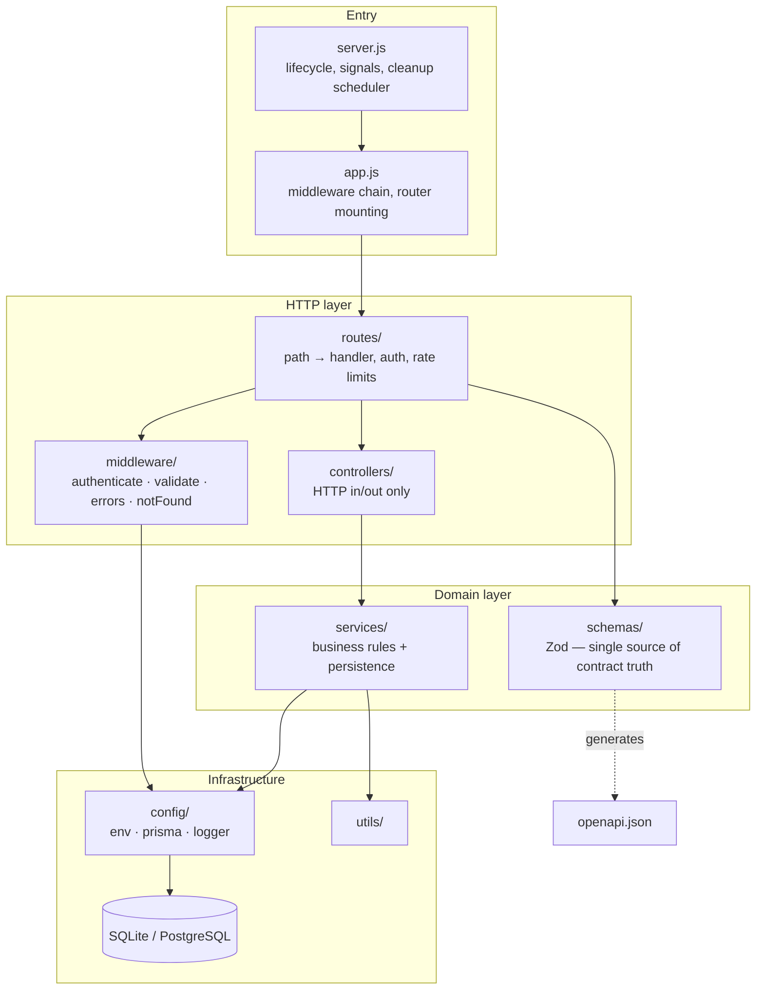
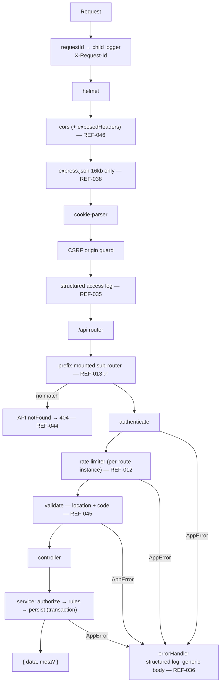
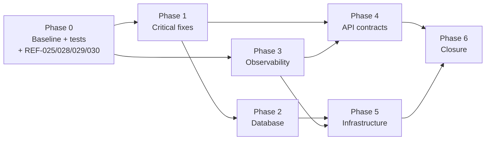

# Daymark Backend — Refactoring Roadmap

**Plan date:** 2026-11-13
**Companion document:** [`BACKEND_CODE_REVIEW.md`](./BACKEND_CODE_REVIEW.md)
**Status:** Proposed. Nothing in this document has been implemented. No application code, migration, schema, or configuration file has been modified.

**Revision 2 (2026-11-13).** This plan was re-reviewed against the source and **re-verified by execution**. Nine recommendations changed; the most important is that **the migration SQL previously prescribed in §5.2/S1 was proven to destroy data** (see §5.2). Changed items are marked **[rev2]**. All `BE-XXX` and `REF-XXX` identifiers are unchanged; three tasks moved phase and two new task IDs were added from the unused range.

Every recommendation below traces to a finding (`BE-XXX`) in the audit report. Every task (`REF-XXX`) states what changes, why, and how to verify it.

---

## 1. Target Architecture

### 1.1 Recommendation: keep the existing architecture

The audit found a clean, acyclic layering — routes → controllers → services → Prisma — with no business logic in controllers, no circular dependencies, and no speculative abstraction. **This is the right architecture for a ~1,250-line Node API and should be preserved.**

The target architecture is therefore the *current* architecture, corrected in four specific places:

| Change | Reason | Finding |
| --- | --- | --- |
| Mount routers on explicit prefixes instead of `/` | Restores 404 semantics and makes `notFound` reachable | BE-004 |
| Move email orchestration from the controller into the service | Registration and delivery are separate failure domains | BE-002 |
| Move JWT verification out of the auth controller into the service | Token policy belongs with auth logic, defined once | BE-029 |
| Add one `config/logger.js` module | Observability is the single largest operational gap | BE-025, BE-011 |

### 1.2 What will deliberately **not** change

These are explicit non-goals. Each is a deliberate decision to preserve working code.

| Not changing | Why |
| --- | --- |
| **No repository layer** | Prisma is already a data-access abstraction. Adding repository interfaces over it would add indirection without removing coupling. The real problem it is often used to solve — untestable services — is better solved by a fast disposable test database (REF-006), which also tests the SQL. |
| **No dependency-injection container** | Three modules, one database, no runtime substitution. A container would add ceremony and obscure the dependency graph. |
| **No interfaces for every service** | Not idiomatic in JavaScript, and there is no second implementation of anything. |
| **No framework migration** | Express 4 works correctly here. Express 5 is available but `asyncHandler` already solves the only problem the upgrade would address. Revisit when Express 4 nears end of support. |
| **No TypeScript migration** | Defensible but out of scope — it is a large, separate programme. The OpenAPI specification (REF-048) delivers much of the type safety at a fraction of the cost. |
| **No microservices, message queue, Redis, Kubernetes, or service mesh** | There is no requirement that justifies any of them. In-process scheduling (REF-020) and in-memory rate limiting are proportionate at this scale. |
| **No directory restructure for appearance** | See §2. |
| **Preserve all 32 strengths in audit §16** | In particular: DB-backed session revocation, token-audience separation, `.strict()` schemas, universal ownership scoping, the UUID/`jti` primary-key design, and the isolated test-database runner. |

### 1.3 Architecture after the plan



The only structural additions are `config/logger.js` and a generated `openapi.json`.

---

## 2. Proposed Directory Structure

Changes are marked **NEW**, **MOVED**, or **SPLIT**. Everything unmarked stays exactly where it is.

```text
project/
├── .git/                                    # NEW — REF-001
├── .github/workflows/ci.yml                 # NEW — REF-003
├── .nvmrc                                   # NEW — REF-004
├── docs/audit/                              # (this audit)
└── backend/
    ├── eslint.config.js                     # NEW — REF-005
    ├── prisma/
    │   ├── schema.prisma
    │   ├── sql/constraints.sql              # NEW — REF-025, Phase 0 (objects Prisma cannot see)
    │   └── migrations/
    │       ├── <existing 7 — NEVER modified>
    │       ├── 2026…_fix_task_creator_cascade/        # NEW — REF-010 (see §5.2/S1 for the verified SQL)
    │       ├── 2026…_priority_order_constraint/       # NEW — REF-024
    │       └── 2026…_friendship_pair_uniqueness/      # NEW — REF-026(b), optional
    ├── scripts/
    │   ├── test.js
    │   └── check-migrations.js              # NEW — REF-028
    ├── test/
    │   ├── helpers/guard.js                 # NEW — REF-030 (fail-closed test-DB guard)
    │   ├── helpers/factories.js             # NEW — REF-006
    │   ├── auth.test.js                     # SPLIT from api.test.js — REF-007
    │   ├── tasks.test.js                    # SPLIT — REF-007
    │   ├── social.test.js                   # SPLIT — REF-007
    │   ├── contracts.test.js                # NEW — REF-059
    │   ├── migrations.test.js               # NEW — REF-028
    │   └── unit/                            # NEW — REF-008
    └── src/
        ├── server.js
        ├── app.js
        ├── config/
        │   ├── env.js
        │   ├── prisma.js
        │   └── logger.js                    # NEW — REF-035
        ├── routes/
        │   ├── api.routes.js
        │   ├── auth.routes.js
        │   ├── task.routes.js
        │   └── social.routes.js            # kept as ONE file — mounted at /friends, per-route auth
        │                                    # (REF-013 delivered without the proposed split;
        │                                    #  see IMPLEMENTATION_STAGE_06 §3)
        ├── controllers/                     # unchanged set
        ├── services/
        │   ├── auth.service.js
        │   ├── task.service.js
        │   ├── social.service.js
        │   ├── email.service.js
        │   └── cleanup.service.js           # NEW — REF-020
        ├── schemas/                         # unchanged set
        ├── middleware/                      # unchanged set
        └── utils/
            ├── app-error.js
            ├── async-handler.js
            ├── safe-user.js
            ├── like-escape.js               # NEW — REF-022
            └── jwt-options.js               # NEW — REF-039 (shared verify options)
```

### 2.1 Package responsibilities and boundaries

| Package | Owns | Must **not** contain | May depend on |
| --- | --- | --- | --- |
| `config/` | Environment parsing, Prisma client, logger | Business logic, HTTP concerns | `zod`, `dotenv`, `@prisma/client`, `pino` |
| `routes/` | Path→handler mapping, middleware attachment, rate limiters | Business logic, direct Prisma access, response bodies | `controllers`, `middleware`, `schemas`, `express-rate-limit` |
| `controllers/` | Reading `request.validated`/`request.user`, calling one service, setting status + envelope, cookie options | Prisma, Zod, business rules, **token verification** (BE-029), **email orchestration** (BE-002) | `services`, `config/env` |
| `services/` | Business rules, authorization predicates, persistence, transactions | `request`/`response` objects, HTTP status codes (use `AppError`) | `config/prisma`, `config/logger`, `utils`, other services |
| `schemas/` | Zod request schemas — the single source of contract truth | Business logic, database access | `zod` |
| `middleware/` | Cross-cutting HTTP concerns | Business rules | `config`, `utils`, `services/auth` (for session lookup only) |
| `utils/` | Small, pure, single-purpose helpers | Prisma, HTTP, configuration | nothing (keep leaf-only) |

### 2.2 Files that move or change

| File | Change | Task |
| --- | --- | --- |
| `routes/social.routes.js` | Mounted on the explicit `/friends` prefix; `authenticate` per route. **Not split** — see IMPLEMENTATION_STAGE_06 §3 | REF-013 |
| `routes/api.routes.js` | Mount on `/friends` instead of `/`; add `/api`-scoped `notFound`; split health routes | REF-013, REF-044 |
| `controllers/auth.controller.js` | Remove inline JWT verification (→ service); remove email orchestration (→ service); merge `me`/`session` | REF-039, REF-011, REF-040 |
| `services/auth.service.js` | Absorb email orchestration and token verification; make registration resilient | REF-011, REF-039 |
| `services/task.service.js` | Escape LIKE wildcards; explicit NULL ordering; transactional completion; drop dead line; add `sortOrder` sort + bulk reorder | REF-022, REF-023, REF-021, REF-038, REF-041 |
| `services/social.service.js` | Unify response shapes; cursor pagination; transactional friendship creation; slim message payload | REF-042, REF-043, REF-026, REF-047 |
| `middleware/error-handler.js` | Structured error logging; drop dead `MulterError` branch | REF-036, REF-038 |
| `middleware/validate.js` | Add `location` and machine-readable `code` to details | REF-045 |
| `app.js` | `exposedHeaders`; remove `urlencoded`; structured access log | REF-046, REF-038, REF-035 |
| `config/prisma.js` | Resolve the SQLite path absolutely | REF-050 |
| `server.js` | Register signals earlier; process-level handlers; shutdown timeout; start cleanup scheduler | REF-053, REF-020 |
| `prisma/schema.prisma` | `createdById` nullable + `SetNull`; friendship pair key | REF-010, REF-026 |
| **Existing 7 migrations** | **Never modified** — forward-only | — |

---

## 3. Target Request Lifecycle



### 3.1 Where each responsibility belongs

| Responsibility | Layer | Rule |
| --- | --- | --- |
| Shape/type validation | `schemas/` via `validate` middleware | Always `.strict()`. Never duplicated in services. |
| Authentication | `authenticate` middleware | JWT **and** live session row. Never bypassed. |
| **Resource authorization** | **service** | Always a `{ id, userId }`-style predicate in the query itself — never a separate pre-check. Preserve the existing 404-not-403 convention. |
| Business rules | `services/` | Throw `AppError` with a stable code; never touch `response`. |
| Persistence & transactions | `services/` | Any read-modify-write must be in `prisma.$transaction`. |
| Status codes & envelope | `controllers/` | `{ data, meta? }` on success. |
| Error → HTTP mapping | `error-handler` | The only place that maps an error to a status. |
| Logging | `config/logger` | Services log domain events; the error handler logs failures. |

### 3.2 Rate-limit placement rule (BE-003, BE-017) **[rev2 — keying strategy corrected]**

Current code applies one shared limiter instance to five routes. The target rule:

> **Every route gets its own limiter instance, from a factory. A limiter guarding email delivery is applied only where email is actually sent, and never to a recovery endpoint.**

> **[rev2] The previously recommended "key login on IP + email" was a weakening and has been withdrawn.** A composite key gives each `(IP, email)` pair its own budget, so an attacker varying the email gets an unlimited number of fresh budgets from one IP. This was executed: after exhausting the budget for `victim@x.com`, a request for `victim2@x.com` returned **200**, and even the case-variant `VICTIM@x.com` returned **200** — because the limiter runs *before* Zod normalises the address. A composite key is weaker than IP alone against spraying and weaker than an account key against targeted brute force.

**Layered instead of composite.** Two independent limiters, both of which must pass:

| Layer | Key | Guards against | Note |
| --- | --- | --- | --- |
| **Per-IP** | `ip:<req.ip>` | password spraying across many accounts from one source | generous ceiling; the only layer that survives email variation |
| **Per-account** | `acct:<normalised email>` | targeted brute force against one account from many sources | strict ceiling; independent of source IP |

*Verified:* with a per-IP ceiling of 5 and a per-account ceiling of 3, a targeted account is cut off at its 4th attempt **and** the per-IP ceiling still bites after the attacker switches to a third account — the behaviour the composite key failed to provide.

**[rev2] Two implementation requirements, both from observed behaviour:**

1. **The account key must normalise the address itself.** Limiters run before `validate`, so `request.body.email` is raw — untrimmed, unnormalised case. The key generator must apply the same `trim().toLowerCase()` the Zod schema applies, and must tolerate a missing or unparsable body (fall back to a per-IP-only decision rather than throwing).
2. **A per-account limiter must never be the only gate on a recovery endpoint**, or an attacker can lock a victim out of their own password reset by burning the victim's account budget. Keep recovery endpoints on a per-IP limiter plus a per-account *email-send* budget that suppresses delivery without rejecting the request — the endpoint keeps returning its generic `202` either way (preserves BE-016 behaviour).

| Route | Limiters | Budget | Key |
| --- | --- | --- | --- |
| `POST /auth/login` | per-IP **+** per-account | 50 / 15 min · 10 / 15 min | `ip:` · `acct:` |
| `POST /auth/register` | per-IP | 10 / hour (prod), relaxed in dev | `ip:` |
| `POST /auth/password-reset/request` | per-IP **+** per-account send budget | 20 / hour · 5 / hour | `ip:` · `acct:` |
| `POST /auth/password-reset/confirm` | per-IP | 20 / 15 min | `ip:` |
| `POST /auth/resend-verification` | per-IP **+** per-account send budget | 20 / hour · 5 / hour | `ip:` · `acct:` |
| social writes | per-user | 30 / min | `user:<id>` (authenticated — more precise than IP) |

Budgets are starting points to be tuned against real traffic, not derived constants.

### 3.3 Reverse-proxy trust **[rev2 — new]**

Every IP-keyed limit above depends on `request.ip` being the real client address, which depends entirely on `TRUST_PROXY_HOPS` matching the deployment. **Both error directions are dangerous, in opposite ways:**

| Setting | Effect | Consequence |
| --- | --- | --- |
| Too low (e.g. the `0` default behind a proxy) | `request.ip` is the proxy's address | every client shares one bucket — **one attacker locks out all users**, amplifying BE-003 and BE-017 from per-IP to global |
| Too high | `X-Forwarded-For` entries the proxy did not write are trusted | an attacker spoofs a fresh address per request and **bypasses every IP-based limit entirely** |

Requirements:

- Keep `express-rate-limit`'s built-in validation enabled (the installed 7.5.1 ships `ERR_ERL_PERMISSIVE_TRUST_PROXY` and `ERR_ERL_UNEXPECTED_X_FORWARDED_FOR`). Do not disable these checks to silence startup noise.
- **[rev2]** Add a startup assertion: when `NODE_ENV=production`, require `TRUST_PROXY_HOPS` to be set deliberately — fail fast if the value is still the default and a proxy is expected. Configuration validation already lives in `config/env.js` (BE-030 territory) and should own this.
- **[rev2]** Note that `ERR_ERL_STORE_REUSE` does **not** catch BE-003: mounting a single limiter *instance* on several routes is legal and emits no warning. *Verified* — reproducing the current shape produced a shared counter and **zero** library warnings. Only the REF-009 regression test catches this class of bug.

## 4. Target API Contracts

### 4.1 Conventions to keep unchanged

`{ "data": … }` / `{ "data": …, "meta": … }` / `{ "error": { message, code, details? } }`; ISO-8601 UTC dates; empty arrays never `null`; 404 (not 403) for another user's resource; `.strict()` rejection of unknown fields; cookie-based sessions.

### 4.2 Changed and added contracts

---

#### C1 · Unknown API routes → 404 (BE-004) — **non-breaking**

| | |
| --- | --- |
| **Existing** | `GET /api/does-not-exist` → `401 UNAUTHENTICATED` when unauthenticated, `404` when authenticated |
| **Proposed** | Always `404 { "error": { "code": "NOT_FOUND" } }` |
| **Reason** | Routing must answer "does this exist?" before "may you?". The current behaviour makes a mistyped URL force a logout in the bundled client. |
| **Frontend impact** | Positive. Clients must stop treating 401 as proof of session expiry on unknown paths. |
| **Transition** | Deploy directly — no client can depend on the current behaviour deliberately. |

---

#### C2 · Task creator becomes nullable (BE-001) — **breaking (field type)**

| | |
| --- | --- |
| **Existing** | `task.createdById: string`; the task is **deleted** if the creator deletes their account |
| **Proposed** | `task.createdById: string \| null`; the task **survives**, with `null` indicating a deleted creator |
| **Reason** | Provenance must not control another user's data lifetime. |
| **Frontend impact** | **[rev2 — corrected]** The bundled frontend **does** read it, at `app.js:314`: `task.createdById !== task.userId ? \`Sent by ${findFriend(task.createdById)?.name \|\| 'a friend'}\`` . With `null` the comparison is still true and `findFriend(null)` is `undefined`, so it renders the existing fallback **"Sent by a friend"** — correct and graceful, but it is a behaviour path that must be covered by a test, not an assumption. Revision 1 of this plan and of the audit stated the frontend does not read this field; that was wrong. |
| **Transition** | Ship with the migration. Document in release notes. Add `createdBy: { id, name } \| null` (REF-015) so clients have a display name without a second lookup. |

---

#### C3 · Registration under email-provider failure (BE-002) — **non-breaking**

| | |
| --- | --- |
| **Existing** | `500 INTERNAL_ERROR`; user row committed; account permanently unusable |
| **Proposed** | `202 { data: { user }, meta: { verificationRequired: true, verificationEmailSent: false } }` |
| **Reason** | A transient third-party outage must not permanently damage an account. |
| **Frontend impact** | Additive field. Clients may prompt "resend verification". |
| **Transition** | Deploy directly — strictly an improvement over a 500. |

---

#### C4 · Explicit completion state replaces toggle (BE-006) — **deprecation**

| | |
| --- | --- |
| **Existing** | `PATCH /api/tasks/:id/toggle` inverts `completed`; a retry flips it back |
| **Proposed** | `PATCH /api/tasks/:id` with `{ "completed": true\|false }` is canonical and idempotent. `/toggle` is retained, documented as non-idempotent, and deprecated. |
| **Reason** | Retries must be safe. The idempotent endpoint already exists and already maintains `completedAt`. |
| **Frontend impact** | Clients should send the explicit value they computed. |
| **Transition** | Keep `/toggle` for ≥1 release with a `Deprecation` header; migrate the bundled client; remove later. |

---

#### C5 · Cursor pagination for messages (BE-007) — **breaking after transition**

| | |
| --- | --- |
| **Existing** | `?page=1&limit=50`; pages descend while items within a page ascend; concatenation scrambles order |
| **Proposed** | `?before=<cursor>&limit=50` → `{ data: { messages }, meta: { nextCursor, hasMore } }`, consistently ordered; cursor is `createdAt`+`id` |
| **Reason** | Offset paging is unstable on an append-heavy feed and the current ordering is self-contradictory. |
| **Frontend impact** | "Load older messages" must switch to cursors. |
| **Transition** | Support both for one release — `before` takes precedence when present; `page` emits a `Deprecation` header. Then remove `page`. |

---

#### C6 · One response shape for friend requests (BE-008) — **additive + status change**

| | |
| --- | --- |
| **Existing** | New request → `201 { id, status, createdAt, user }`; auto-accept → `201 { id, status, user }` (no `createdAt`); decline → `200 { status: "declined" }`, a value the DB cannot store |
| **Proposed** | **[rev2 — narrowed]** Both branches → `{ id, status, createdAt, updatedAt, user }`, **both keeping `201`**, with `meta.autoAccepted: true` distinguishing the auto-accept branch. Decline keeps `200` but reports a status the system can represent. |
| **Reason** | A response schema must depend on the endpoint, not an internal branch. Status values must be drawn from the domain the database permits. |
| **Frontend impact** | `createdAt` becomes reliable; `meta.autoAccepted` is additive. **No status code changes.** |
| **Transition** | **[rev2]** Now a purely additive change — deploy directly. The previously proposed `201 → 200` change for the auto-accept branch has been **withdrawn**: it was a semantic nicety that broke clients branching on the status code, for no behavioural gain. The `meta` flag conveys the same information without breaking anyone. The `declined` value remains a **product decision** (§16 Q3): either persist it by widening the CHECK, or return the friendship as deleted. |

---

#### C7 · Validation error details gain location and code (BE-012) — **additive**

| | |
| --- | --- |
| **Existing** | `{ "path": "", "message": "Unrecognized key: \"nope\"" }` — unmappable to a field |
| **Proposed** | `{ "location": "body", "path": "title" \| null, "code": "unrecognized_keys", "message": "…" }` |
| **Reason** | Clients must map errors to form fields and branch on a stable code rather than parsing prose. |
| **Frontend impact** | Field-level validation becomes possible. Existing `path`/`message` retained. |
| **Transition** | Additive; deploy directly. |

---

#### C8 · Task ordering and bulk reorder (BE-013) — **additive**

| | |
| --- | --- |
| **Existing** | `sortBy` ∈ `createdAt \| dueDate \| priority`; reordering requires N parallel PATCHes |
| **Proposed** | Add `sortBy=sortOrder` (tie-break `createdAt`). Add `PATCH /api/tasks/order` with `{ "items": [{ "id", "sortOrder" }] }`, applied in one transaction, ownership-verified for every id, max 500 items. |
| **Reason** | The column, its index, and its write path already exist — only the read path and an atomic bulk write are missing. |
| **Frontend impact** | Removes the fetch-all-pages workaround; makes reorder atomic. |
| **Transition** | Purely additive. |

---

#### C9 · Explicit NULL ordering and escaped search (BE-009, BE-010) — **minor behavioural**

| | |
| --- | --- |
| **Existing** | `NULL` `dueDate` sorts first ASC / last DESC (SQLite-specific); `%` and `_` in `search` act as wildcards |
| **Proposed** | Undated tasks **always sort last** in both directions, documented and tested. `search` treats `%`/`_` literally via escaping + `ESCAPE`. Case-insensitivity is documented and pinned by a test. |
| **Reason** | Ordering and matching are contract guarantees, not engine side effects. Prevents a silent regression on the planned PostgreSQL migration. |
| **Frontend impact** | Undated tasks move in one sort direction; searches containing `%`/`_` return fewer results. |
| **Transition** | Deploy with release notes; both are corrections. |

---

#### C10 · Exposed response headers (BE-014) — **additive**

Add `Access-Control-Expose-Headers: X-Request-Id, RateLimit, RateLimit-Policy, RateLimit-Reset, Retry-After` so the browser can read diagnostics the server already sends.

---

#### C11 · Generic registration response (BE-016) — **breaking, product decision required**

| | |
| --- | --- |
| **Existing** | `409 EMAIL_ALREADY_REGISTERED` — an enumeration oracle |
| **Proposed** | `202` with an identical generic body whether or not the address is taken; an "account already exists" email is sent to the address instead |
| **Reason** | Consistency with login and the password-reset endpoints, which are already carefully generic. |
| **Frontend impact** | Cannot show "email already taken" inline; the UX must be redesigned around "check your inbox". |
| **Transition** | **Requires product sign-off (§16 Q4) and depends on BE-002 being fixed first.** Do not ship otherwise. |

---

#### C12 · Slimmer message payloads (BE-032) — **breaking after transition**

| | |
| --- | --- |
| **Existing** | Every message embeds `sender: { id, name, email, createdAt, updatedAt }` |
| **Proposed** | **[rev2 — reduced to additive]** Add `senderId` and a `meta.participants` map. **Keep the embedded `sender` object.** Removal is deferred to an optional later step, not scheduled here. |
| **Reason** | A two-party conversation repeats the same two user objects up to 100× per page on the API's highest-volume endpoint. |
| **Frontend impact** | **None.** The bundled frontend reads `message.sender.id` (`app.js:942`) and `message.sender.name` (`app.js:947`); both keep working. New clients can use the slimmer fields. |
| **Transition** | **[rev2]** Additive only — deploy directly. Removing `sender` is reclassified as an **optional optimisation** (§4.4) and gated on evidence that payload size is an actual problem. This endpoint is not currently slow, and breaking a working client to save bytes nobody has measured is not justified. |

---

#### C13 · Liveness/readiness split (BE-031) — **additive**

`GET /api/health/live` → always 200 while the process runs. `GET /api/health/ready` → 200, or **503** `DEPENDENCY_UNAVAILABLE` when the database is unreachable. `GET /api/health` retained as an alias for readiness.

---

#### C14 · Token in POST body (BE-035) — **additive, frontend-coordinated**

Add `POST /api/auth/verify-email` accepting `{ token }`. Email links point to a frontend page carrying the token in the URL **fragment** (never sent to the server or logged), which posts it. Retain the existing `GET` route for at least one token lifetime (24 h) so links already in inboxes keep working.

### 4.3 Versioning (BE-033)

Introduce `/api/v1` **only when the first breaking change ships**, keeping `/api` as an alias for one release. Versioning before it is needed adds ceremony without benefit.

**[rev2]** After the reclassification in §4.4, the number of genuinely breaking changes dropped from six to three, and only one of those (C5) is scheduled. If §16 Q4 defers C11 and §16 Q3 chooses a non-breaking decline semantic, **C5 may be the only breaking change in the whole programme** — in which case a dual-parameter transition on one endpoint is cheaper than versioning the entire API, and `/api/v1` should not be introduced at all.

### 4.4 Change classification **[rev2 — new]**

The audit found defects; not every defect justifies a contract change, and not every improvement justifies breaking a client. Each proposed change is classified by the *obligation* behind it, so approval can be granted per class rather than wholesale.

#### Class 1 — Mandatory bug fixes (ship regardless; no product input needed)

| Change | Finding | Task | Breaking? |
| --- | --- | --- | --- |
| Account deletion must not destroy another user's tasks | BE-001 | REF-010 | field becomes nullable (C2) — graceful in the bundled client |
| Registration must survive an email-provider outage | BE-002 | REF-011 | no (C3) |
| Login failures must not block account recovery | BE-003 | REF-012 | no |
| Unknown `/api/*` must return 404, not 401 | BE-004 | REF-013, REF-014 | no (C1) |
| Completion update must be transactional | BE-021 | REF-021 | no |
| Expired sessions/tokens must be purged | BE-005 | REF-020 | no |
| Server must bind the intended database from any CWD | BE-022 | REF-050 | no |
| Documentation must not claim unsupported bearer auth | BE-015 | REF-016 | no |

#### Class 2 — Justified improvements (clear engineering benefit, evidence-backed)

| Change | Finding | Task | Breaking? |
| --- | --- | --- | --- |
| Validation details carry `location` + machine code | BE-012 | REF-045 | no (C7) |
| Expose `X-Request-Id` and rate-limit headers | BE-014 | REF-046 | no (C10) |
| `sortBy=sortOrder` + atomic bulk reorder | BE-013 | REF-041 | no (C8) |
| Cursor pagination for messages | BE-007 | REF-043 | **yes** (C5) — dual-support transition |
| One response shape for friend requests | BE-008 | REF-042 | no, after the rev2 narrowing (C6) |
| Escaped `LIKE` + explicit NULL ordering | BE-009, BE-010 | REF-022, REF-023 | behavioural (C9) |
| Structured logging and diagnosable errors | BE-011, BE-025 | REF-035, REF-036 | no |
| Database-level `priority` pair constraint | BE-018 | REF-024 | removing `priorityOrder` from responses is breaking in principle; **0 occurrences** in the bundled frontend |
| Constraints registered and asserted | BE-019 | REF-025, REF-028 | no |
| Friendship creation transaction | BE-020 | REF-026 (a) | no |
| Liveness/readiness split | BE-031 | REF-051 | no (C13) |
| Process-level handlers, shutdown timeout | BE-036 | REF-053 | no |
| Dead code removal | BE-028 | REF-038 | **yes** — form-encoded bodies stop being accepted |
| OpenAPI specification | BE-033 | REF-048, REF-058, REF-059 | no |

#### Class 3 — Optional optimisations (defer unless evidence appears)

| Change | Finding | Task | Why optional |
| --- | --- | --- | --- |
| **[rev2]** Remove the embedded `sender` object | BE-032 | REF-047 (removal half) | Payload size is not a measured problem; removal breaks the working bundled client. Ship `senderId` + `meta.participants` additively; remove only if a real payload problem is demonstrated. |
| **[rev2]** Friendship unordered-pair index | BE-020 | REF-026 (b) | *Potential* finding that did not reproduce on this stack. Valuable on PostgreSQL/multi-instance; defer until §16 Q1 answers. |
| Token in POST body instead of URL | BE-035 | REF-052 | Single-use, short-lived tokens plus an access log that omits URLs already bound the exposure. Needs coordinated frontend work. |
| Retire `/toggle` | BE-006 | REF-044 (removal half) | Deprecate and document now; remove only after clients migrate. |
| Container definition | BE-026 | REF-055 | Needs a deployment target first (§16 Q1). |

#### Class 4 — Product decisions (must not ship without sign-off)

| Change | Finding | Task | Question |
| --- | --- | --- | --- |
| Generic registration response (drop 409) | BE-016 | REF-049 | §16 Q4 |
| Unfriend retention policy | BE-024 | REF-054 | §16 Q3 |
| Decline semantics (`declined` persisted vs deleted) | BE-008 | REF-042 | §16 Q3 |
| Bearer-token support | BE-015 | — | §16 Q2 |

### 4.5 "Non-breaking" changes that still affect clients **[rev2 — new]**

Audit-review point: several changes labelled non-breaking do change observable behaviour. None requires a client rewrite, but each needs a release note and a test.

| Change | Labelled | Actually observable as | Bundled-frontend effect (verified) |
| --- | --- | --- | --- |
| C1 — 404 instead of 401 on unknown `/api/*` | non-breaking | status code changes for a class of URLs | **Behaviour change, desirable.** `app.js:75` signs the user out on any 401 while signed in; after the fix a mistyped URL no longer does. Any client with a blanket 401 rule is affected — in its favour. |
| C2 — `createdById` nullable | breaking (field type) | `null` where a string was guaranteed | Renders "Sent by a friend" (`app.js:314`). Graceful, but **must be covered by a test**. |
| C3 — 202 instead of 500 on provider failure | non-breaking | a success-family status where an error was returned | **None** — the frontend already branches on `meta.verificationRequired` (`app.js:174`) and shows "Check your email…". |
| C7 — validation `path` `""` → `null` | additive | a falsy value changes type | **None** — `app.js` uses `item.path \|\| 'input'`; both are falsy. |
| C9 — NULL ordering and escaped search | minor behavioural | undated tasks move; `%`/`_` searches narrow | Visible list reordering in one sort direction. Release note required. |
| C10 — `exposedHeaders` | additive | new readable headers | None. |
| C13 — health split | additive | `/api/health` retained as an alias | None, provided the alias is kept. |
| REF-038 — drop `express.urlencoded` | listed under a phase whose table said "API impact: None" | form-encoded mutations rejected | **None** — the frontend sends JSON only. **[rev2]** The phase table was wrong and has been corrected; this is a real, if low-risk, breaking change. |
| REF-024 — `priorityOrder` removed | listed only under §13.1 | a response field disappears | **None** — 0 occurrences in `app.js`. **[rev2]** Phase 2's API-impact row omitted it and has been corrected. |

## 5. Database Improvement Plan

### 5.1 Absolute rules

1. **Never modify an existing migration.** All seven are applied; editing one breaks Prisma's checksum and corrupts upgraded databases. Every change is a **new forward migration**.
2. **Back up before any destructive step.** `SECURITY.md` requires a tested restore procedure; none exists (REF-029 creates one).
3. **Every table-rebuild migration must re-apply `prisma/sql/constraints.sql`** (REF-025), or the triggers and CHECKs are silently lost (BE-019).
4. **[rev2] `DROP TABLE` fires `ON DELETE` actions on child tables.** SQLite performs an implicit delete of every row before dropping a table, which triggers child-table foreign-key *actions*. `PRAGMA defer_foreign_keys=ON` defers constraint **violations**; it does **not** suppress these actions. Any rebuild of a table that other tables reference must therefore protect the child rows explicitly. *Verified:* the migration previously prescribed here silently set every `chat_messages.task_id` to `NULL`.
5. **[rev3 — corrected in Stage 3] Migrations are not atomic *by default*, but can be made atomic.** Prisma 7 with the `better-sqlite3` adapter does not wrap a migration file in a transaction: a deliberate runtime failure (a duplicate primary key) midway through a migration left the partially applied state behind — measured. **Wrapping the migration body in an explicit `BEGIN; … COMMIT;` does make it atomic** — the same deliberate failure rolled back completely, also measured. Every migration that rebuilds a table must therefore open with `BEGIN` and close with `COMMIT`.
   Two consequences follow. First, `PRAGMA foreign_keys=OFF` cannot be used inside such a migration (it is a no-op within a transaction), so child-row protection must use the capture-and-restore approach in §5.2/S1 rather than a pragma. Second, atomicity protects against a *failed* migration only: once a rebuild has **succeeded** and `created_by_id` contains NULLs, the column can no longer be made `NOT NULL`, so REF-029's backup remains the only route back from a successful-but-unwanted change. REF-029 stays a hard prerequisite.
   *Revision 2 stated flatly that migrations are not transactional and that restore is the only rollback. That was measured with a harness whose temporary workspace lacked `node_modules`, so the migration never actually executed. The corrected measurement is above.*
6. **[rev2] Every rebuild migration ends with `PRAGMA foreign_key_check`** and a row-count assertion, so silent reference damage fails the migration instead of shipping.

### 5.2 Schema changes

#### S1 · `tasks.created_by_id` → nullable, `ON DELETE SET NULL` (BE-001, REF-010) — **CRITICAL** **[rev2 — rewritten]**

```prisma
createdById String? @map("created_by_id")
createdBy   User?   @relation("TaskCreator", fields: [createdById], references: [id], onDelete: SetNull)
```

> **[rev2] The migration previously prescribed here was wrong and would have caused data loss.** It was executed against a copy of the real database under `prisma migrate deploy`. It correctly set the foreign key to `SET NULL` and preserved all 14 task rows, **but it also**:
>
> | Observed | Cause |
> | --- | --- |
> | every `chat_messages.task_id` became `NULL` (2 → 0) | `DROP TABLE "tasks"` performs an implicit delete, firing `chat_messages.task_id`'s `ON DELETE SET NULL`. `PRAGMA defer_foreign_keys=ON` does not prevent this. |
> | both priority triggers disappeared (2 → 0) | trigger re-application was written as a **comment**, not as SQL, so a faithful implementation drops them (BE-019). |
>
> `chat_messages.task_id` is the link between a task-assignment notification and its task. It is user-visible: the bundled frontend styles those messages differently (`app.js:943`). Losing it is exactly the class of silent data loss BE-001 exists to prevent.

**Verified migration.** The version below was executed against a copy of the real database and produced: task_id links **preserved** (2 → 2), both triggers **present**, all 8 indexes present, 14 task rows, `created_by_id` → `SET NULL`, `foreign_key_check` **0 orphans**, `friendships` CHECK intact, and **no Prisma drift**.

```sql
-- [rev3] Explicit transaction: Prisma does not provide one, and without it a
-- mid-migration failure leaves partial state behind (both measured).
BEGIN;

-- Guard A: defer constraint *violations* during the rebuild.
-- (Works inside a transaction; PRAGMA foreign_keys=OFF would not.)
PRAGMA defer_foreign_keys=ON;

-- Guard B: capture child references that DROP TABLE would otherwise SET NULL.
--          Independent of Guard A, so it holds even if a future runner wraps this in a transaction.
CREATE TEMP TABLE "_task_link_backup" AS
  SELECT "id","task_id" FROM "chat_messages" WHERE "task_id" IS NOT NULL;

CREATE TABLE "new_tasks" (
  "id" TEXT NOT NULL PRIMARY KEY, "user_id" TEXT NOT NULL, "created_by_id" TEXT,   -- now nullable
  "title" TEXT NOT NULL, "description" TEXT, "due_date" DATETIME,
  "priority" TEXT NOT NULL DEFAULT 'medium', "priority_order" INTEGER NOT NULL DEFAULT 2,
  "sort_order" INTEGER NOT NULL DEFAULT 0, "completed" BOOLEAN NOT NULL DEFAULT false,
  "completed_at" DATETIME, "created_at" DATETIME NOT NULL DEFAULT CURRENT_TIMESTAMP,
  "updated_at" DATETIME NOT NULL,
  CONSTRAINT "tasks_user_id_fkey"       FOREIGN KEY ("user_id")       REFERENCES "users"("id") ON DELETE CASCADE  ON UPDATE CASCADE,
  CONSTRAINT "tasks_created_by_id_fkey" FOREIGN KEY ("created_by_id") REFERENCES "users"("id") ON DELETE SET NULL ON UPDATE CASCADE
);

INSERT INTO "new_tasks" ("id","user_id","created_by_id","title","description","due_date",
  "priority","priority_order","sort_order","completed","completed_at","created_at","updated_at")
SELECT "id","user_id","created_by_id","title","description","due_date",
  "priority","priority_order","sort_order","completed","completed_at","created_at","updated_at"
FROM "tasks";                                    -- pure copy: no column is transformed

DROP TABLE "tasks";
ALTER TABLE "new_tasks" RENAME TO "tasks";

-- Guard B restore: re-link only rows whose task still exists.
UPDATE "chat_messages" SET "task_id" =
  (SELECT b."task_id" FROM "_task_link_backup" b WHERE b."id" = "chat_messages"."id")
WHERE "task_id" IS NULL
  AND EXISTS (SELECT 1 FROM "_task_link_backup" b WHERE b."id" = "chat_messages"."id")
  AND EXISTS (SELECT 1 FROM "tasks" t JOIN "_task_link_backup" b ON b."task_id" = t."id"
              WHERE b."id" = "chat_messages"."id");
DROP TABLE "_task_link_backup";

-- All 8 indexes, restated explicitly (a rebuild drops them with the table).
CREATE INDEX "tasks_user_id_idx"                ON "tasks"("user_id");
CREATE INDEX "tasks_completed_idx"              ON "tasks"("completed");
CREATE INDEX "tasks_due_date_idx"               ON "tasks"("due_date");
CREATE INDEX "tasks_user_id_completed_idx"      ON "tasks"("user_id","completed");
CREATE INDEX "tasks_user_id_due_date_idx"       ON "tasks"("user_id","due_date");
CREATE INDEX "tasks_user_id_priority_order_idx" ON "tasks"("user_id","priority_order");
CREATE INDEX "tasks_user_id_sort_order_idx"     ON "tasks"("user_id","sort_order");
CREATE INDEX "tasks_created_by_id_idx"          ON "tasks"("created_by_id");

-- Both triggers, restated explicitly as SQL (REF-025 / BE-019). NOT a comment.
CREATE TRIGGER "tasks_priority_insert_check" BEFORE INSERT ON "tasks" FOR EACH ROW
WHEN NEW."priority" NOT IN ('low','medium','high')
BEGIN SELECT RAISE(ABORT,'invalid task priority'); END;

CREATE TRIGGER "tasks_priority_update_check" BEFORE UPDATE OF "priority" ON "tasks" FOR EACH ROW
WHEN NEW."priority" NOT IN ('low','medium','high')
BEGIN SELECT RAISE(ABORT,'invalid task priority'); END;

COMMIT;   -- [rev3]
```

**[rev3] This SQL now exists as a rehearsable artefact** at
`backend/prisma/sql/proposed/be-001-fix-task-creator-cascade.sql` — deliberately **outside** `prisma/migrations/`, so Prisma never runs it. `npm run db:rehearse` applies it to a disposable copy and checks every condition below. Promoting it into the migration history is REF-010.

**Post-migration assertions (run by REF-028, must fail the deploy if violated):**

| Assertion | Why |
| --- | --- |
| `PRAGMA foreign_key_check` returns no rows | no orphaned references |
| `tasks` row count equals the pre-migration count | no rows lost in the copy |
| `chat_messages` rows with non-null `task_id` equals the pre-migration count | Guard B worked |
| both `tasks_priority_*_check` triggers exist | BE-019 |
| all 8 `tasks` indexes exist | rebuild completeness |
| `PRAGMA foreign_key_list("tasks")` shows `created_by_id → SET NULL` | the actual fix |
| `prisma migrate diff --from-migrations --to-schema` is empty | no drift |

- **Data preservation:** pure copy plus an explicit restore of child links.
- **Destructive step:** `DROP TABLE` after the copy. **[rev3]** With the explicit `BEGIN … COMMIT` above the migration is atomic, so a *failed* run rolls back cleanly (measured).
- **Rollback:** a failure rolls back by itself. For a **successful** migration that then has to be undone, **restore from the REF-029 backup**. A reverse rebuild restoring `NOT NULL` is only possible while no `created_by_id` has become `NULL`; once any creator has deleted their account the change is one-way. Do not plan on reversing it in place.
- **[rev2] Alternative considered and rejected:** `PRAGMA foreign_keys=OFF` instead of Guard B. It was verified to work on this stack, but it relies on migrations not being transactional — an implementation detail that could change in any Prisma release, and whose failure mode is silent data loss. Guard B is correct either way, so it is preferred. Keeping `defer_foreign_keys=ON` costs nothing and matches Prisma's own generated style.

#### S2 · `priority` / `priority_order` coupling (BE-018, REF-024)

Extend the triggers to reject mismatched pairs:

```sql
WHEN NEW."priority_order" <> (CASE NEW."priority" WHEN 'low' THEN 1 WHEN 'medium' THEN 2 WHEN 'high' THEN 3 END)
```

Run a data audit first — any pre-existing mismatched row would make the trigger reject later updates to it. Also remove `priorityOrder` from API responses.

#### S3 · Friendship unordered-pair uniqueness (BE-020, REF-026) **[rev2 — approach changed]**

> **[rev2] The generated-column approach was rejected after testing.** A `user_pair_key` column generated by SQLite works at the SQL level, but **Prisma has no concept of generated columns**: declared in `schema.prisma`, Prisma includes it in `INSERT` statements and SQLite rejects the write (`cannot INSERT into generated column`); omitted from `schema.prisma`, the column exists but nothing can use it. Either way it adds a column, a backfill and a failure mode for no benefit.

**Two halves, with different urgency.**

**(a) The transaction — do this.** Wrap `sendFriendRequest`'s check-and-create in `prisma.$transaction` and treat `P2002` as the "already exists" branch rather than relying on the pre-check. This is the half that carries the value and it is free of schema risk.

**(b) The database constraint — verified option.** A **unique index on canonically-ordered expressions**, which needs no new column, no backfill and no application change:

```sql
CREATE UNIQUE INDEX "friendships_user_pair_key"
  ON "friendships"(MIN("requester_id","addressee_id"), MAX("requester_id","addressee_id"));
```

*Verified on SQLite 3.53.2:* the index is created, a reciprocal `(Y,X)` insert is rejected once `(X,Y)` exists, an unrelated `(X,Z)` pair is still allowed, the planner uses the index for pair lookups, and **`prisma migrate diff` reports no drift** — Prisma ignores expression indexes exactly as it ignores triggers and CHECKs. It ports to PostgreSQL by substituting `LEAST`/`GREATEST`.

| | Expression index (recommended) | Canonical columns `user_a_id`/`user_b_id` |
| --- | --- | --- |
| New columns / backfill | none | two columns + backfill |
| Application changes | none | must maintain both columns on every write |
| Airtight | yes | only if `NOT NULL` — which needs a **table rebuild** (SQLite cannot `ADD COLUMN NOT NULL` without a default), and nullable columns let rows bypass the index because SQLite treats NULLs as distinct |
| Visible to Prisma | **no** — must be registered in `constraints.sql` (REF-025) and asserted by REF-028 | yes — survives Prisma-generated rebuilds |
| Verified here | yes, end to end | yes, mechanically |

Choose the expression index now; revisit canonical columns only if a PostgreSQL migration makes Prisma visibility worth the extra moving parts.

**Preconditions.** Scan for and merge existing duplicate pairs before creating the index — the audit found none (0/12 trials) but a production database must be checked, and index creation fails outright if any exist.

**[rev2] Sequencing note.** BE-020 is the plan's only *Potential* finding: it did not reproduce on the current single-process SQLite stack. Half (a) is cheap and should ship. Half (b) may be deferred until §16 Q1 confirms PostgreSQL or multi-instance, provided the deferral is recorded.

#### S4 · Cleanup of expired rows (BE-005, REF-020) **[rev2 — safety rules added]**

An in-process scheduled job (hourly) purging expired rows. **The three tables are not equally safe to purge**, because each uses the presence or absence of its row differently.

> **[rev2] Verified replay hazard.** Deleting an `email_verification_tokens` row **while its JWT is still valid restores replay capability**. Replay protection for verification is "insert the `jti` as a primary key" (`auth.service.js:71`) — absence of the row means the insert succeeds. This was executed: a token already consumed, whose row was then deleted, **verified successfully a second time**. Password-reset and session rows do not share this property: there, absence of the row means *reject* (`auth.service.js:132`, `middleware/authenticate.js:41`), which was also verified.

| Table | Safe to delete when | Row absence means | Required guard |
| --- | --- | --- | --- |
| `sessions` | `expires_at < now()`, **or** `revoked_at IS NOT NULL AND revoked_at < now() − 24 h` | reject (401) | none — fail-closed |
| `password_reset_tokens` | `expires_at < now()`, **or** `used_at IS NOT NULL` | reject (400) | none — fail-closed |
| **`email_verification_tokens`** | **`expires_at < now() − 48 h` only** | **accept — replay becomes possible** | **never delete a row whose `expires_at` is in the future or recently past** |

The verification row's `expires_at` is set to the JWT's own `exp` (`auth.service.js:71`), so once `expires_at` has passed, `jwt.verify` rejects the token before the row is ever consulted. The 48-hour margin covers clock skew between the issuing and verifying processes; it is cheap insurance against a fail-open outcome.

**Operational requirements:**

- **Bounded work.** Delete in batches (e.g. 500 rows) with a per-sweep ceiling, so a large backlog cannot hold a write lock on SQLite.
- **[rev2] Graceful shutdown.** `unref()` the timer so it never keeps the event loop alive, `clearInterval` on `SIGTERM`, and set a shutting-down flag so a sweep is not started during shutdown. An in-flight sweep must be awaited before `prisma.$disconnect()`.
- **[rev2] Multi-instance limitation.** Every instance would run the same sweep, duplicating work and contending for locks. On single-process SQLite this is harmless and no coordination is needed. **If §16 Q1 selects multi-instance,** gate the sweep behind a PostgreSQL advisory lock or move it to a single scheduled command. Record this limitation rather than pre-building for it.
- **Failure isolation.** A sweep error must be logged and swallowed; it must never crash the process or reject at the top level (interacts with BE-036).

### 5.3 Query changes

| Change | Finding | Task |
| --- | --- | --- |
| Escape `%`, `_`, `\` in `search`; emit `ESCAPE` | BE-009 | REF-022 |
| Explicit NULL-last ordering for `dueDate` | BE-010 | REF-023 |
| Wrap `updateTask`'s completion read-modify-write in a transaction | BE-021 | REF-021 |
| Add `sortOrder` to `sortBy`; add transactional bulk reorder | BE-013 | REF-041 |
| Cursor pagination for messages | BE-007 | REF-043 |

### 5.4 Indexes

**No index is missing** — `EXPLAIN QUERY PLAN` confirmed every hot query uses one, and there are no N+1 queries. Two additions follow new features only:

| Index | Justifies |
| --- | --- |
| `friendships(MIN(requester_id,addressee_id), MAX(...))` UNIQUE **[rev2]** | S3 — enforces the unordered-pair invariant with no new column. Invisible to Prisma, so it must live in `constraints.sql` (REF-025). |
| `chat_messages(sender_id, recipient_id, created_at, id)` | C5 — stable composite cursor tie-breaking |

Do **not** add an index for the `LIKE '%term%'` search — it cannot be used. If search becomes slow, add SQLite FTS5 or PostgreSQL `pg_trgm` as a deliberate feature.

---

## 6. Authentication and Security Improvement Plan

### 6.1 Essential corrections (must ship before production)

| Change | Finding | Task |
| --- | --- | --- |
| Per-route rate limiters; never gate recovery behind the login counter; **[rev2]** layered per-IP **and** per-account keys — *not* a composite `ip+email` key, which was verified bypassable | BE-003 | REF-012 |
| **[rev2]** `TRUST_PROXY_HOPS` startup assertion; keep `express-rate-limit` proxy validation enabled | BE-003, BE-017 | REF-012 |
| Registration resilient to email-provider failure | BE-002 | REF-011 |
| Scheduled purge of expired sessions and consumed tokens, **[rev2] honouring the per-table expiry rules in §5.2/S4** (premature deletion of a verification token restores replay — verified) | BE-005 | REF-020 |
| Correct the README's false bearer-token claim | BE-015 | REF-016 |

### 6.2 Recommended (before or shortly after a public launch)

| Change | Finding | Task |
| --- | --- | --- |
| Generic registration response (requires product sign-off) | BE-016 | REF-049 |
| Generic friend-request response | BE-016 | REF-049 |
| Token in POST body + URL fragment | BE-035 | REF-052 |
| Decide and document the unfriend retention policy | BE-024 | REF-054 |
| Structured security-event logging (login failure, lockout, reset, deletion) | BE-025 | REF-035 |

### 6.3 Optional

Multi-device session listing and selective revocation (the `sessions` table already supports it); configurable bcrypt cost; account-lockout after sustained failures; bearer-token support **only if §16 Q2 confirms a non-browser client is required**.

### 6.4 Explicitly not changing

The session-revocation design, token-audience separation, `.strict()` schemas, ownership scoping, dummy-hash login timing, cookie flags, Helmet configuration, and the static-file allowlist are all correct. **Do not alter them.**

---

## 7. Error Handling and Validation Strategy

### 7.1 Error taxonomy

| Class | Produced by | Maps to | Logged |
| --- | --- | --- | --- |
| `AppError` | services | its own `statusCode`/`code` | 4xx: debug · 5xx: error |
| `ZodError` | `validate` | 422 `VALIDATION_ERROR` + `details[]` | debug |
| Prisma `P2002` | database | 409 `CONFLICT` | warn |
| Prisma `P2025` | database | 404 `NOT_FOUND` | debug |
| body-parser `SyntaxError` | parser | 400 `INVALID_JSON` | debug |
| `entity.too.large` | parser | 413 `PAYLOAD_TOO_LARGE` | debug |
| `CorsError` | cors | 403 `CORS_ORIGIN_DENIED` | warn |
| Unrecognised | anywhere | 500 `INTERNAL_ERROR` (generic body) | **error + full stack** |

### 7.2 Logging rules (BE-011, BE-025)

**Log:** `requestId`, `method`, **route pattern** (`/api/tasks/:id`, never the raw URL — this preserves the correct existing decision not to log verification tokens), `statusCode`, `durationMs`, `errorName`, `error.message`, `stack` (5xx only), `userId` when authenticated.

**Never log:** raw URLs with query strings, request bodies, cookies, `Authorization` headers, password or token values, or raw Prisma error objects (which may embed query arguments). Use the logger's redaction allowlist rather than suppressing the message entirely.

**Response bodies are unchanged** — they already correctly omit internals.

### 7.3 Validation strategy

Keep Zod with `.strict()` everywhere — it is the source of the API's mass-assignment and prototype-pollution immunity. Add `location` and a machine-readable `code` to each detail (C7). Keep validation exclusively in `schemas/` + `validate`; services validate *business* rules only (ownership, friendship, state transitions) and signal them with `AppError`.

---

## 8. Configuration and Infrastructure Plan

| Change | Reason | Finding | Task |
| --- | --- | --- | --- |
| Initialise git; commit the current state as the baseline | No history, review, or revert exists | BE-026 | REF-001 |
| CI: `npm ci`, `npm test`, `npm audit`, migration check, lint | Nothing enforces that tests pass | BE-026 | REF-003 |
| `.nvmrc` + document the native build toolchain | This checkout could not run its own tests (BE-026 evidence) | BE-026 | REF-004 |
| ESLint with a minimal rule set | No style or correctness enforcement | BE-026 | REF-005 |
| Resolve the SQLite path absolutely | Server fails or binds an empty DB from another CWD | BE-022 | REF-050 |
| Liveness/readiness split | 500 vs 503 drives orchestrator behaviour | BE-031 | REF-051 |
| Process-level handlers; signals before `listen`; shutdown timeout | Startup-window and background-job failures are unhandled | BE-036 | REF-053 |
| Structured logger | No levels, parsing, or correlation | BE-025 | REF-035 |
| Fix the `COOKIE_SAME_SITE` message | Describes the opposite of the rule that fired | BE-030 | REF-056 |
| Backup/restore procedure, rehearsed | `SECURITY.md` requires one; none exists | BE-023 | REF-029 |
| `Dockerfile` **only once a deployment target is chosen** | Premature otherwise | BE-026 | REF-055 |

**Explicitly rejected:** Kubernetes, service mesh, message queue, Redis, microservices. No requirement justifies any of them; in-process scheduling and in-memory rate limiting are proportionate.

---

## 9. Testing Strategy

Tests are the prerequisite for everything else: **BE-001 and BE-002 both live in gaps the current single-test suite does not reach.** Build the safety net before changing behaviour.

### 9.1 Structure

| Layer | Location | Covers |
| --- | --- | --- |
| Unit | `test/unit/` | `parseDate`, `exclusiveDateEnd`, `buildListWhere`, `toPublicUser`, `PRIORITY_ORDER`, LIKE escaping |
| Integration | `test/auth·tasks·social.test.js` | Endpoint behaviour against a real isolated database |
| Contract | `test/contracts.test.js` | Response shapes pinned; later validated against OpenAPI |
| Migration | `test/migrations.test.js` | Fresh apply, no drift, constraints present, no data loss |

Keep `scripts/test.js`'s isolated-database approach — it is already correct and deliberately never resets `dev.db`.

#### 9.1.1 Test- and migration-database safety **[rev2 — new]**

Audit-review point 9. `scripts/test.js` is safe, but **nothing enforces that it is the entry point**:

| Hazard | Status | Required guard |
| --- | --- | --- |
| `node --test test/api.test.js` run directly loads `.env` and binds **`dev.db`** | **Verified** — resolves to `NODE_ENV=development`, `DATABASE_URL=file:./prisma/dev.db` | REF-030: a guard module imported first by every suite that aborts unless `NODE_ENV === 'test'` **and** the resolved database is the test database — *before any connection is opened* |
| An IDE or test-explorer "run this file" action does the same | Same root cause | Same guard |
| `npm run db:migrate` is `prisma migrate dev`, which can **reset** the database when it detects drift | By design | Document that `db:migrate` is development-only; non-development environments use `db:deploy`; CI never runs `migrate dev` |
| A migration rehearsal touching real data | Avoidable | REF-029 operates on a **copy**; REF-028 runs against a throwaway database |
| Probe/benchmark scripts written during implementation | Avoidable | Same guard module; keep them outside `backend/` |

The guard must fail **closed**: an unset or unexpected `DATABASE_URL` aborts rather than defaulting to anything.

### 9.2 Regression tests required before the matching fix

| Test | Asserts | Finding |
| --- | --- | --- |
| Creator deletion preserves the recipient's task | After A (creator) deletes, B's task exists, is readable, creator reports `null` | BE-001 |
| Registration survives provider failure | Stubbed throwing provider → 202, user exists, resend later succeeds, login works | BE-002 |
| Recovery survives login lockout | 10 failed logins → `/password-reset/request` still 202, `/register` still succeeds | BE-003 |
| Unknown API route → 404 | Both authenticated and unauthenticated | BE-004 |
| Message pages concatenate chronologically | No duplicates/omissions with inserts between pages | BE-007 |
| Friend-request shapes identical | Both branches return the same key set | BE-008 |
| Search treats `%`/`_` literally | A `%` search returns only literal matches | BE-009 |
| Undated tasks sort last | Both directions | BE-010 |
| Explicit completion is idempotent | Same request twice → identical result, unchanged `completedAt` | BE-006 |
| Constraints survive migration | Both triggers + both CHECKs exist after `migrate deploy` | BE-019 |
| Cleanup removes only invalid rows | Expired/used purged; live sessions survive | BE-005 |
| **[rev2]** Verification replay survives a cleanup sweep | A consumed but unexpired verification token still fails after the sweep | BE-005 |
| **[rev2]** Migration preserves child links | `chat_messages.task_id` link count unchanged across REF-010; triggers and all 8 indexes present | BE-001, BE-019 |
| **[rev2]** Rate limits are not bypassable by identifier variation | Switching to a second address does not grant a fresh budget beyond the per-IP ceiling; a case-variant address maps to the same account bucket | BE-003 |
| **[rev2]** Tests cannot touch the development database | A suite run with a non-test `DATABASE_URL` aborts before connecting | BE-027 |
| **[rev2]** Deleted creator renders in the real client | The bundled frontend shows "Sent by a friend" for a task whose creator was deleted | BE-001 |

### 9.3 Coverage targets

Services ≥ 85 % · middleware ≥ 90 % · controllers ≥ 80 % · **auth service ≥ 95 %**. Targets guide, they do not gate — except that every `BE-XXX` fix must ship with its regression test.

---

## 10. Incremental Implementation Phases

Seven phases. Each is independently reviewable and leaves the system working.

---

### Phase 0 — Baseline and Regression Protection

| | |
| --- | --- |
| **Goal** | Make every later change reviewable, verifiable, and revertible — **and make the Phase-1 migration survivable**. |
| **Findings** | BE-026, BE-027, BE-019, BE-023 |
| **Priority** | **Highest — blocks everything** |
| **Prerequisites** | None |
| **Files** | `.git/`, `.github/workflows/ci.yml`, `.nvmrc`, `backend/eslint.config.js`, `backend/test/**`, `backend/scripts/check-migrations.js`, `backend/prisma/sql/constraints.sql` |
| **Changes** | Initialise git and commit the baseline; add CI; add ESLint and `.nvmrc`; **[rev2] add the test-database safety guard**; split the single test into suites; add fixtures and unit tests; **[rev2] REF-025 (constraints file), REF-028 (migration test) and REF-029 (backup rehearsal) moved here from Phase 2** |
| **Reason** | Phase 1 alters a cascade rule that destroys data when wrong, via a non-atomic table rebuild whose only rollback is a restore. Version control, isolable tests, a re-appliable constraints file and a rehearsed restore are **prerequisites of that migration**, not database-hardening work that can follow it. |
| **Risks** | Low. Splitting tests may surface order dependencies in the existing shared-state suite — that is a finding, not a regression. |
| **API impact** | None |
| **DB impact** | None — REF-029 rehearses restore **on a copy only** |
| **Tests** | The full split suite passes; CI green on a trial PR; the migration test runs against a throwaway database |
| **Acceptance** | `git log` shows the baseline; CI runs `npm ci`, `npm test`, `npm audit`, lint, migration check; suites pass independently and in any order; **[rev2]** a restore from backup has been demonstrated; `constraints.sql` exists and REF-028 asserts its objects |
| **Rollback** | N/A — additive only |
| **DoD** | A pull request cannot merge without green CI; `npm test` reports multiple independent tests; **[rev2]** running a test file directly cannot touch `dev.db` |

---

### Phase 1 — Critical Correctness and Security

| | |
| --- | --- |
| **Goal** | Eliminate data loss, permanent account lockout, recovery denial, and the forced-logout routing defect. |
| **Findings** | BE-001, BE-002, BE-003, BE-004 |
| **Priority** | **Critical — release-blocking** |
| **Prerequisites** | Phase 0 in full — regression tests failing against current code (REF-009), **[rev2]** plus REF-025 (constraints file), REF-028 (migration assertions) and REF-029 (rehearsed restore), all of which Phase 0 now owns |
| **Files** | `prisma/schema.prisma`, new migration, `src/services/auth.service.js`, `src/controllers/auth.controller.js`, `src/services/email.service.js`, `src/routes/auth.routes.js`, `src/routes/api.routes.js`, `src/routes/social.routes.js` → split, `src/middleware/not-found.js` |
| **Changes** | S1 cascade fix; registration/email decoupling; per-route rate limiters; prefix-mounted routers + API-scoped `notFound` |
| **Reason** | Each converts a severe, confirmed failure into correct behaviour. |
| **Risks** | **Highest in the plan.** S1 is a `DROP TABLE` rebuild that **runs outside a transaction** on this stack, so a mid-migration failure leaves a partially migrated database — restore from the REF-029 backup is the only rollback. **[rev2]** The rebuild also fires `ON DELETE SET NULL` on `chat_messages.task_id` and drops both priority triggers unless the §5.2/S1 guards are present; both were observed in a real `migrate deploy`. Mitigate with the verified §5.2/S1 SQL, the REF-028 post-migration assertions, and a staging rehearsal. Router re-mounting could change path resolution — mitigate with a test asserting all 23 endpoints still resolve. |
| **API impact** | C1 (non-breaking), C2 (**breaking field type**), C3 (non-breaking) |
| **DB impact** | **Table rebuild on `tasks`.** Backup mandatory. **[rev2]** Constraints, all 8 indexes **and** `chat_messages.task_id` links must be explicitly preserved — see §5.2/S1. |
| **Tests** | All four Phase-0 regression tests flip from failing to passing; all 23 endpoints resolve; **[rev2]** every §5.2/S1 post-migration assertion passes (row counts, `task_id` link count, triggers, indexes, `foreign_key_check`, no drift); the bundled frontend still renders an assigned task whose creator was deleted |
| **Acceptance** | Creator deletion preserves the recipient's task with `createdById: null`; registration returns 202 under provider failure; recovery works after login lockout; unknown API routes return 404 |
| **Rollback** | Restore from backup (schema change is not cleanly reversible once `NULL`s exist) |
| **DoD** | All four findings verified fixed by automated tests; migration rehearsed on a staging copy; release notes document C2 |

---

### Phase 2 — Database and Migration Hardening

| | |
| --- | --- |
| **Goal** | Make database-level invariants durable and migrations safe to repeat. |
| **Findings** | BE-005, BE-018, BE-020, BE-021, BE-009, BE-010 **[rev2: BE-019 and BE-023 moved to Phase 0 with REF-025/028/029]** |
| **Priority** | High |
| **Prerequisites** | Phase 1 |
| **Files** | one or two new migrations, `src/services/task.service.js`, `src/services/social.service.js`, `src/services/cleanup.service.js` (new), `src/utils/like-escape.js` (new), `src/server.js` |
| **Changes** | Priority-pair trigger; friendship transaction (+ optional pair index); transactional completion update; LIKE escaping; explicit NULL ordering; cleanup scheduler with the §5.2/S4 safety rules |
| **Reason** | Removes engine-dependent behaviour before the planned PostgreSQL migration, and makes invariants the database enforces rather than discipline. |
| **Risks** | Medium. The priority trigger will reject pre-existing mismatched rows — audit data first. The pair-key constraint fails if duplicates exist — detect and merge first. |
| **API impact** | C9 (minor behavioural: search results and undated-task ordering). **[rev2]** Also REF-024 removes `priorityOrder` from task responses — breaking in principle, zero occurrences in the bundled frontend. |
| **DB impact** | **[rev2]** One migration for the priority-pair trigger; optionally a second adding the friendship **expression** unique index (no generated column, no backfill — see §5.2/S3) |
| **Tests** | Constraint-survival test; cleanup test; search-escaping test; NULL-ordering test; transactional-completion concurrency test |
| **Acceptance** | Mismatched priority pairs rejected at the database level; duplicate friendship pairs impossible; expired rows purged hourly; `%` searches literal; undated tasks last |
| **Rollback** | Drop the new constraints and disable the scheduler — no data transformation to reverse |
| **DoD** | **[rev2]** REF-028 asserts the new constraints alongside the existing ones; the cleanup job honours the §5.2/S4 per-table expiry rules |

---

### Phase 3 — Observability and Code Hygiene

| | |
| --- | --- |
| **Goal** | Make production incidents diagnosable; remove misleading code. |
| **Findings** | BE-011, BE-025, BE-028, BE-029, BE-034 |
| **Priority** | High (BE-011/BE-025) · Low (the rest) |
| **Prerequisites** | Phase 0 |
| **Files** | `src/config/logger.js` (new), `src/app.js`, `src/server.js`, `src/middleware/error-handler.js`, `src/controllers/auth.controller.js`, `src/services/task.service.js`, `src/utils/jwt-options.js` (new) |
| **Changes** | Add `pino`; replace `console.*`; structured access log with route pattern + request id; full error logging with redaction; delete dead code; move JWT verification to the service; merge duplicate controllers |
| **Reason** | A production 500 currently logs only an error class name and cannot be attributed to an endpoint. |
| **Risks** | Low. Main risk is logging something sensitive — mitigate with an explicit redaction allowlist and a test asserting no token or password appears in logs. |
| **API impact** | **[rev2 — corrected]** Not none. REF-038 removes `express.urlencoded`, so form-encoded mutations stop being accepted (verified: they currently succeed with `201`). No known client is affected — the bundled frontend sends JSON only — but this is a real breaking change and belongs in release notes (§13.1). |
| **DB impact** | None |
| **Tests** | Log-shape test; secret-redaction test; logout behaviour unchanged for valid/expired/absent cookies; **[rev2]** a form-encoded mutation is rejected and a JSON one is not |
| **Acceptance** | A 500 logs request id, method, route pattern, message and stack; no raw URL, body, cookie, or token is ever logged |
| **Rollback** | Revert the commit — behaviour is otherwise unchanged |
| **DoD** | One logger used everywhere; `grep "console\."` in `src/` returns only intentional startup messages |

---

### Phase 4 — API Consistency and Frontend Integration

| | |
| --- | --- |
| **Goal** | Stabilise the contract **before** a separate frontend is built against it. |
| **Findings** | BE-006, BE-007, BE-008, BE-012, BE-013, BE-014, BE-015, BE-032, BE-033, BE-016 |
| **Priority** | High — gates frontend work |
| **Prerequisites** | Phases 1–3 |
| **Files** | `src/middleware/validate.js`, `src/app.js`, `src/schemas/*.js`, `src/services/task.service.js`, `src/services/social.service.js`, `src/routes/*.js`, `backend/README.md`, `openapi.json` (generated) |
| **Changes** | C4–C8, C10, C12; README correction; OpenAPI generated from the Zod schemas |
| **Reason** | Four of these are breaking. Shipping them before a frontend exists costs nothing; shipping them after costs a rewrite. |
| **Risks** | Medium — the bundled frontend consumes these endpoints and must be updated in step. Dual-support transitions keep each step reversible. |
| **API impact** | **Highest in the plan.** C5, C6, C11, C12 are breaking; the rest are additive. |
| **DB impact** | None (one index for cursor tie-breaking) |
| **Tests** | Contract tests pinning every response shape; cursor-pagination correctness; idempotency; bulk-reorder atomicity and ownership; OpenAPI validation |
| **Acceptance** | All 23 endpoints documented in OpenAPI and matching live responses; both friend-request branches return one shape; message pages concatenate chronologically; `sortBy=sortOrder` works; bulk reorder atomic |
| **Rollback** | Per-change revert; dual-support periods mean no client breaks mid-transition |
| **DoD** | `openapi.json` published and validated in CI; README accurate; breaking changes in release notes; bundled frontend updated |

> **C11 (generic registration) requires product sign-off (§16 Q4) and must not ship without it.**

---

### Phase 5 — Infrastructure and Operational Reliability

| | |
| --- | --- |
| **Goal** | Make the service deployable and operable by someone other than its author. |
| **Findings** | BE-017, BE-022, BE-030, BE-031, BE-035, BE-036, BE-024 |
| **Priority** | Medium |
| **Prerequisites** | Phases 1–3 |
| **Files** | `src/config/prisma.js`, `src/config/env.js`, `src/routes/api.routes.js`, `src/server.js`, `src/services/email.service.js`, `src/routes/auth.routes.js`, `Dockerfile` (conditional) |
| **Changes** | Absolute SQLite path; environment-aware registration limit; liveness/readiness split; process-level handlers and shutdown timeout; token-in-POST flow; corrected config message; documented unfriend retention policy |
| **Reason** | Removes deployment footguns and clarifies operational signals. |
| **Risks** | Low–medium. C14 requires coordinated frontend changes — retain the `GET` route for ≥24 h. |
| **API impact** | C13, C14 (both additive) |
| **DB impact** | None, unless the retention decision (§16 Q3) chooses deletion |
| **Tests** | Start from three CWDs and bind the same database; readiness returns 503 on DB failure while liveness returns 200; SIGTERM during startup exits cleanly |
| **Acceptance** | Server starts correctly from any directory; health endpoints distinguish liveness from readiness; no token appears in any URL in the new flow |
| **Rollback** | Per-change revert; `Dockerfile` is additive |
| **DoD** | A developer can start the backend from the README with no undocumented steps; deployment prerequisites documented |

---

### Phase 6 — Final Verification and Documentation

| | |
| --- | --- |
| **Goal** | Confirm completion and leave the system documented. |
| **Findings** | All |
| **Priority** | Required to close |
| **Prerequisites** | Phases 0–5 |
| **Files** | `README.md`, `backend/README.md`, `SECURITY.md`, `docs/audit/*` |
| **Changes** | Re-run every audit verification; update docs; record outcomes against §15 |
| **Risks** | None |
| **Acceptance** | Every finding is fixed, explicitly deferred with a reason, or closed as a product decision |
| **DoD** | §15 criteria met; traceability matrix (§12.3) fully resolved |

---

## 11. Task-Level Implementation Checklist

### Phase 0 — Baseline

| ID | Task | Findings | Verification |
| --- | --- | --- | --- |
| REF-001 | `git init`; commit the current state verbatim as the baseline | BE-026 | `git log` shows one baseline commit; working tree clean |
| REF-002 | Verify `.gitignore` excludes `.env`, `*.db`, `node_modules` | BE-026 | `git status --ignored` shows them ignored; `git ls-files` lists no secret or DB file |
| REF-003 | CI workflow: `npm ci`, lint, `npm test`, `npm audit`, migration check | BE-026 | Trial PR runs all five steps green |
| REF-004 | `.nvmrc` matching `engines.node`; document the native build toolchain for `better-sqlite3` | BE-026 | A fresh clone on the pinned Node version runs `npm ci && npm test` with no manual repair |
| REF-005 | ESLint flat config + `npm run lint` | BE-026 | Lint passes on existing source or reports only agreed exceptions |
| REF-006 | `test/helpers/factories.js` — create users, sessions, friendships, tasks **without** hitting rate-limited endpoints | BE-027, BE-017 | Suites create ≥20 users without a 429 |
| REF-007 | Split `api.test.js` into `auth` / `tasks` / `social` suites with independent fixtures | BE-027 | Each suite passes alone and in any order |
| REF-008 | Unit tests for `parseDate`, `exclusiveDateEnd`, `buildListWhere`, `toPublicUser`, `PRIORITY_ORDER` | BE-027 | Unit suite runs with no database |
| REF-009 | **Write the four Phase-1 regression tests and confirm they FAIL** against current code | BE-001, BE-002, BE-003, BE-004 | All four fail with the exact symptoms documented in the audit |
| **REF-030** **[rev2 — new]** | **Test-database safety guard.** A shared `test/helpers/guard.js`, imported first by every suite, that throws unless `NODE_ENV === 'test'` **and** the resolved `DATABASE_URL` points at the test database. Required because running `node --test test/api.test.js` directly today loads `.env` and binds **`dev.db`** — verified. Also document that `npm run db:migrate` (`prisma migrate dev`) may **reset** the database on drift, and that non-development environments must use `db:deploy`. | BE-027, BE-023 | A suite run with `NODE_ENV` unset or a non-test `DATABASE_URL` **aborts before opening a connection**; `npm test` is unaffected |
| **REF-025** **[rev2 — moved from Phase 2]** | Extract both priority triggers and the `friendships.status` CHECK into `prisma/sql/constraints.sql`; require every rebuild migration to restate them as SQL; document in the migration workflow | BE-019 | Constraint-survival test passes after `migrate deploy`; the file is the single source for these objects |
| **REF-028** **[rev2 — moved from Phase 2]** | `scripts/check-migrations.js` + `test/migrations.test.js`: fresh apply, empty `migrate diff`, all constraints present, **and the §5.2/S1 post-migration assertions** (row counts, `chat_messages.task_id` link count, index count, `PRAGMA foreign_key_check`) | BE-023, BE-019, BE-001 | Runs in CI against a throwaway database; fails on drift, a missing constraint, or any lost row or link |
| **REF-029** **[rev2 — moved from Phase 2]** | Document **and rehearse** a backup/restore procedure for the SQLite file; rehearsal operates on a **copy only** | BE-023, BE-001 | A restore from backup is demonstrated before Phase 1 ships; the runbook names exact commands |

### Phase 1 — Critical

| ID | Task | Findings | Verification |
| --- | --- | --- | --- |
| REF-010 **[rev2 — revised]** | Migration + schema: `created_by_id` nullable, `ON DELETE SET NULL`, using the **verified SQL in §5.2/S1** — including Guard B (capture/restore of `chat_messages.task_id`), all **8** indexes (not 7), and both triggers **restated as SQL** | BE-001, BE-019 | REF-009's cascade test passes; **all seven §5.2/S1 post-migration assertions** pass; `chat_messages` link count unchanged; no Prisma drift |
| REF-011 **[rev2 — revised]** | Move email orchestration into `authService.register`. On delivery failure still return **202** with the existing `meta.verificationRequired: true` and **no new existence-revealing field** (see below); log the failure; make `resend-verification` swallow and log provider errors so recovery always returns its generic 202. **Do not reorder the bcrypt hash before the uniqueness check** — the current order equalises timing between the new-account and duplicate paths. | BE-002, BE-016 | REF-009's registration test passes; provider failure yields 202 and an account recoverable via `resend-verification`; responses for a new vs. existing address remain indistinguishable in body and status under REF-049 |
| REF-012 **[rev2 — revised]** | Convert `loginLimiter` to a factory; one instance per route; **layered per-IP *and* per-account limiters per §3.2 — not a composite `ip+email` key**, which was verified bypassable by varying or case-varying the address; normalise the address inside the key generator (it runs before Zod); never gate a recovery endpoint on an account-keyed rejection. Add the §3.3 `TRUST_PROXY_HOPS` startup assertion and keep `express-rate-limit`'s proxy validation enabled. | BE-003, BE-017 | REF-009's recovery test passes; 10 failed logins leave `/password-reset/request` and `/register` working; **switching to a second address does not grant a fresh budget beyond the per-IP ceiling**; a case-variant address maps to the same account bucket |
| REF-013 ✅ **delivered (Stage 6)** **[rev4 — revised]** | Mount every sub-router on an explicit prefix in `api.routes.js`, and attach `authenticate` **per route** instead of with a path-less `router.use`. **[rev4]** The originally proposed split of `social.routes.js` into `friend.routes.js` + `message.routes.js` was **not** performed — see IMPLEMENTATION_STAGE_06 §3 for the reasoning. **[rev4]** Implementation also found a **second cause this plan had missed**: a path-less `router.use(authenticate)` in `social.routes.js` *and* `task.routes.js`. That alone kept unknown paths under those prefixes at 401, so correcting the mount by itself would not have fixed BE-004. | BE-004 | All 23 endpoints resolve; no router is mounted on `/`; no path-less `router.use(authenticate)` remains |
| REF-014 ✅ **delivered (Stage 6)** | Add an `/api`-scoped `notFound` before the global one | BE-004 | REF-009's 404 test passes both authenticated and unauthenticated — verified in-process and over a real socket, for GET/POST/PATCH/DELETE and for an unrouted method on a real path |
| REF-015 | Expose the creator as `createdBy: { id, name } \| null` in task responses | BE-001 | Response contains a creator object or `null`; never a dangling id |
| REF-016 ✅ **delivered (Stage 6)** | Correct `backend/README.md`: cookie sessions only, no bearer tokens. **[rev4]** Also added a "Route organization" section documenting the explicit-prefix and per-route-auth conventions, and corrected the stale `known-defects/` layout entry and Tests table | BE-015 | Documentation matches the verified 401 for bearer requests — the same JWT returns 200 in the cookie and 401 as a bearer header, now asserted by `test/api-routing.test.js` |

### Phase 2 — Database

| ID | Task | Findings | Verification |
| --- | --- | --- | --- |
| REF-020 **[rev2 — revised]** | `cleanup.service.js` + hourly scheduler implementing the **per-table expiry rules in §5.2/S4**. Critically: **never delete an `email_verification_tokens` row whose `expires_at` is in the future or within a 48 h margin** — verified that premature deletion restores replay. Batched deletes with a per-sweep ceiling; `unref()` the timer, `clearInterval` on SIGTERM, await any in-flight sweep before `$disconnect()`; swallow and log sweep errors. Record the multi-instance limitation. | BE-005 | Expired/used rows purged; live sessions survive; **a consumed-but-unexpired verification token still cannot be replayed after a sweep**; SIGTERM during a sweep exits cleanly; the process exits without the timer holding the event loop |
| REF-021 | Wrap `updateTask`'s completion read-modify-write in `prisma.$transaction`; share the implementation with `toggleTask` | BE-021, BE-006 | Concurrency test shows `completedAt` non-null exactly when `completed` is true |
| REF-022 | `utils/like-escape.js`; escape `%`, `_`, `\` in `search`; emit `ESCAPE` | BE-009 | A `%` search returns only literal matches; case-insensitivity test pins the guarantee |
| REF-023 | Explicit NULL-last ordering for `dueDate` in both directions | BE-010 | Undated tasks last in ASC and DESC |
| REF-024 | Migration: extend priority triggers to enforce the `priority`/`priority_order` pair; audit existing rows first; remove `priorityOrder` from responses | BE-018 | Direct SQL writing a mismatched pair is rejected; responses omit `priorityOrder`; sorting still correct |
| REF-026 **[rev2 — split and revised]** | **(a) Required:** wrap `sendFriendRequest`'s check-and-create in `prisma.$transaction` and handle `P2002` as the "already exists" branch. **(b) Optional (§4.4 Class 3, gated on §16 Q1):** add the **unique expression index** `(MIN(requester_id,addressee_id), MAX(...))` — **not** a generated column, which Prisma cannot write to; register it in `constraints.sql` (REF-025); scan and merge duplicates first. | BE-020 | (a) concurrent reciprocal requests yield exactly one row and no unhandled error; (b) if shipped: the index rejects a reciprocal pair, allows unrelated pairs, and `migrate diff` stays empty |

### Phase 3 — Observability and hygiene

| ID | Task | Findings | Verification |
| --- | --- | --- | --- |
| REF-035 | `config/logger.js` (pino); replace all `console.*`; per-request child logger; access log with route pattern + request id | BE-025, BE-011 | Logs are valid JSON with levels; a request's access and error lines share a request id |
| REF-036 | Error handler logs `errorName`, `message`, `stack` (5xx) with a redaction allowlist; response bodies unchanged | BE-011 | A 500 is diagnosable from logs; redaction test finds no token or password |
| REF-038 | Delete the `MulterError` branch and `delete data.assignedToId`; remove `express.urlencoded` | BE-028 | Form-encoded mutations rejected; all 23 endpoints unchanged |
| REF-039 | `utils/jwt-options.js`; move logout's token verification into `authService`; hoist the inline `require` | BE-029 | Logout returns 204 for valid/expired/absent cookies; valid sessions revoked; options defined once |
| REF-040 | Merge `me` and `session` into one handler; keep both routes and their distinct middleware | BE-034 | `/me` 401s when signed out; `/session` returns `200 { user: null }` |

### Phase 4 — API consistency

| ID | Task | Findings | Verification |
| --- | --- | --- | --- |
| REF-041 | Add `sortOrder` to `sortBy` (tie-break `createdAt`); add transactional `PATCH /api/tasks/order` with per-item ownership checks, max 500 items | BE-013 | Manual order returned correctly; a foreign id rejects the whole batch; no partial application |
| REF-042 | Unify both `sendFriendRequest` branches to one shape; 200 + `meta.autoAccepted` for auto-accept; decide decline semantics | BE-008 | Contract test asserts identical key sets from both branches |
| REF-043 | Cursor pagination for messages (`before`, `nextCursor`, `hasMore`); dual-support `page` for one release with a `Deprecation` header | BE-007 | Concatenated pages are chronological with inserts between fetches; no duplicates or omissions |
| REF-044 | Document `/toggle` as non-idempotent + `Deprecation` header; migrate the bundled client to explicit `completed` | BE-006 | Explicit-state request repeated twice yields identical results |
| REF-045 | Add `location` + machine-readable `code` to validation details; `null` (not `""`) for object-level issues | BE-012 | Every failure class returns the expected `location`/`path`/`code` triple |
| REF-046 | CORS `exposedHeaders` for `X-Request-Id` and the rate-limit headers | BE-014 | A cross-origin client reads `Retry-After` on a 429 |
| REF-047 **[rev2 — reduced to additive]** | **Add** `senderId` and `meta.participants`; **keep** the embedded `sender` object. Removal is reclassified Class 3 (§4.4) and is **not scheduled** — the bundled frontend reads `message.sender.id` and `.name`, and no payload problem has been measured. | BE-032 | Both the new fields and `sender` are present; the bundled chat view is unchanged |
| REF-048 **[rev2 — scope narrowed to requests]** | Generate the **request** half of `openapi.json` with Zod 4's native `z.toJSONSchema(schema, { io: 'input' })` — **no third-party converter**; the common `zod-to-openapi` packages target Zod 3 and this project is on 4.6.7. Verified: all 17 request schemas convert in `input` mode. **Do not use `io: 'output'`** — it throws on the five schemas containing `.transform()`. Hand-correct the query-parameter half (see REF-058). | BE-033 | All 23 endpoints have request schemas generated from the same Zod objects the server validates with, so the spec cannot drift from validation |
| **REF-058** **[rev2 — new]** | **Hand-author what Zod cannot express.** (1) **Responses** — no response schema exists in Zod; author one per endpoint plus shared `User`, `Task`, `Message`, `Pagination` and the `{ error: { message, code, details? } }` envelope. (2) **Security** — declare the cookie session scheme and mark which of the 23 endpoints require it, which are optional-auth (`/auth/session`) and which are public. (3) **Status codes** — enumerate the real set per endpoint (including 401/403/404/409/413/422/429) from the audit's §6 inventory. (4) **Query-parameter fidelity** — generated types say `boolean`/`integer` for `completed`/`page`/`limit`, but the wire format is always a string, and cross-field rules (`dueAfter ≤ dueBefore`) are absent entirely; correct both by hand. | BE-033, BE-012 | Spec describes responses, auth and error shapes for every endpoint; query parameters match the wire format; documented statuses match the audit inventory |
| **REF-059** **[rev2 — new]** | Serve the spec at `/api/openapi.json` and add a CI contract test that replays representative requests and validates **live responses** against it, so the hand-authored half cannot drift either | BE-033 | Contract test fails if any response diverges from the published schema |
| REF-049 | **(gated on §16 Q4)** Generic registration and friend-request responses | BE-016 | Known and unknown addresses produce byte-identical responses |

### Phase 5 — Infrastructure

| ID | Task | Findings | Verification |
| --- | --- | --- | --- |
| REF-050 | Resolve the SQLite path absolutely in `config/prisma.js`; fail fast if the file is absent rather than creating an empty one | BE-022 | Starting from three CWDs binds the same database |
| REF-051 | `/api/health/live` and `/api/health/ready` (503 on DB failure); keep `/api/health` as a readiness alias | BE-031 | Readiness returns 503 while liveness returns 200 during a simulated DB outage |
| REF-052 | `POST /api/auth/verify-email` accepting `{ token }`; email links use a URL fragment; retain `GET` for ≥24 h | BE-035 | New flow works; no token appears in any access log; existing links still function |
| REF-053 | Register signals before `$connect()`; add `unhandledRejection`/`uncaughtException` handlers; add a 10 s shutdown timeout; flush logs before exit | BE-036 | SIGTERM during startup exits cleanly; a non-route rejection is logged and shuts down orderly |
| REF-054 | **(gated on §16 Q3)** Implement and document the unfriend retention policy | BE-024 | Chosen behaviour asserted by test and stated in the README |
| REF-055 | **(gated on §16 Q1)** `Dockerfile` + `.dockerignore` once a deployment target is chosen | BE-026 | Container builds and passes the health check |
| REF-056 | Reword the `COOKIE_SAME_SITE=none` validation message | BE-030 | Message names the real constraint |
| REF-057 | Make the registration limit environment-aware; keep production email limits intact | BE-017 | >5 registrations succeed in test/dev; production budget unchanged |

### Phase 6 — Closure

| ID | Task | Findings | Verification |
| --- | --- | --- | --- |
| REF-060 | Re-run every audit verification (V1–V13) and record results | All | All previously-passing checks still pass; new regression tests pass |
| REF-061 | Update `README.md`, `backend/README.md`, `SECURITY.md` to match verified behaviour | BE-015, BE-033 | No documented claim contradicts observed behaviour |
| REF-062 | Complete the traceability matrix (§12.3): fixed / deferred-with-reason / closed-as-product-decision | All | No finding is unaccounted for |

---

## 12. Dependencies and Execution Order

### 12.1 Hard ordering constraints



**[rev2] Sequencing defect corrected.** Revision 1 listed REF-025 and REF-029 in Phase 2 while simultaneously requiring both *before* REF-010 in Phase 1 — a contradiction that would have been resolved at implementation time by running the migration without a rehearsed restore and without a constraints file. Both tasks, plus REF-028 (which supplies the migration's acceptance assertions), now sit in **Phase 0**, where their dependency relationship is structural rather than advisory.

| Must happen first | Before | Why |
| --- | --- | --- |
| REF-001 (git) | everything | A cascade change that deletes data must be revertible |
| REF-009 (failing tests) | REF-010/011/012/014 | A fix with no failing test first proves nothing |
| **REF-029 (backup rehearsal)** | REF-010 | The migration drops and recreates `tasks` **outside a transaction**, so a partial failure is unrecoverable without a restore. **[rev2: now Phase 0]** |
| **REF-025 (constraints file)** | REF-010 | A rebuild without it drops both triggers — **observed**, not theorised. **[rev2: now Phase 0]** |
| **REF-028 (migration assertions)** | REF-010 | Supplies the post-migration checks that detect lost rows, lost `task_id` links and missing constraints. **[rev2: now Phase 0]** |
| **REF-030 (test-DB guard)** | any test work | Without it a directly-run test file writes to `dev.db`. **[rev2: new]** |
| **REF-048 (request spec)** | REF-058 (response/auth/status spec) | The hand-authored half extends the generated half **[rev2]** |
| **REF-058** | REF-059 (contract test) | There is nothing to validate against until responses are described **[rev2]** |
| REF-011 (resilient registration) | REF-049 | Generic registration depends on reliable email delivery |
| REF-035 (logger) | REF-036 | The error handler needs the logger |
| REF-013 (router split) | REF-014 | `notFound` is unreachable until routers stop matching `/` |
| REF-048 (OpenAPI) | breaking changes | Publish the contract before changing it |
| Duplicate-pair scan | REF-026 | A unique index fails if duplicates exist |
| Priority-pair audit | REF-024 | The trigger rejects pre-existing mismatched rows |

### 12.2 Parallelisable work

- Phase 3 (observability) runs alongside Phase 1 — different files, no overlap.
- Within Phase 0: REF-003/004/005 (tooling) and REF-006/007/008 (tests) are independent.
- Within Phase 2: REF-020 (cleanup), REF-022/023 (query semantics) and REF-024/026 (constraints) are independent.
- **[rev2]** Within Phase 0: REF-025 and REF-029 are independent of the test work and can proceed in parallel with REF-006/007/008.
- Within Phase 4: REF-045, REF-046 and REF-041 are independent; REF-043 and REF-047 should be bundled (same endpoint).
- REF-016, REF-038, REF-040 and REF-056 are isolated one-file changes shippable any time after Phase 0.

### 12.3 Traceability matrix

Every finding maps to at least one task; every task maps to at least one finding. **No HIGH or CRITICAL finding is absent from the plan.**

| Finding | Severity | Tasks | Phase |
| --- | --- | --- | --- |
| BE-001 | CRITICAL | REF-009, REF-025, REF-028, REF-029, REF-010 ✅ **delivered** · REF-015 deferred (see IMPLEMENTATION_STAGE_04 §4) | 0, 1 |
| BE-002 | HIGH | REF-009, REF-011 ✅ **delivered** | 0, 1 |
| BE-003 | HIGH | REF-009, REF-012 ✅ **delivered** | 0, 1 |
| BE-004 | HIGH | REF-009, REF-013 ✅ **delivered (deviation: no router split — see IMPLEMENTATION_STAGE_06 §3)** · REF-014 ✅ **delivered** | 0, 1 |
| BE-005 | MEDIUM | REF-020 | 2 |
| BE-006 | MEDIUM | REF-021, REF-044 | 2, 4 |
| BE-007 | MEDIUM | REF-043 | 4 |
| BE-008 | MEDIUM | REF-042 | 4 |
| BE-009 | MEDIUM | REF-022 | 2 |
| BE-010 | MEDIUM | REF-023 | 2 |
| BE-011 | MEDIUM | REF-035, REF-036 | 3 |
| BE-012 | MEDIUM | REF-045 | 4 |
| BE-013 | MEDIUM | REF-041 | 4 |
| BE-014 | MEDIUM | REF-046 | 4 |
| BE-015 | MEDIUM | REF-016 ✅ **delivered** | 1 |
| BE-016 | MEDIUM | REF-049 *(gated)* | 4 |
| BE-017 | MEDIUM | REF-006, REF-057 — *partially delivered with REF-012: the registration budget is now environment-aware (see IMPLEMENTATION_STAGE_05 §6)* | 0, 5 |
| BE-018 | MEDIUM | REF-024 | 2 |
| BE-019 | MEDIUM | REF-025, REF-028, REF-010 | **0**, 1 |
| BE-020 | MEDIUM | REF-026 (a) required, (b) optional | 2 |
| BE-021 | MEDIUM | REF-021 | 2 |
| BE-022 | MEDIUM | REF-050 | 5 |
| BE-023 | MEDIUM | REF-028, REF-029, REF-030 | **0** |
| BE-024 | MEDIUM | REF-054 *(gated)* | 5 |
| BE-025 | MEDIUM | REF-035 | 3 |
| BE-026 | MEDIUM | REF-001–005, REF-055 *(gated)* | 0, 5 |
| BE-027 | MEDIUM | REF-006, REF-007, REF-008, REF-009, REF-030 | 0 |
| BE-028 | LOW | REF-038 | 3 |
| BE-029 | LOW | REF-039 | 3 |
| BE-030 | LOW | REF-056 | 5 |
| BE-031 | LOW | REF-051 | 5 |
| BE-032 | LOW | REF-047 (additive only) | 4 |
| BE-033 | LOW | REF-048, REF-058, REF-059 | 4 |
| BE-034 | LOW | REF-040 | 3 |
| BE-035 | LOW | REF-052 | 5 |
| BE-036 | LOW | REF-053 | 5 |

Three tasks are **gated on product decisions** (REF-049, REF-054, REF-055) and must not ship without sign-off — see §16.

**[rev2]** Task-ID changes in this revision: **REF-025, REF-028 and REF-029 moved from Phase 2 to Phase 0** (dependency correction); **REF-030, REF-058 and REF-059 added** from the unused ID range; **REF-026 split** into a required half (a) and an optional half (b); **REF-047 reduced** to its additive half. No existing identifier was renumbered or reused.

---

## 13. Breaking Changes and Compatibility Strategy

### 13.1 Breaking changes **[rev2 — three withdrawn]**

Revision 1 listed ten breaking changes. Three are withdrawn as unnecessary (§4.4), leaving **one scheduled** breaking change plus two that are gated on product decisions.

| Change | Affects | Task | Status | Transition |
| --- | --- | --- | --- | --- |
| Message pagination moves to cursors | Chat "load more" | REF-043 | **Scheduled** | Dual-support `page` + `before` for one release, `Deprecation` header, then remove |
| `task.createdById` becomes nullable | Clients reading it — **including the bundled frontend** (`app.js:314`) | REF-010 | **Scheduled**, unavoidable | Degrades to "Sent by a friend"; covered by a test; add `createdBy` object (REF-015); release note |
| Form-encoded bodies rejected | Any form-posting client (none known) | REF-038 | **Scheduled** | Release note. **[rev2]** Previously mislabelled "API impact: None" in Phase 3. |
| `priorityOrder` removed from task responses | Clients reading it — **0 occurrences** in the bundled frontend | REF-024 | **Scheduled** | Release note |
| Undated-task ordering changes in one direction | Task list display | REF-023 | **Scheduled** | Release note |
| `%`/`_` searches return fewer results | Search | REF-022 | **Scheduled** | Release note |
| Registration stops returning 409 | "Email already taken" UX | REF-049 | **Gated** on §16 Q4 | Requires a UX redesign; do not ship without sign-off |
| Decline semantics change | Friend-request decline | REF-042 | **Gated** on §16 Q3 | Product decision |
| ~~Auto-accepted friend request returns 200 not 201~~ | — | REF-042 | **[rev2] WITHDRAWN** | `meta.autoAccepted` conveys the same information additively. The status change broke clients for no behavioural gain. |
| ~~`sender` object removed from messages~~ | — | REF-047 | **[rev2] WITHDRAWN** | Reduced to additive (`senderId` + `meta.participants`). Removal reclassified Class 3 and unscheduled — it would break the working bundled frontend to save unmeasured bytes. |
| ~~Unknown `/api/*` returns 404 not 401~~ | — | REF-014 | **[rev2] RECLASSIFIED** | Not breaking: it corrects a defect no client can deliberately depend on. Listed in §4.5 as an observable behaviour change instead. |

### 13.2 Explicitly **not** broken

| Preserved | Why it matters |
| --- | --- |
| Existing session cookies remain valid | No JWT or session-table change — **users are not logged out** by any phase |
| Cookie name, flags, and `Path=/api` | Unchanged |
| `{ data, meta }` / `{ error }` envelopes | Unchanged |
| 404-not-403 for other users' resources | Deliberately preserved |
| Date format (ISO-8601 UTC) | Unchanged |
| All 23 endpoint paths | No path renamed or removed (`/toggle` deprecated, not deleted) |
| Environment variable names | No rename; only additive (`LOG_LEVEL`) |
| **All stored data** | No migration transforms a value; the only rebuild is a pure copy **[rev2]** plus an explicit restore of `chat_messages.task_id` links |
| **[rev2] The bundled frontend keeps working at every phase boundary** | See §13.4 |

### 13.3 Bundled-frontend preservation **[rev2 — new]**

Audit-review point 8. The vanilla-JS client in the repository root is a working product, not scaffolding. **Invariant: it must function after every phase, not only at the end of the programme.**

Its actual response-field dependencies were enumerated from source, so the impact of each change is known rather than assumed:

| Field | Used at | Affected by | Outcome |
| --- | --- | --- | --- |
| `task.createdById` | `app.js:314` | REF-010 (nullable) | Falls back to "Sent by a friend" — **graceful**, must be tested |
| `task.sortOrder` | 8 sites incl. `app.js:585,737,749,771` | REF-041 (additive) | Unaffected; REF-041 lets it stop fetching every page |
| `message.sender.id` / `.name` | `app.js:942,947` | REF-047 | **Unaffected** after the rev2 reduction to additive |
| `message.taskId` | `app.js:943` | **REF-010** | Would have been destroyed by the rev1 migration; preserved by Guard B |
| `meta.pagination.pages` | `app.js:291` | REF-043 (chat only) | Task pagination unchanged |
| `meta.verificationRequired` | `app.js:174` | REF-011 | **Already handled** — the 202 path needs no client change |
| `error.details[].path` / `.message` | `app.js:78` | REF-045 | `path \|\| 'input'` tolerates `null` |
| `error.code` | `app.js:184-186` | REF-049 | `INVALID_CREDENTIALS`, `EMAIL_NOT_VERIFIED` must keep their codes |
| `task.priorityOrder` | **not used** | REF-024 | Safe to remove |
| `task.completedAt` | **not used** | — | — |

**Per-phase requirement.** Each phase's Definition of Done gains: *the bundled frontend is loaded against the running API and the affected flow is exercised by hand* — sign in, list and reorder tasks, assign a task to a friend, open the chat, and confirm an assignment notification still renders with its task styling. This is cheap, and it is the only check that exercises the real client against the real contract.

### 13.4 Deployment compatibility

Phases 0–3 are backward-compatible and deployable independently. Phase 4's breaking changes should ship together behind `/api/v1` with `/api` aliased for one release. No phase requires downtime beyond the normal migration window; the Phase-1 table rebuild on `tasks` briefly locks that table and must run during a maintenance window with a verified backup.

---

## 14. Frontend Integration Checklist

Verify before building a separate frontend.

### 14.1 Must be true (blockers)

- [x] Unknown `/api/*` returns **404**, not 401 — REF-014 *(BE-004)* — **done, Stage 6**
- [ ] Validation `details[]` carry `location`, `path`, and a stable `code` — REF-045 *(BE-012)*
- [ ] Message pages concatenate in chronological order — REF-043 *(BE-007)*
- [ ] `POST /api/friends/requests` returns one shape from both branches — REF-042 *(BE-008)*
- [ ] An idempotent way to set completion is documented as canonical — REF-044 *(BE-006)*
- [ ] `sortBy=sortOrder` and a bulk reorder endpoint exist — REF-041 *(BE-013)*
- [ ] `X-Request-Id` and rate-limit headers are CORS-exposed — REF-046 *(BE-014)*
- [ ] `openapi.json` is published and matches live responses — REF-048 *(BE-033)*
- [x] `backend/README.md` no longer claims bearer-token support — REF-016 *(BE-015)* — **done, Stage 6**
- [ ] **[rev2]** The spec describes **responses, authentication, status codes and the error envelope** — not only request bodies — REF-058, REF-059 *(BE-033)*
- [ ] **[rev2]** `task.createdById` is documented as nullable, and clients handle `null` — REF-010, REF-015 *(BE-001)*

### 14.2 Must be decided

- [ ] Does a non-browser client need to authenticate? *(§16 Q2 — if yes, bearer support is required)*
- [ ] Is generic registration (no 409) acceptable? *(§16 Q4 — changes signup UX)*
- [ ] What happens to message history on unfriend? *(§16 Q3)*
- [ ] Is real-time chat required, or is 5-second polling acceptable? *(§16 Q7)*

### 14.3 Must be verified against a running server

- [ ] CORS preflight succeeds from the frontend's exact origin with credentials
- [ ] Cookies are sent and accepted cross-origin in a **real browser** (not just supertest)
- [ ] `GET /api/auth/session` returns `200 { user: null }` on first load
- [ ] A 401 from a *known* endpoint signs the user out; a 404 does not
- [ ] `Retry-After` is readable on a 429
- [ ] Mutations include an `Origin` header the server allows
- [ ] Empty states return `[]` with `pagination.pages: 0`
- [ ] Dates parse as ISO-8601 UTC in the client's timezone handling
- [ ] 413 is handled for oversized bodies (16 KB limit)
- [ ] Verification and reset links open correctly from a real email client
- [ ] **[rev2]** The bundled frontend still works end to end — sign in, list and reorder tasks, assign a task to a friend, open the chat, confirm an assignment notification keeps its task styling (`message.taskId`)

---

## 15. Verification and Completion Criteria

Refactoring is complete when **all** of the following are objectively true. These are observable conditions, not guarantees of correctness — "zero bugs" is not claimable and is not claimed.

### 15.1 Correctness

1. All four Phase-1 regression tests pass, each having first failed against the pre-fix code.
2. Deleting an account never deletes a task owned by another user — asserted by test.
3. Registration under email-provider failure produces a usable, recoverable account — asserted by test.
4. Ten failed logins leave password reset and registration functional — asserted by test.
5. Unknown `/api/*` returns 404 regardless of authentication — asserted by test.

### 15.2 Database

6. `prisma migrate diff --from-migrations --to-schema` reports an empty diff.
7. The migration test confirms: a fresh database applies cleanly, constraints exist after deploy, and no rows are lost in the rebuild.
7a. **[rev2]** The REF-010 rebuild preserves the `chat_messages.task_id` link count exactly, leaves `PRAGMA foreign_key_check` empty, and leaves both triggers and all 8 `tasks` indexes present — each asserted automatically, not inspected by hand.
7b. **[rev2]** A restore from the REF-029 backup has been demonstrated **before** REF-010 ships, on a copy.
8. Both priority triggers and both CHECK constraints are present after `migrate deploy`, asserted by test.
9. Expired sessions and consumed tokens are purged; live sessions survive — asserted by test.
10. No existing migration file has been modified (checksums unchanged).

### 15.3 API contract

11. `openapi.json` validates, covers all 23 endpoints, and contract tests confirm live responses match it.
12. Every breaking change in §13.1 is listed in release notes with a transition path.
13. All items in §14.1 are checked.

### 15.4 Security

14. No finding in audit §9.3 remains open, except those explicitly deferred with a documented reason.
15. A log-redaction test confirms no token, password, cookie, or raw URL with a query string is ever logged.
15a. **[rev2]** Rate limits resist identifier variation: a per-IP ceiling still applies after the attacker switches account identifiers, and case variants map to one account bucket.
15b. **[rev2]** A consumed-but-unexpired email-verification token cannot be replayed after a cleanup sweep.
15c. **[rev2]** `TRUST_PROXY_HOPS` is asserted at startup in production, and `express-rate-limit`'s proxy validation is enabled, not suppressed.
16. All 32 strengths in audit §16 are verified still present — in particular session revocation, token-audience separation, `.strict()` schemas, and ownership scoping.

### 15.5 Operations

17. CI runs `npm ci`, lint, `npm test`, `npm audit`, and the migration check on every push, and is green.
18. `npm audit` reports zero vulnerabilities at the severity threshold agreed in CI.
19. A backup/restore has been rehearsed on a copy and documented.
20. The server starts correctly from at least three different working directories.
21. A developer can go from a fresh clone to a running server using only the README, with no undocumented steps — verified by someone who did not write it.

### 15.6 Testing

22. Test suites run independently and in any order.
22a. **[rev2]** A test suite run against a non-test database aborts before opening a connection.
22b. **[rev2]** The bundled frontend has been exercised by hand against the running API at every phase boundary (§13.3).
23. Coverage meets §9.3 targets, with the auth service ≥ 95 %.
24. Every `BE-XXX` fix ships with a regression test referencing its finding ID.

### 15.7 Traceability

25. The §12.3 matrix is fully resolved — every finding marked fixed, deferred with a reason, or closed as a product decision.

---

## 16. Risks, Open Questions, and Decisions Required

### 16.1 Decisions that cannot be made from the code

| # | Question | Blocks | Default if no decision |
| --- | --- | --- | --- |
| **Q1** | What is the deployment target and expected scale? | Urgency of BE-009/010/020; REF-055 | Assume single-instance SQLite; treat portability work as preparatory, not urgent |
| **Q2** | Must non-browser clients authenticate? | BE-015 scope | Assume **no** — correct the README only; do not add bearer support |
| **Q3** | Delete, hide, or retain message history on unfriend? | REF-054, decline semantics in REF-042 | Retain current behaviour and **document it explicitly** |
| **Q4** | Is registration-time email enumeration acceptable? | REF-049 | Keep 409 and document the trade-off; do **not** ship C11 unilaterally |
| **Q5** | Nullable `createdById`, or transfer/archive assigned tasks? | REF-010 shape | Nullable + `SET NULL` — simplest correct fix |
| **Q6** | Are breaking changes acceptable before a frontend ships? | Phase 4 sequencing | Assume **yes** — this is the cheapest possible moment |
| **Q7** | Is real-time chat required? | Out of scope unless yes | Keep 5-second polling |
| **Q8** | What are the retention and backup requirements? | REF-029 | Daily backup, 30-day retention, quarterly restore rehearsal |

### 16.2 Risks

| Risk | Likelihood | Impact | Mitigation |
| --- | --- | --- | --- |
| The `tasks` rebuild (REF-010) loses rows, child links, triggers or indexes | **Was: realised** — the rev1 SQL destroyed `chat_messages.task_id` and both triggers in a real `migrate deploy` | **Severe** | Use only the **verified** §5.2/S1 SQL with Guard B; REF-028 asserts all seven post-migration conditions; rehearsed restore (REF-029) in Phase 0 |
| **[rev2]** A migration fails midway, leaving a partially migrated database | Low | **Severe** | Migrations are **not** transactional on this stack (verified). Restore from the REF-029 backup is the only rollback — which is why REF-029 precedes REF-010 |
| **[rev2]** Rate limits are bypassed by varying the account identifier | **Would have been certain** under the rev1 composite key | High | Layered per-IP **and** per-account limiters (§3.2), normalised keys, verified by test |
| **[rev2]** `TRUST_PROXY_HOPS` misconfigured in either direction | Medium | High | Too low → global lockout; too high → IP limits bypassable. Startup assertion plus the library's own proxy validation (§3.3) |
| **[rev2]** Cleanup job re-enables verification-token replay | **Would have been certain** under the rev1 "delete expired or used" rule | High | Per-table rules (§5.2/S4): never delete a verification row until 48 h past expiry; covered by a regression test |
| **[rev2]** A test run or rehearsal writes to `dev.db` | Medium | Medium | REF-030 fail-closed guard; `migrate dev` documented as development-only |
| Re-applying constraints is forgotten in a rebuild | Medium | High | REF-025 extracts them to one file; REF-028 fails CI if they are missing |
| Router re-mounting (REF-013) changes path resolution | Low | High | **[rev4] Did not occur (Stage 6).** The 23-endpoint matrix was run before and after and is now a permanent assertion in `test/api-routing.test.js` |
| Phase 4 breaks the bundled frontend | **Low after rev2** | Medium | Two breaking changes withdrawn (§13.1); field-level dependency map and a per-phase manual check (§13.3) |
| Pre-existing mismatched priority rows block REF-024 | Low | Medium | Audit and correct data before adding the trigger |
| Pre-existing duplicate friendship pairs block REF-026(b) | Low | Medium | Scan and merge before adding the index; half (b) is optional and deferrable |
| **[rev2]** The OpenAPI spec documents requests accurately but responses not at all | Medium if REF-058 is skipped | Medium | REF-048 generates only what Zod can express; REF-058 hand-authors responses, auth, statuses and query-param fidelity; REF-059 validates live responses against the result |
| New logging leaks sensitive data | Medium | High | Explicit redaction allowlist; route pattern not raw URL; redaction test in CI |
| PostgreSQL migration silently changes search/ordering | Medium (if Q1 = Postgres) | High | REF-022/023 make the guarantees explicit and test-pinned **before** any migration |
| Scope creep into a rewrite | Medium | High | §1.2 non-goals are binding; every task must cite a `BE-XXX` |
| Native `better-sqlite3` build fails on a contributor's machine | Medium | Medium | REF-004 pins Node and documents the toolchain; CI catches it |

### 16.3 Explicitly deferred

TypeScript migration; Express 5 upgrade; real-time transport; full-text search; multi-device session management; PostgreSQL migration itself (the plan only removes blockers); containerisation beyond REF-055. Each needs a requirement before it is justified.

---

## 17. Final Recommended Execution Sequence **[rev2 — resequenced]**

Each stage is a separately approved, independently reviewable unit of work. **The change from revision 1 is that the migration prerequisites (constraints file, migration assertions, rehearsed restore) now complete before the migration rather than after it.**

| # | Stage | Tasks | Gate before proceeding |
| --- | --- | --- | --- |
| **1** | **Baseline** — git, CI, lint, Node pin | REF-001 … REF-005 | CI green on a trial PR |
| **2** | **Safety net** — test-DB guard, split tests, fixtures, unit tests, four failing regression tests | REF-030, REF-006 … REF-009 | All four regression tests **fail** with the documented symptoms; a non-test `DATABASE_URL` aborts the suite |
| **3** | **[rev2] Migration prerequisites** — constraints file, migration assertions, rehearsed restore | REF-025, REF-028, REF-029 | `constraints.sql` exists; REF-028 asserts every §5.2/S1 condition; a restore has been demonstrated on a copy |
| **4** | **BE-001 fix** — cascade migration using the **verified** §5.2/S1 SQL *(highest-risk change in the plan)* | REF-010, REF-015 | All seven post-migration assertions pass; `chat_messages.task_id` link count unchanged; bundled frontend renders a deleted-creator task |
| **5** | **BE-002 + BE-003 fixes** — registration resilience, layered rate limiters | REF-011, REF-012 | Both regression tests pass; identifier variation does not grant a fresh budget |
| **6** ✅ **complete** | **BE-004 fix** — explicit prefix mounts, per-route auth, API `notFound`, README correction | REF-013, REF-014, REF-016 | 404 test passes; all 23 endpoints resolve — **met:** lint PASS · 359/359 stable · known-defect suite empty |
| **7** | **Observability** — logger, error logging, dead-code removal | REF-035, REF-036, REF-038, REF-039, REF-040 | A 500 is diagnosable; redaction test passes; form-encoded rejection noted in release notes |
| **8** | **Database hardening** — cleanup (per-table expiry rules), transactions, constraints, query semantics | REF-020, REF-021, REF-022, REF-023, REF-024, REF-026(a) | Verification-replay-after-sweep test passes; migration and constraint tests pass |
| **9** | **Publish the contract** — request spec, then responses/auth/statuses, then the contract test | REF-048 → REF-058 → REF-059 | Spec covers all 23 endpoints including responses, auth and errors; live responses validate against it |
| **10** | **Additive API improvements** | REF-041, REF-042, REF-045, REF-046, REF-047 | Contract tests pass; **no breaking change in this stage after rev2** |
| **11** | **The one scheduled breaking change** — cursor pagination, with dual support | REF-043, REF-044 | Dual-support verified; bundled client migrated |
| **12** | **Infrastructure** — paths, health, lifecycle, limits, config message | REF-050, REF-051, REF-053, REF-056, REF-057 | Starts from any CWD; readiness returns 503 correctly |
| **13** | **Gated work** *(only with §16 sign-off)* | REF-049, REF-052, REF-054, REF-055, REF-026(b) | Written product decision recorded |
| **14** | **Closure** — re-verify, document, complete traceability | REF-060, REF-061, REF-062 | §15 criteria met |

### Start here

**Stage 1 (REF-001 — initialise version control), then Stages 2 and 3 in full before Stage 4.**

Stage 4 alters a foreign-key cascade rule through a table rebuild that, on this stack, **runs outside a transaction** and whose first drafted version was proven to destroy data. Stages 1–3 exist solely to make Stage 4 survivable: version control to revert code, failing tests to prove the fix, a constraints file so the rebuild does not silently drop the triggers, automated assertions so lost rows or links fail the deploy, and a rehearsed restore because that is the only rollback available.

Revision 1 placed two of those prerequisites *after* the migration. That ordering has been corrected, and it is the single most important change in this revision.

---

**Reminder:** this plan is proposed, not implemented. No application code, migration, schema, or configuration file has been modified. Only the two documents in `docs/audit/` were created and revised.
